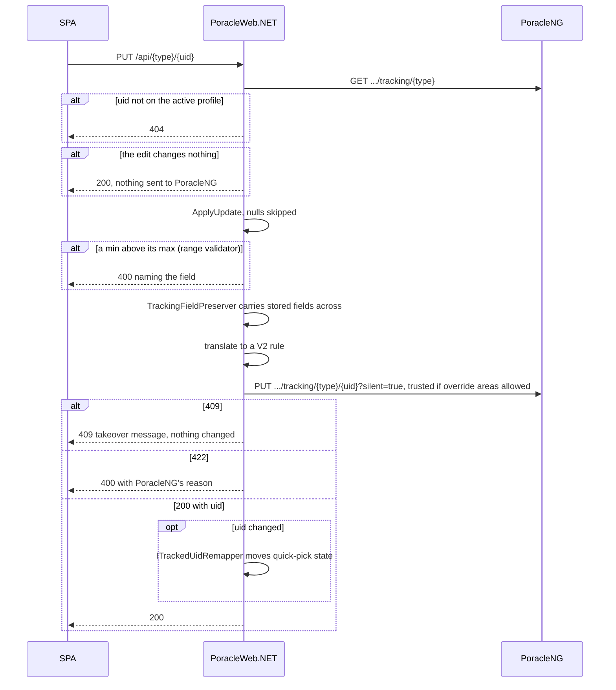
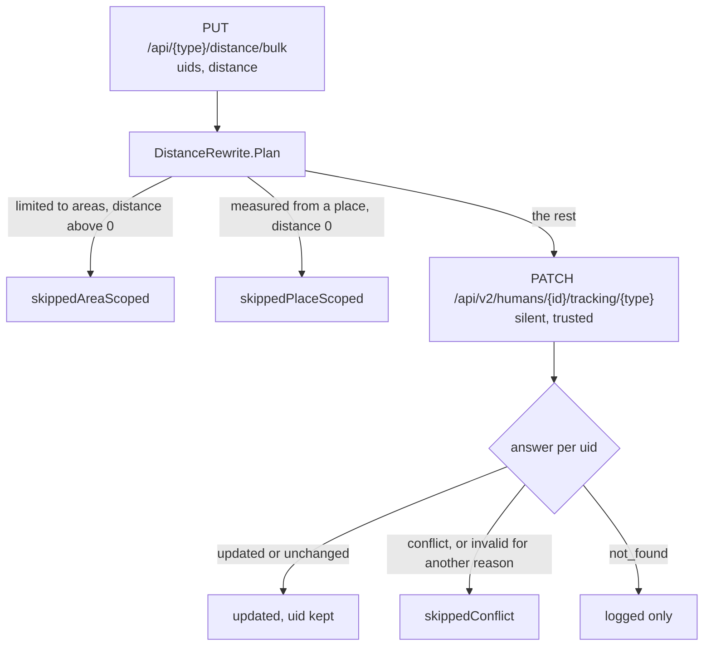

# Backend Patterns

## Alarm services (PoracleNG API proxy)

Ten alarm tracking services (`MonsterService`, `RaidService`, `EggService`, `QuestService`, `InvasionService`, `LureService`, `NestService`, `GymService`, `FortChangeService`, `MaxBattleService`) use `IPoracleTrackingProxy` to proxy CRUD operations through the PoracleNG REST API. They do **not** use repositories or direct database access.

`PokestopEventService` is the eleventh, and the exception: Pokéstop Events have no v1 route, so it uses `IPoracleIncidentProxy` against `/api/v2/humans/{id}/tracking/incident` instead. It never touches `IPoracleTrackingProxy`.

See [PoracleNG API Proxy](poracleng-proxy.md) for the full architecture, request flow, and how to add new alarm types.

### JSON serialization

Alarm data is serialized/deserialized with `JsonNamingPolicy.SnakeCaseLower` to match PoracleNG's snake_case field names:

```csharp
private static readonly JsonSerializerOptions SnakeCaseOptions = new()
{
    PropertyNamingPolicy = JsonNamingPolicy.SnakeCaseLower,
    PropertyNameCaseInsensitive = true,
};
```

### Update pattern

Creates and edits both go to PoracleNG's `/api/v2` and nowhere else. There is no v1 fallback: a route that answers gin's plaintext `404 page not found` raises `PoracleUnsupportedException`, and a row the translator can't express is refused with "PoracleNG can't store this alarm as it is: ... Nothing was changed." rather than sent through the older surface. Bulk distance and the cleaning toggle are the exception to the full replace: each is one `PATCH /api/v2/humans/{id}/tracking/{type}` naming the uids and the one setting, so nothing else a rule holds is re-sent.

An edit is `PUT /api/v2/humans/{id}/tracking/{type}/{uid}`, a **full replace**: a field left out of the body is reset to its default. The body is built by serializing the typed model, so every column PoracleWeb.NET has no property for would arrive absent. `TrackingFieldPreserver.PreserveStoredFieldsAsync` runs first on every update: it re-reads the stored row and copies across any property the submitted body lacks. Before it existed, editing an alarm on the web reset `override_location_label`, `override_areas` and `pvp_ranking_evolution` set from the bot (#730). A read failure returns the body untouched rather than failing the edit.

PoracleNG answers 409 for an edit that would duplicate another rule or change exactly one updatable field of it, and the proxy turns that into the takeover message. Services keep no copy of PoracleNG's diff any more. The PUT keeps the rule's uid on 5.4.0 (jfberry/PoracleNG #303) unless the server's reassignment fails, so the response is always read, and `ITrackedUidRemapper` moves quick-pick applied state to the new uid whenever it does change. See [The v2 write path](poracleng-proxy.md#the-v2-write-path).



The `...` is `/api/v2/humans/{id}`. `TrackingFieldPreserver` reads the same list again rather than trusting the first read. `trusted=true` is added only when the rule names override areas that `IUserAreaPolicy` allowed.

## Repository layer (non-alarm entities)

There is no repository for humans, profiles or alarms. Every human and profile read and write, the admin user list, the webhook list, the batch read that resolves geofence owners' names and account deletion go through `IPoracleHumanProxy` and PoracleNG's `/api/v2` routes. The `poracle_web` tables have one repository each: `OidcSessionRepository`, `QuickPickAppliedStateRepository`, `QuickPickDefinitionRepository`, `SiteSettingRepository`, `UserGeofenceRepository` and `WebhookDelegateRepository`.

!!! note "`BaseRepository` removed"
    The generic `BaseRepository<TEntity, TModel>` and all alarm repository classes have been removed. `EnsureNotNullDefaults()` went with them; the remaining repositories normalise nulls where they need to.

## Mapping extensions

Mapping is done with static extension methods in `Core.Mappings/`. There is no AutoMapper dependency.

`AlarmMappingExtensions` covers the alarm DTOs: `To*()` builds a model from a `*Create` DTO (`create.ToMonster()`), and `ApplyUpdate()` merges a `*Update` DTO onto an existing model (`update.ApplyUpdate(existing)`).

`EntityMappingExtensions` covers the `poracle_web` entities (user geofences, site settings, webhook delegates, quick-pick definitions and applied state) with `ToModel()`, `ToEntity()`, and `ApplyTo()`.

All `*Update` models use **nullable** properties so partial updates don't zero out unset fields. `ApplyUpdate` skips nulls explicitly:

```csharp
public static void ApplyUpdate(this MonsterUpdate src, Monster dest)
{
    if (src.Ping != null) dest.Ping = src.Ping;
    if (src.Distance != null) dest.Distance = src.Distance.Value;
    // ... one guarded assignment per field
}
```

## Monster filter defaults

PoracleNG fills a field only when it's **absent** from the write. A non-nullable `int` on a `*Create` model is never absent: it serialises as whatever it defaults to, and that value is stored. So every default on a `*Create` model is authoritative, and getting one wrong writes it into every rule. Believing PoracleNG would supply them is how 15,383 production rules ended up with `pvp_ranking_best = 0` (#895).

A bound's "no filter" value is the column's default, which isn't always zero:

| Property | Default | Notes |
|---|---|---|
| `max_iv` | 100 | |
| `max_cp` | 9000 | |
| `max_level` | 55 | |
| `max_weight` | 9000000 | |
| `max_atk`, `max_def`, `max_sta` | 15 | |
| `pvp_ranking_best` | 1 | Ranks are 1-based. `[Range]` still admits 0 so stored legacy rules stay editable |
| `pvp_ranking_worst` | 4096 | |
| `costume` | 9000 | Any costume. 0 means no costume |
| `size` | -1 | Any size |
| `max_size` | 5 | |
| `team` (Raid, Egg, Gym) | 4 | Any team |
| `move`, `evolution` (Raid) | 9000 | Any |

When adding a field, ask what the column stores for "no filter", and check its pair: the bug in #895 was one half of a `best`/`worst` pair left without an initializer. Every write goes through `TrackingV2Translator`, which turns the v1-shaped row into a `V2*Rule` body. A rule read back with a legacy zero (`pvp_ranking_best 0`, `size 0`) shows the default, and the next write saves it.

## Raid level service

`IRaidLevelService` / `RaidLevelService` is a singleton that serves the canonical Pokémon GO raid-type vocabulary to the frontend, mirroring the [WatWowMap masterfile](https://github.com/WatWowMap/Masterfile-Generator) without the locale-blind English strings leaking into the UI. The implementation returns a baked-in snapshot of 19 levels (1-Star through Coordinated 2) via `GET /api/masterdata/raid-levels`, with each entry exposing `{ value, category, name, namePlural }`. A `TODO` in `GetAllAsync` documents the upgrade path to a live masterfile fetch with on-disk caching under `DATA_DIR`; the wire contract will not change. The frontend `RaidLevelService` caches the response in a signal and falls back to a baked-in `KNOWN_LEVELS` constant on fetch error so the level picker always works, even offline.

PoracleNG accepts any positive integer as a raid/egg level, so the picker's `+ Add` affordance lets users alarm on levels that haven't been added to the canonical list yet. The `[Range(0, int.MaxValue)]` attribute on the alarm `Create`/`Update` DTOs ensures custom integers and the `9000` "any" sentinel pass server-side validation.

## Test alert service

`TestAlertService` lets users trigger a sample notification for an alarm of one of the eight types `TestAlertController.ValidTypes` names: `pokemon`, `raid`, `egg`, `quest`, `invasion`, `lure`, `nest`, `gym`. Fort Changes, Max Battles and Pokéstop Events have no test alert, and the controller answers 400 for any other type. It uses `Task.WhenAll` to fetch the alarm (via `IPoracleTrackingProxy`) and the human record (via `IPoracleHumanProxy`) in parallel. It then constructs a realistic mock webhook payload based on the alarm's filter fields (e.g., `pokemon_id`, `raid_level`, `quest_reward`) using the user's location as the event coordinates. The payload is sent to PoracleNG's `POST /api/test` endpoint, which formats and delivers the notification. Once PoracleNG accepts it (2xx), the service sends one plain-text note (`TestAlertService.TestNote`, English only, because the backend has no message localisation) to the same target, same id and type including webhooks and Telegram, through `IPoracleApiProxy.DeliverTextAsync`, which posts one job to PoracleNG's `POST /api/deliverMessages`. The note says the alert is a sample and not a live one, so a member who pressed the button by accident doesn't go looking for a spawn (#1097). A refused or unreachable `/api/test` sends no note, and a failed note never fails the test: the service logs a warning with the alarm type, the uid and the target type, never the target id (it can be a webhook URL), and still returns success. Rate-limited at 5 requests per 60s per user (falling back to the IP) via the `test-alert` policy.

## Fort change and Max Battle services

`FortChangeService` and `MaxBattleService` follow the same `IPoracleTrackingProxy` pattern as all other alarm services. They proxy CRUD operations through PoracleNG's tracking endpoints. Each has the standard three distance endpoints (`PUT /{uid}`, `PUT /distance`, `PUT /distance/bulk`).

## Invasion service

### Grunt type checks

`InvasionService` runs `RequireGruntType` before every create and edit. It rewrites the legacy `metal` to `steel` (`InvasionGruntTypes.Normalise`), because PoracleNG's game data has no `metal` and v2 refuses it. It then refuses a blank value, control characters, or anything longer than the 255-character column. It deliberately doesn't check against a list: production holds grunt types this code doesn't model (`blanche`, `candela`, `spark`, `npc 0` to `npc 10`, `player team leader`), and those must stay editable. Case is left as sent, and PoracleNG normalises a spaced name such as `player team leader` to `player_team_leader` on write.

A Pokéstop event grunt (Kecleon, Gold Stop, Showcase) picked on the invasion page is saved as a Pokéstop event rule instead, through `IPoracleIncidentProxy`.

## Bulk operations

Each alarm controller has three distance endpoints:

| Endpoint | Purpose |
|---|---|
| `PUT /{uid}` | Update a single alarm (full object) |
| `PUT /distance` | Update ALL alarms' distance for the current user/profile |
| `PUT /distance/bulk` | Update distance for specific UIDs: `{ uids: number[], distance: number }` |

The two distance endpoints send one `PATCH /api/v2/humans/{id}/tracking/{type}?silent=true&trusted=true` with `{"uids": [...], "set": {"distance": n}}`, so nothing else a rule holds is re-sent and each rule keeps its uid. `DistanceRewrite.Plan` first sets aside the rules a radius can't apply to: one limited to areas can't take a radius above zero, and one measured from a saved place can't take zero. PoracleNG answers per uid, and `DistanceRewrite.Report` turns that into `{ updated, skippedAreaScoped, skippedPlaceScoped, skippedConflict }`. A rule PoracleNG refuses because it would clash with another is reported as a conflict, and the rest still go through. The cleaning toggle is the same `PATCH` with `{"set": {"clean": n}}`.



## Poracle API proxies

### IPoracleTrackingProxy (alarm tracking)

Proxies alarm reads, creates, edits and deletes to PoracleNG's `/api/v2/humans/{id}/tracking/*` routes. Authenticated via the `X-Poracle-Secret` header. No v1 tracking route is called. See [PoracleNG API Proxy](poracleng-proxy.md) for full details.

- Registered as `AddHttpClient<IPoracleTrackingProxy, PoracleTrackingProxy>()`; there is no decorator
- Used by: all alarm services, `DashboardService`, `CleaningService`, `ProfileOverviewService`, `TestAlertService`, `RuleRepairJob`, `UserAreaWriter`

### IPoracleHumanProxy (human/profile management)

Proxies human and profile operations to PoracleNG's `/api/v2/humans/...` routes: user reads and creation, location, areas, profile switching and profile CRUD, plus the admin user list and delete and the admin-roles read.

- Registered via `AddHttpClient<IPoracleHumanProxy, PoracleHumanProxy>()`
- Used by: `HumanService`, `ProfileService`, `ProfileOverviewService`, `UserGeofenceService`, `UserAreaPolicy`, `UserAreaWriter`, `UserRoleResolver`, `TestAlertService`, `RuleRepairJob`, and the `Admin`, `Area`, `Auth`, `Location`, `Profile` and `ProfileOverview` controllers
- URL-encodes user IDs with `Uri.EscapeDataString()` -- critical for webhook IDs that contain slashes

### IPoracleApiProxy (config, areas, templates)

Wraps HttpClient calls for non-tracking Poracle API operations.

- Used for: config and config values, templates, masterdata (grunts, localized monsters), geofence maps and hashes, asking PoracleNG to reload geofences, test alerts (`POST /api/test`, then the one-line note after it through `POST /api/deliverMessages`) and geocoding (`/api/geocode/forward` and `/reverse`)
- Registered via `AddHttpClient<IPoracleApiProxy, PoracleApiProxy>()`

### IPoracleMuteProxy (quiet periods)

Proxies the mute store at `/api/v2/humans/{id}/mutes`. **v2 only**, with no v1 equivalent and no capability
check: every supported PoracleNG has the routes. `MuteController` answers `{ mutes }`, and all three actions
answer 503 through `PoracleUnreachableExceptionFilter` when PoracleNG cannot be reached.

### IPoracleIncidentProxy (Pokéstop Events)

Proxies Pokéstop-event alarm CRUD at `/api/v2/humans/{id}/tracking/incident`. Both proxies now speak
v2, but `IPoracleTrackingProxy` hands its callers the v1 row shape every service is built on, and
Pokéstop events never had one, so the incident proxy keeps its own model rather than adding a second
shape to every tracking method. The tracking proxy folds event rules into the invasion list for the
reads that show them there.

### IPoracleSummaryProxy (quest summary delivery)

Reads and writes the quest summary schedule for `SummaryScheduleController`. See [Quest Summary Delivery](../features/quest-summary-schedules.md).

That makes six Poracle proxies in total: tracking, incident, human, mute, summary and api.

### Config parsing

`PoracleConfig` is parsed from Poracle's JSON configuration. The `defaultTemplateName` field can be a number or string — deserialization handles both via `JsonElement`.

## Server capability probe

`IPoracleServerProfileService` / `PoracleServerProfileService` asks the PoracleNG instance what it is.
One read: `GET {Poracle:ApiAddress}/health`, which carries the release number and PoracleNG's own
capability map. It is unauthenticated, so the probe carries no secret and still works when the API key
is wrong, which is itself worth knowing: "reachable but every write 401s" and "not running" look
identical otherwise. The map is read key-by-key rather than into a fixed type, because it is upstream's
and it grows. It covers bot and template-editor features and says nothing about alarms.

There used to be a second read, `schema_migrations` and `information_schema` straight out of PoracleNG's
database, for the costume columns and the lure and invasion unique keys. Every supported release answers
those the same way, so it went when 5.2.1 became the minimum, and `Poracle:TrackingApiVersion` went with
5.4.0.

`PoracleServerProfile.MinimumSupported` is **5.4.0**. `IsBelowMinimum` is true only when the server is
*known* to be older: unreachable, unparseable, or the `0.0.0` a locally built binary reports are all
unknown rather than too old, so the banner is not shown on a guess. `IsSupported` is the rule every
version-decided feature shares: reachable and not known to be older, so a local build counts as current
and an unreachable server does not. `Supports(capability)` defaults a missing key to false, per
PoracleNG's map contract.

Against a server below the minimum PoracleWeb.NET keeps running. `PoracleCompatibilityStartupService`
logs an error at startup naming what breaks, and the Versions card on the admin settings page shows the
same thing. Refusing to start would take the whole site down over something an operator can fix.

The profile is cached in `IMemoryCache` for five minutes and the HttpClient's timeout is five seconds, so
an unreachable server answers "unknown" quickly instead of stalling the admin page.
`GET /api/admin/server-profile` serves it (admin only); `?refresh=true` invalidates the cache and the
GitHub update check first.

### Per-feature capability services

Two services answer a question from Poracle's own configuration: `SummaryCapabilityService` reads
`tracking.quest_summary_enabled` and `PokemonEditCapabilityService` reads `tracking.pokemon_edit`, both
from `GET /api/config/values`, caching for five minutes. They exist because both are deployment settings
an operator can switch off on a server that supports the feature, not because of the server's version.

The services that used to answer "is this server new enough" (`QuestPokecoinCapabilityService`,
`PlaceUpdateCapabilityService`, `CostumeCapabilityService`, `MuteCapabilityService`) are gone with the
fallbacks they guarded: every supported release has the feature, so its control is always shown and the
endpoints that only reported them (`GET /api/settings/costume-capability`, `GET /api/quests/capability`)
no longer exist.

There is deliberately no central registry. A user-facing control cannot ask the admin-only
`GET /api/admin/server-profile`, so an ordinary authenticated endpoint answers instead, like
`GET /api/summary-schedules/capability`.

See [Version compatibility](poracleng-compatibility.md) for how to choose a signal and what each
feature needs.

## Areas

Every area write goes to PoracleNG's `/api/v2` area routes, and PoracleNG keeps `humans.area` and
`profiles.area` in step. PoracleWeb.NET writes neither table.

User-drawn geofences are why there is more than a plain `SetAreasAsync`. PoracleWeb.NET serves them with
`userSelectable=false` to keep them off the bot's area picker, and PoracleNG's `setAreas` drops any name
whose fence is not user-selectable. `IUserAreaWriter` gets round that with the v2 `trusted` flag (PoracleNG
5.4.0) and does its own authorising first, because `trusted` skips PoracleNG's check. A name is allowed when
it is in the union of:

- the names PoracleNG lists as `userSelectable` for this user;
- the user's own drawn geofences;
- the names already on the profile being written.

| Operation | What it does |
|---|---|
| `SaveSelectionAsync` (Areas page) | One trusted `POST /api/v2/humans/{id}/areas`. A name outside the union answers 400 `{ error, areas }` before anything is sent. Names PoracleNG has no fence for are dropped by PoracleNG and reported back, not treated as an error. |
| `FilterAllowedAsync` (new profile) | The same union, but a disallowed name is dropped with a warning instead of refused. Used by profile create only. Both duplicates copy the caller's own source profile's list trusted and unfiltered (the source may be a non-active profile); import writes no areas. |
| `AddToActiveProfileAsync` / `RemoveFromActiveProfileAsync` | The geofence toggle, and create. Read the active profile's list, change it, post it trusted. |
| `PreviewRemovalAsync` / `RemoveEverywhereAsync` | Delete. A dry run reports the alarms that would widen; the real call removes the name from every profile. |
| `RenameEverywhereAsync` | Rename and approval. PoracleNG's geofences are reloaded first, because the new name has to be loaded. |

The geofence service orders these so a failure leaves something retryable. Create reloads PoracleNG's
fences before it adds the name, and if the add fails the fence is kept and flagged `activationFailed`.
Delete removes the name from the profiles first and deletes the row last, so a failed removal keeps the
fence. A user rename that PoracleNG refuses puts the old name back.

Geofence polygons come from the Poracle API (via the unified feed), not the database.

### Per-alarm areas

An alarm can confine itself to named areas of its own, stored in the row's `override_areas`. That is the
`userSelectable` problem one layer down: PoracleNG's tracking write checks every entry against its
allowed areas and answers **400 "area not permitted"** for a user-drawn fence, failing the whole request.

`PoracleTrackingProxy` handles it in three steps, with no write to PoracleNG's database:

1. `OverrideScope` refuses an incoherent scope before anything is sent. A row cannot carry both a place
   and a set of areas; areas cannot coexist with a radius; a place needs one.
2. `IUserAreaPolicy` authorises each name: selectable for the user, one of the user's own drawn
   geofences, on the active profile, or already on the rule being edited. A name that passes none of
   those is refused.
3. The write is sent with `?trusted=true`, so PoracleNG stores the list as given.

The Pokéstop event proxy (`PoracleIncidentProxy`) does the same for its own routes. A write that names no override area sends no `trusted` flag.

## Location

`LocationController` uses `IPoracleHumanProxy.SetLocationAsync()` to set the user's location. PoracleNG handles the write and state reload atomically, so there's no transaction to manage here.

### Saved places

The same controller owns the places an alarm can be anchored to instead of the profile pin. PoracleNG
stores them in `user_locations`, keyed by (human, label), and they are reached only through
`IPoracleHumanProxy`.

| Endpoint | Behaviour |
|---|---|
| `GET /api/location/places` | Returns `SavedPlaces { Default, Named }`. `Default` is the profile pin every alarm falls back to, null when the user has never set one. |
| `POST /api/location/places` | Saves a place, then returns the updated set. PoracleNG reports a rejected label inside a 200 because its endpoint answers per row, so the refusal is unwrapped and returned as a 400 the SPA can show against the field. |
| `DELETE /api/location/places/{label}` | 204 on success. **409** with `referencingRules` when alarms still point at the label — PoracleNG refuses rather than orphaning it, and naming the alarms is the difference between "could not delete" and knowing what to repoint. Carried as `PlaceInUseException`. |

A label is what an alarm's `override_location_label` refers to. The whole controller carries `[RequireFeatureEnabled(DisableFeatureKeys.Location)]`, so `disable_location` takes the pin, the places API, the static and distance maps and weather with it.

## Service lifetimes

| Service | Lifetime | Reason |
|---|---|---|
| Most services | **Scoped** | Per-request |
| `MasterDataService` | **Singleton** | Cached game data. Serves move and item names from the WatWowMap masterfile, and the English monster map as the fallback for `GET /api/masterdata/monsters`, which normally proxies Poracle's translated one |
| `RaidLevelService` | **Singleton** | Stateless canonical-list provider; future live masterfile fetch will cache here |
| `UpstreamFeatureFlagService` | Scoped | Resolves Poracle's own per-type disable flags into `disable_*` keys, cached 5 min; fails open |

!!! info "DashboardService uses the proxy"
    `DashboardService` calls `IPoracleTrackingProxy.GetAllTrackingAsync()` to fetch all alarm types in a single API call, then counts each type from the response.

## Profiles

- `humans.current_profile_no` (not `profile_no`) tracks the active profile
- All alarm tables reference `profile_no` to filter by active profile

### Active hours

The `Profile` model includes an `ActiveHours` (`string?`) property representing a JSON array of time-window rules stored in the `active_hours` column of the `profiles` table. `ProfileService.DeserializeProfiles()` extracts `active_hours` from the PoracleNG proxy's `JsonElement` response and maps it onto the model.

`ProfileController` includes `active_hours` in the proxy payload for Create, Update, and Duplicate
endpoints. Validation lives in `Core.Models/ActiveHoursValidator`, shared with `SummaryScheduleController`
so the two cannot drift:

- Each entry must specify `day` (1--7), `hours` (0--23), `mins` (0--59)
- Maximum 28 entries per profile (four per day across seven days)
- Returns a `400 Bad Request` with details on validation failure

It accepts `hours` and `mins` as either numbers or strings, because PoracleNG stores them inconsistently.

#### Repeating entries

An entry can also fire repeatedly across a window, which adds three snake_case fields to the stored
JSON:

```json
{"day": 1, "hours": 9, "mins": 0, "end_hours": 17, "end_mins": 0, "step": 2}
```

That fires at 09:00 and every two hours up to and including 17:00. A single fire omits all three
fields entirely.

`step` must be a whole number of hours no greater than 23, and when it is positive the end time must be
strictly later than the start — a window spanning midnight is not supported. A `step` of zero or less is
a single fire, and any end fields beside it are ignored rather than refused, matching what
`ActiveHourEntry.Fires()` does upstream. The end fields carry `omitempty` in PoracleNG, so a window
ending on the hour arrives with `end_mins` missing: a missing end field reads as 0 and is never an
error.

## Scanner service

The scanner DB (`ScannerDb` connection string) is optional. When not configured, `IScannerService` is not registered and scanner endpoints return appropriate fallback responses.

### Gym search endpoints

`ScannerController` exposes two gym endpoints backed by `ScannerService`:

| Endpoint | Purpose |
|---|---|
| `GET /api/scanner/gyms?search=term&limit=20` | Search gyms by name prefix (`term%`, index-sargable). User input is escaped for LIKE wildcards (`%`, `_`, `\`). Search length 2--100 chars; `limit` clamped to `[1, 50]`. |
| `GET /api/scanner/gyms/{id}` | Return a single gym by its ID (max 128 chars). |

Both endpoints are rate-limited under the `scanner-search` policy (60 requests/min per user, falling back to the IP).

Both endpoints resolve the gym's area name by running point-in-polygon checks against cached Koji admin geofences (via `IKojiService.GetAdminGeofencesAsync()`). The first matching fence name is set on the result's `Area` property.

Graceful fallback: if the scanner DB is unreachable or the query fails, the search endpoint returns an empty array and the single-gym endpoint returns 404. If `IKojiService` is unavailable, area resolution is skipped (gym is returned without an area name).

### GymSearchResult model

`GymSearchResult` in `Core.Models` carries the gym data returned by both endpoints:

| Property | Type | Notes |
|---|---|---|
| `Id` | `string` | Scanner gym ID |
| `Name` | `string?` | Gym name from scanner DB |
| `Url` | `string?` | Photo thumbnail URL from scanner DB |
| `Lat` | `double` | Latitude |
| `Lon` | `double` | Longitude |
| `TeamId` | `int?` | Controlling team (0 = neutral) |
| `Area` | `string?` | Resolved at request time via point-in-polygon, not stored |

### ScannerGymEntity.Url

The `ScannerGymEntity` in the scanner context maps the `url` column from the `gym` table, providing gym photo thumbnail URLs to `GymSearchResult`.

### PointInPolygon

`IScannerService` declares a static `PointInPolygon(double lat, double lon, double[][] polygon)` method using the ray-casting algorithm. The method tests if a point lies inside a polygon (where each entry is `[lat, lon]`) and returns `false` for degenerate polygons with fewer than 3 vertices. Used by `ScannerController` to determine which Koji geofence area a gym belongs to.

## GeoMath

`Core.Services/GeoMath.cs` holds the polygon maths used outside the scanner path: `AreaSqKm` (spherical excess / Girard's theorem, R = 6371 km), `Centroid` (vertex mean), `Contains` (ray casting), and `DescribeArea` (plain-language size band). It backs the geofence review card's size, location and overlap fields.

!!! warning "Keep in sync with the frontend"
    `GeoMath` is a hand-port of the frontend's `shared/utils/geo.utils.ts`. If the two drift, the area a user sees while drawing a geofence stops matching the one an admin sees in the review thread. The tests derive their expected values from the sphere's radius (`2πR/360`) rather than from the implementation, so a port mistake fails rather than being enshrined.

## Discord notifications

`IDiscordNotificationService` opens and maintains the geofence review thread. Two mechanics are easy to get wrong:

- **The map must be uploaded, not linked.** Poracle's `GET /api/geofence/{area}/map` returns a *pregenerated tileserver-cache* URL that the cache evicts, so an embed linking it goes blank within hours. The bytes are downloaded (via a separate unauthenticated named `HttpClient`, so the bot token never reaches the tileserver) and posted as a message attachment.
- **Editing the card re-uploads the map.** Discord folds an `attachment://` attachment into the embed, so the message reports an empty `attachments` array — there is no ID to carry forward, and the embed's resolved `cdn.discordapp.com` URL is a signed link that expires. A forum post's starter message shares the thread's ID, so the opening embed is edited with `PATCH /channels/{threadId}/messages/{threadId}`.

One `BuildEmbed` produces the pending, approved and rejected cards so they cannot drift apart, and each piece degrades on its own: a failed download links the URL, a failed card rewrite still posts the verdict reply, and a Koji outage just omits the overlap line.

## Golbat API proxy

### IGolbatApiProxy (Pokemon availability)

Proxies requests to Golbat's `GET /api/pokemon/available` endpoint, which returns currently spawning species with per-species/form counts. Authentication uses the `X-Golbat-Secret` header (per-request, not on DefaultRequestHeaders).

- Registered conditionally via `AddHttpClient<IGolbatApiProxy, GolbatApiProxy>()` — only when `Golbat:ApiAddress` is configured
- Response parsing handles both flat arrays `[1,2,3]` and object arrays `[{"id":1,"form":0,"count":100}]`, deduplicating by Pokemon ID
- On error: returns empty list (never throws), logs warning

### IPokemonAvailabilityService (caching layer)

Caches Golbat availability data in `IMemoryCache` with a 5-minute absolute expiration. Maintains a `_lastKnownGood` fallback — if Golbat goes down after a successful fetch, the stale data is served rather than returning empty.

- Registered as **singleton** (only when Golbat is configured)
- Cache key: `golbat_available_pokemon`
- `PokemonAvailabilityController` uses nullable DI injection (`IPokemonAvailabilityService? = null`) — when Golbat is not configured, the endpoint returns `{ available: [], enabled: false }`

## Weather data

Weather data is served via `IScannerService` from the scanner DB (`ScannerWeatherEntity`). `ScannerService` fetches weather cells using S2 cell geometry (`S2CellHelper`) and returns `WeatherData` models with cell polygons and gameplay weather conditions. The `LocationController` exposes weather data alongside the user's location. Weather is optional -- when the scanner DB is not configured, weather endpoints return empty results.

## Rate limiting

Sensitive endpoints use **partitioned** rate limiting, never one global bucket:

| Policy | Limit | Window | Applied to |
|---|---|---|---|
| `auth` | 30 requests | 60 seconds | Login / callback / token exchange |
| `auth-read` | 120 requests | 60 seconds | Current user, profile switch |
| `test-alert` | 5 requests | 60 seconds | Test-alert sends |
| `mutes` | 60 requests | 60 seconds | Quiet-period reads and writes |
| `geojson-import` | 5 requests | 60 seconds | A user's own GeoJSON import |
| `scanner-search` | 60 requests | 60 seconds | Scanner gym search / lookup |
| `geofence-feed-refresh` | 20 requests | 60 seconds | The anonymous feed-refresh POST |

Configured in `Program.cs` using `RateLimitPartition.GetFixedWindowLimiter`. `auth` and
`geofence-feed-refresh` key on `RemoteIpAddress` because neither caller is signed in; the other five key
on the authenticated user, falling back to the IP. The `mutes` limit is set for reads — the quiet chip is
read on every alarm page, and the store is written a few times a day at most. `geofence-feed-refresh`
bounds guessing at the shared secret rather than load: the work per call is one cache eviction.

!!! danger "Never use global rate limiting for auth"
    Global (non-partitioned) `AddFixedWindowLimiter` for auth causes cascading login failures — multiple users share one bucket.
