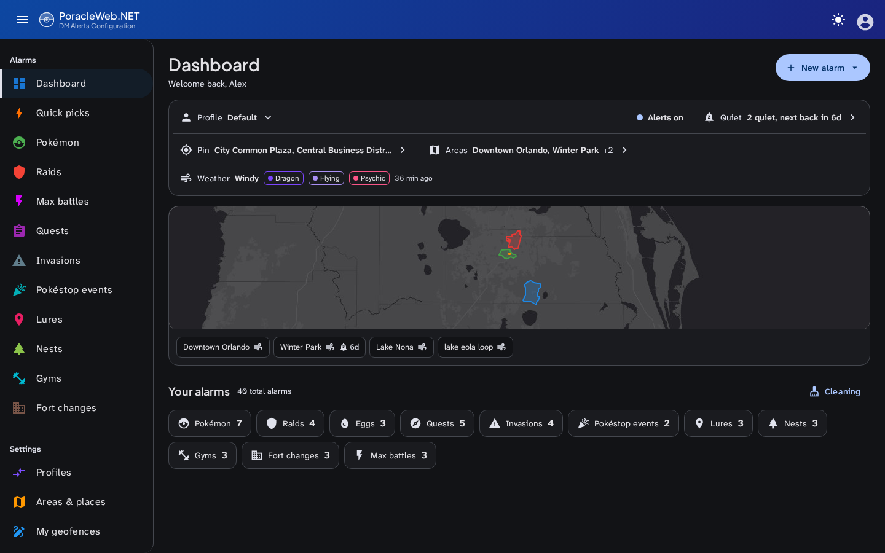
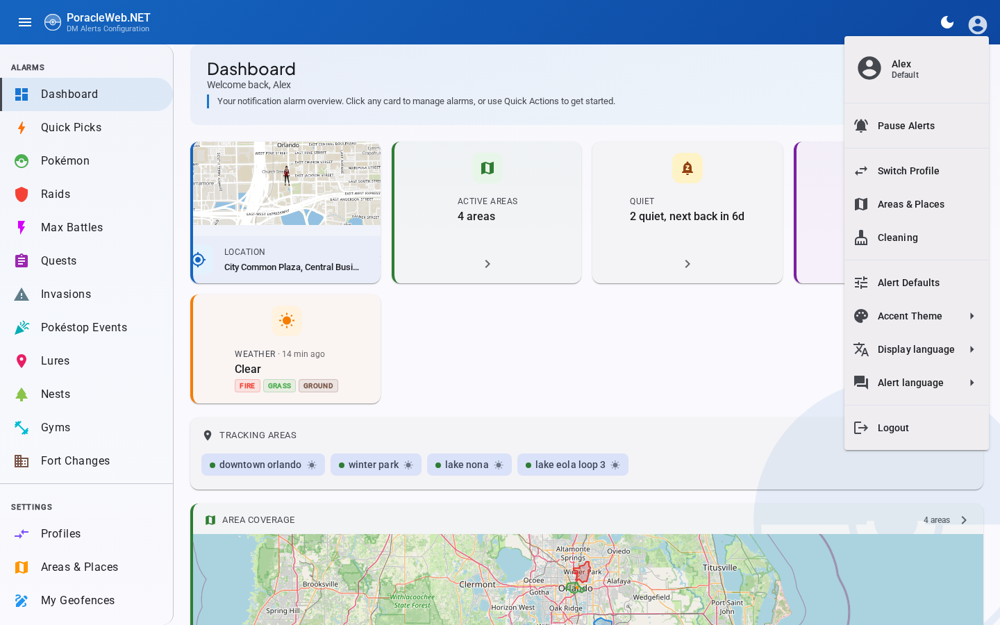
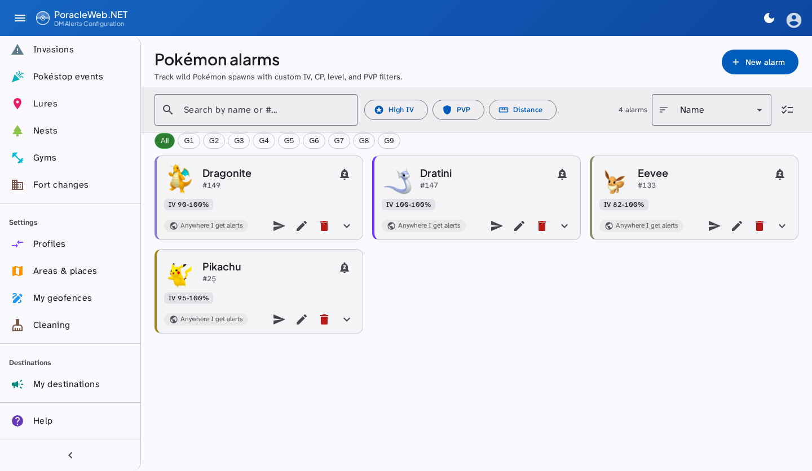

# Frontend Patterns

## Angular conventions

- All components are **standalone** (no NgModules)
- Uses `inject()` function instead of constructor injection
- Uses Angular signals for reactive state where applicable
- Lazy-loaded routes in `app.routes.ts`
- Services in `core/services/` use `HttpClient` to call the .NET API

## Project structure

```
src/app/
├── core/
│   ├── guards/          Auth guard, admin guard
│   ├── services/        HTTP services for each API resource
│   ├── interceptors/    JWT token interceptor
│   └── models/          TypeScript interfaces
├── modules/
│   ├── auth/            Login page
│   ├── dashboard/       Dashboard with onboarding
│   ├── pokemon/         Pokemon alarm management
│   ├── raids/           Raid alarm management
│   ├── quests/          Quest alarm management
│   ├── invasions/       Invasion alarm management
│   ├── lures/           Lure alarm management
│   ├── nests/           Nest alarm management
│   ├── gyms/            Gym alarm management
│   ├── fort-changes/    Fort change alarm management
│   ├── max-battles/     Max Battle (Dynamax) alarm management
│   ├── pokestop-events/ Pokéstop Event alarm management
│   ├── areas/           Areas, the home pin, and saved places on one page
│   ├── geofences/       Custom geofence drawing
│   ├── profiles-overview/  Profile cards, the routed /profiles page
│   ├── profiles/        Profile add / edit / duplicate dialogs
│   ├── cleaning/        Alarm cleanup tools
│   ├── quick-picks/     Quick pick alarm templates
│   ├── help/            In-app help page
│   └── admin/           Admin panel (users, webhooks, settings, geofence submissions)
└── shared/
    ├── components/      Reusable UI components
    └── utils/           Utility functions (geo.utils, alarm-scope, etc.)
```

`/places` is a redirect to `/areas` — places were folded into the Areas & Places page, beside the pin they belong with. `/admin` redirects to `/admin/users`.

## Services

### ScannerService

`ScannerService` (`core/services/scanner.service.ts`) provides access to the optional scanner database for gym lookups. Both methods use `catchError` for graceful degradation when the scanner DB is unavailable (returns `of(null)` or `of([])`).

- `searchGyms(search, limit)` — Searches gyms by name. Returns an empty array if the search term is less than 2 characters.
- `getGymById(id)` — Fetches a single gym by ID. Returns `null` on error.

The `GymSearchResult` interface defines the shape: `id`, `name`, `url`, `lat`, `lon`, `teamId`, and `area`.

### TestAlertService

`TestAlertService` (`core/services/test-alert.service.ts`) manages test alert requests from alarm list cards. It tracks per-UID cooldowns (15-second TTL via a `Map`) and deduplicates in-flight requests to prevent duplicate API calls. After sending, it displays success/error/cooldown feedback via Material snackbar. The test button appears in `mat-card-actions` on eight of the eleven alarm types — Pokemon, Raids, Eggs, Quests, Invasions, Lures, Nests and Gyms. Fort Changes, Max Battles and Pokéstop Events have no test alert: `TestAlertController.ValidTypes` does not carry them, and a request naming one answers 400.

### MuteService

`MuteService` (`core/services/mute.service.ts`) holds the user's quiet periods as a live signal, read
from and written to `/api/mutes`. The list response carries `capable` alongside the rules, so one call
answers both whether this PoracleNG has the mute store (every supported release does; an unreachable or
too-old server does not) and what is currently muted. When it does not, the quiet surface is not
rendered at all.

Two things about the upstream store shape the service. Mutes are keyed by `(scope, value)` with no id,
so that pair is the key here too. And the store lives in the processor's memory, so a restart wipes it
with no notification: nothing here trusts a fetched list for longer than a page view, and the countdown
ticks rather than resolving to a clock time. PoracleNG holds seven scopes; the SPA writes four —
`gym`, `pokemon`, `area`, `station`.

### PokestopEventService

`PokestopEventService` (`core/services/pokestop-event.service.ts`) backs the Pokéstop Events module.
The type is v2-only, and the page exists only where Poracle's config carries `general.disable_showcase = false`; elsewhere it is not reachable.

### ProfileService — active hours

`ProfileService` (`core/services/profile.service.ts`) parses the `activeHours` field from the API response in `getAll()`, mapping the snake_case `active_hours` JSON string to a typed `ActiveHoursEntry[]` on each profile model.

- `updateActiveHours(profileNo, entries)` — sends the active hours array to the API for the given profile

The `active-hours.models.ts` file (`core/models/`) defines the `ActiveHoursEntry` interface and utility functions for working with time-window rules (serialization, display formatting, validation).

### PlacesService

`PlacesService` (`core/services/places.service.ts`) holds the places an alarm can be aimed at: the named ones, plus the profile pin under `pin` (null when it is the 0,0 Poracle stores for "not set"). It is a signal rather than a per-caller fetch because the Where sheet, the Places section and every card carrying a where chip read the same list, and a place added in one has to appear in the others without a reload.

- `load()` / `add(place)` / `move(label, lat, lon)` — each sets the signal from the response
- `remove(label)` — answers **409** with `referencingRules` when alarms still point at the place; the caller should name them rather than reporting a bare failure

There is no `canEdit` flag: the move control is always rendered, because every supported PoracleNG has the route, and a failed move shows an error. See [Version compatibility](poracleng-compatibility.md#what-still-depends-on-the-server).

### AlertLanguageService

`AlertLanguageService` (`core/services/alert-language.service.ts`) owns the language Poracle writes alerts in — DM text and Pokemon names in your notifications — which is a different setting from the display language. It writes optimistically to `localStorage('poracle-language')` and rolls back if the API call fails, and reconciles against the authoritative `human.Language`, since the bot can change it out of band. Its selected value is a computed: a language the user has actually been given, falling back to Poracle's configured locale, then `en`.

### MasterDataService

`MasterDataService` (`core/services/masterdata.service.ts`) holds the game data the pickers render: Pokemon names, types, form names, evolution chains, plus move and item names.

Names, types and forms are fetched from `GET /api/masterdata/monsters?locale={display language}` — Poracle owns those translations — while moves and items come from `/api/masterdata/{moves,items}` in English. All four load in one `forkJoin`; only the monster call is wrapped in `catchError`, so a Poracle that cannot serve it leaves the English names in place instead of cancelling the rest.

An `effect` on `I18nService.currentLang` re-fetches when the display language changes and re-emits on `ready$`, so a species picker that is already open updates in place rather than needing a reload.

Type names are the subtlety. Poracle returns them translated, but the uicons file names and the type filter chips both key on the English name, so the **English name is kept as the value** — resolved from the stable type id via `shared/utils/pokemon-types.ts` — and the translated string is stored alongside as a display label, read through `getTypeLabel()`. Only the chip's text is localized; everything that identifies a type is not.

### AlertDefaultsService

`AlertDefaultsService` (`core/services/alert-defaults.service.ts`) remembers what scope a **new** alarm should open with: mode, default radius in km (clamped 0.1–100), and a default saved place. Stored in `localStorage` under `poracle-default-alert-mode`, `poracle-default-alert-distance-km` and `poracle-default-alert-place`. Client-side only — existing alarms are untouched. Edited from `AlertDefaultsDialogComponent` in the user menu.

### PokemonAvailabilityService

`PokemonAvailabilityService` (`core/services/pokemon-availability.service.ts`) provides Pokemon spawn availability data from the Golbat scanner API. It is a `providedIn: 'root'` singleton.

- `enabled` signal — `true` when Golbat is configured on the backend
- `availableIds` signal — `Set<number>` of currently spawning Pokemon IDs for O(1) lookups
- `isAvailable(id)` — returns whether a Pokemon is currently spawning
- `load()` — idempotent initial fetch + 5-minute auto-refresh via `setInterval`
- Graceful degradation: preserves `enabled` state and stale data on refresh errors

The `PokemonSelectorComponent` injects this service and calls `load()` in `ngOnInit()`. When `enabled()` is true, it renders:

- A "Live > Spawning" filter toggle chip (with animated pulse dot)
- Green availability dots on autocomplete options and tile grid items
- Available-first sorting when any filter is active

## UI patterns

### Alarm lists
Card grid with filter pills showing IV/CP/Level/PVP/Gender at a glance. All alarm types (including Fort Changes and Max Battles) follow this same card grid pattern with type-specific filter pills.

### Bulk operations
Select mode toggle (checklist icon) on each alarm list. The bulk bar is one shared component, `shared/components/bulk-action-bar/`: the count of selected cards on screen (`actionIds`), Select all / Deselect all as text buttons, a tonal Change radius, and a filled warn "Delete N". Below 600px it is fixed to the bottom of the screen and `styles.scss` pads `main` while it shows. `bulk-action-bar.component.spec.ts` pins all ten lists to it.

### Loading states
Animated skeleton card placeholders on Pokemon, Raids, and Quests pages.

### Animations
Grid items fade in with 30ms stagger delay.

### Theming

The toolbar gradient, the sidenav's active link and the UI accent colours follow an accent theme picked from the user menu. The colours are applied as CSS custom properties on `document.body.style` so they reach across Angular's view encapsulation.

Dark and light mode bridge Material tokens to component styles through CSS variables, and the choice is stored in `localStorage('poracle-theme')`.








### Onboarding wizard
Shows on the dashboard for new users until explicitly dismissed. Detects existing location/areas/alarms and marks steps as complete. Route-based actions (Choose Areas, Add Alarm) hide the overlay temporarily without setting the localStorage completion flag.

### Active hours components

`ActiveHoursChipComponent` (`shared/components/active-hours-chip/`) renders a compact read-only summary of a profile's active hours schedule as a Material chip. Displayed inline on `ProfileOverviewComponent` cards.

`ActiveHoursEditorDialogComponent` (`shared/components/active-hours-editor-dialog/`) provides a full editing UI for active hours rules. Opened from the profile overview when the user clicks the active hours chip or the "Set active hours" action. Validates entries client-side (day 1--7, hours 0--23, mins 0--59, max 28 entries) before submitting. A rule can repeat across a window, which sends `step`, `end_hours` and `end_mins` alongside the start; see [Active hours](backend.md#active-hours).

`LocationWarningComponent` (`shared/components/location-warning/`) displays a contextual warning when the user's location is not set, since active hours depend on the user's timezone derived from their location.

`ProfileOverviewComponent` integrates active hours display and editing — each profile card shows the `ActiveHoursChipComponent` and opens the editor dialog for modifications.

!!! note "`ProfileListComponent` removed"
    The unused `ProfileListComponent` has been removed. Profile management is handled entirely by `ProfileOverviewComponent`.

### Where an alarm reaches you

`ScopePickerComponent` (`shared/components/scope-picker/`) is the one control for an alarm's delivery scope, wherever the question is asked. Three mutually exclusive options — inherit the profile's areas, a radius from a point or saved place, or only specific areas — modelled as a radio group because PoracleNG refuses every combination of them, so a state that would need validating cannot be expressed. It is rendered inline by every alarm add and edit dialog and by the quick-pick apply dialog. It previously existed as two copies, a two-option radio in the dialogs and a three-option sheet on the card, which drifted apart within a day and left no way to set a per-alarm area override before the alarm existed.

`WhereChipComponent` (`shared/components/where-chip/`) states the answer on the alarm card as a sentence fragment — "Anywhere I get alerts", "Anywhere in my areas", "Within 2 km of Home", "Only in Terrigal, Erina" — and is the way into the sheet. All ten list templates put it in the card's footer. An `editable` input turns it into a plain statement where there is nothing to open.

`WhereSheetComponent` (`shared/components/where-sheet/`) is a dialog shell around the scope picker and nothing else, for changing scope from a card where there is no form to put the control in.

### Rule card and list toolbar

`AlarmCardComponent` (`shared/components/alarm-card/`) is the one card all ten alarm lists draw. The list
projects the parts by attribute (`ruleMedia`, `ruleTitle`, `ruleSubtitle`, `ruleStatus`, `ruleFilters`,
`ruleScope`, `ruleActions`) and the card lays them out the same way everywhere: subject and status on top,
one line of filters, scope chip and actions on one row. The shared pieces of vocabulary (`.rule-pill`,
`.rule-tag`, `.rule-subtitle`, `.rule-sprite`, `.rule-icon`) are styled by the card. Its `edge` input takes
a team, tier or primary-type colour from `shared/utils/rule-colours.ts`, the only place those colours are
defined; each is a light/dark pair held at 3:1 against the card in both themes (`rule-colours.spec.ts`).
`alarm-card-parity.spec.ts` pins every list to the card and says which ones carry an edge.

The card also owns the rule summary: the `description` PoracleNG returns beside each rule, the same sentence
its bot answers a `!pokemon` command with, behind a Details toggle. It offers no toggle when there is no
description, or when the alert language and the display language disagree, since Poracle localises the
sentence with the alert language while the card follows the display language. Fort changes (a raw JSON
array upstream) and Pokéstop events (no description) do not pass one.

`AlarmListToolbarComponent` (`shared/components/alarm-list-toolbar/`) is the bar above every list: search,
count, sort menu and the select-mode toggle, plus a "no matches" line with the way back. Each list decides
what a search matches and what each sort means through `shared/utils/alarm-list-query.ts`, whose sort is
stable, so the default order (`orderAlarms`) survives ties and an edited card does not move.

### Quiet periods

Three components make up the quiet surface: `QuietChipComponent` on the card, `QuietSheetComponent` for
muting one subject, and `QuietListSheetComponent` for reviewing what is muted.

The chip appears only where the card names something a mute can be scoped to, which is six templates and
four scopes: pokemon and nests (`pokemon`), gyms and raids (`gym`), max battles (`station`), and the
areas list (`area`). Quests, invasions, lures and fort changes deliberately do not carry it — a quest is
defined by its reward, an invasion by its grunt type, a lure by its lure type, and a fort change by
nothing that maps to a mute scope. `quiet-surface-parity.spec.ts` pins both halves of that list, so
adding the chip to a tenth surface or dropping it from one of the six fails the build.

### Places section

`PlacesSectionComponent` (`shared/components/places-section/`) lists the user's named places inside the Areas & Places page's **Pin and places** panel, directly under the row holding the pin. The page is map first: `AreaMapComponent` draws the pin and every named place as markers (its `places` input), and clicking one opens the panel. The pin is not repeated in the list, since the row above it is the pin. Adding a place borrows `LocationDialogComponent` as a coordinate picker rather than growing a second map, then asks for the name separately.

### Server profile card

`ServerProfileCardComponent` (`shared/components/server-profile-card/`) sits on the admin settings page and says which PoracleNG the deployment talks to, which capabilities are switched on, and whether the version is below what this build needs. Only enabled capabilities are listed — a key present and false means the binary knows the feature and has it off. See [Server capability probe](backend.md#server-capability-probe).

### Level selector

`LevelSelectorComponent` (`shared/components/level-selector/`) is the chip-based picker for raid, egg, and raid-boss levels. A single `pickerType: 'raid' | 'egg' | 'boss'` input drives layout and behavior — multi-select vs single-select, whether the `Any` (9000) chip is offered, and which canonical levels go in the primary chip row vs the "More raid types…" overflow menu. See [Raid level selector](../features/alarms.md#raid-level-selector) for the user-facing behavior.

`RaidLevelService` (`core/services/raid-level.service.ts`) fetches the canonical raid-level list from `GET /api/masterdata/raid-levels` on first dialog/list usage and caches the result in a signal. A baked-in `KNOWN_LEVELS` constant in `core/models/raid-level.models.ts` is the fallback when the network call fails or hasn't resolved. The same constant powers the synchronous `resolveLevel(value)` helper used by `LevelLabelPipe` so alarm cards have a usable label even before the API response lands. The pipe detects ngx-translate's key-not-found pass-through and falls back to a generic "Level {n}" string so future masterfile additions don't leak raw translation keys into the UI.

Custom integers typed via the `+ Add` chip live in the component's local signal — they are **not** persisted to localStorage. Closing the dialog (or refreshing the page) discards typed-but-not-saved chips. Existing alarms at custom levels re-seed the chip when the edit dialog opens via the `[value]` input setter.

### Gym picker

`GymPickerComponent` (`shared/components/gym-picker/`) is a standalone autocomplete for selecting a gym from the scanner database. It wraps a Material autocomplete input with debounced search (300ms, minimum 2 characters). Each option row displays the gym photo thumbnail, name, and area name. The component exposes a two-way `gymId` model binding so parent dialogs can read/write the selected gym ID directly.

In edit mode, when the component initializes with an existing `gymId`, an `effect()` calls `ScannerService.getGymById` to load and display the gym details. A `searchSubject` piped through `debounceTime` / `distinctUntilChanged` / `switchMap` drives the autocomplete options. Subscription cleanup uses `takeUntilDestroyed`.

Integrated into gym-add-dialog, gym-edit-dialog, raid-add-dialog, and raid-edit-dialog.

### Gym list cards

Gym alarm list cards resolve and display targeted gym names. When alarms have a `gym_id`, the component uses `ScannerService.getGymById` with `forkJoin` to batch-lookup gym details, showing the gym name on each card instead of the raw ID.

### GeoJSON import/export

The geofences module includes GeoJSON import and export dialogs for interoperability with external mapping tools. Users can export their custom geofences as GeoJSON `FeatureCollection` files and import geofences from GeoJSON files. The import dialog validates the GeoJSON structure and previews polygons on a Leaflet map before confirming the import. Admin geofence management also supports GeoJSON export for bulk operations.

### Keyboard shortcuts

| Key | Action |
|---|---|
| ++question++ | Help |
| ++bracket-left++ | Collapse sidebar |
| ++bracket-right++ | Expand sidebar |
