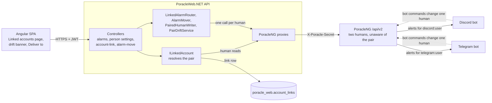
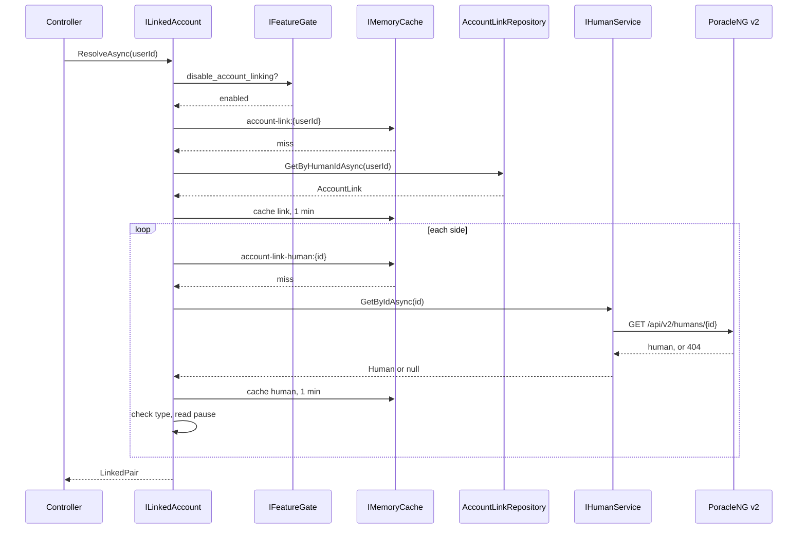
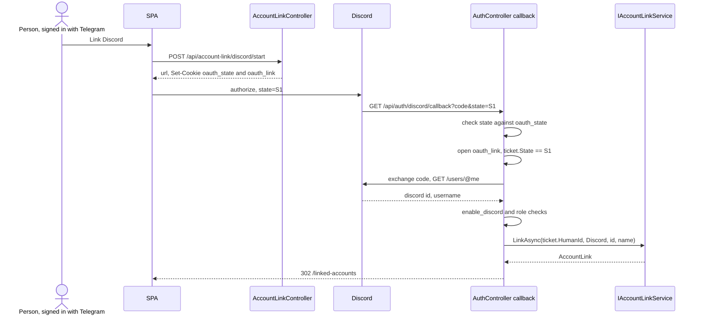
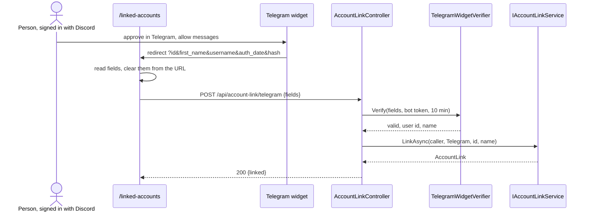
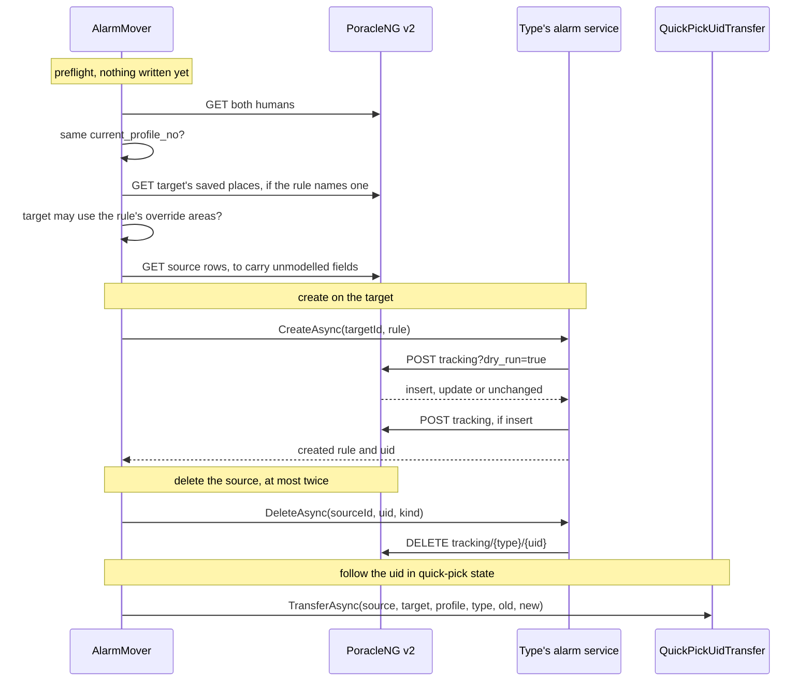
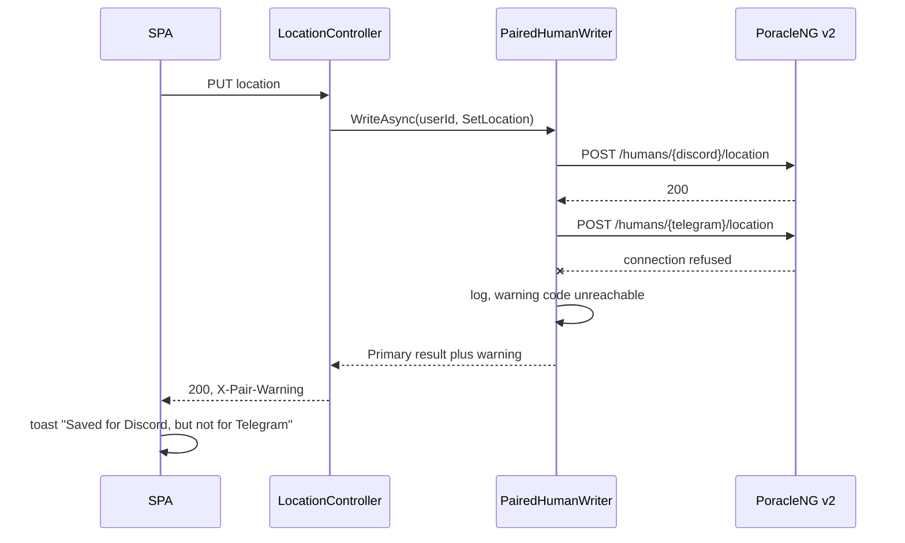
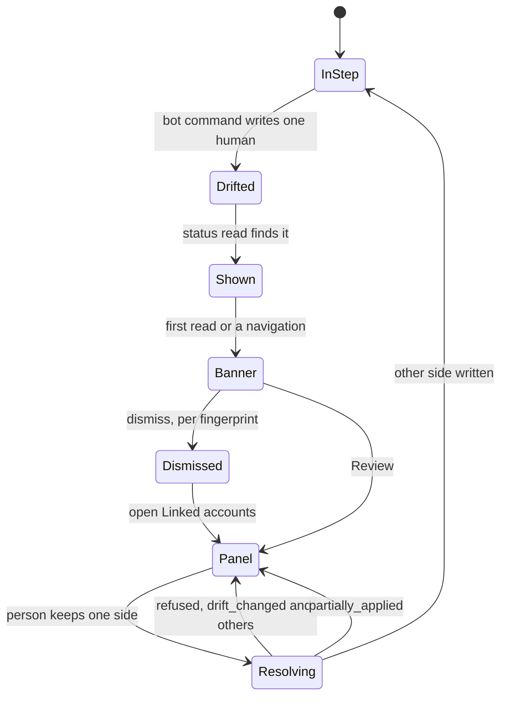
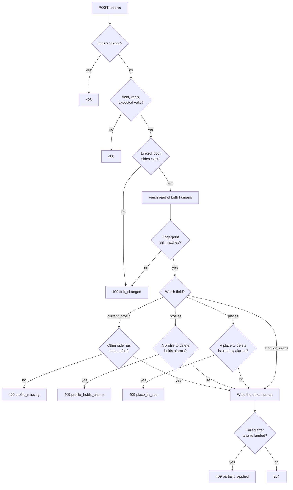

# Linked Accounts

A person who uses Poracle from both Discord and Telegram has two PoracleNG humans, one `discord:user` and
one `telegram:user`. PoracleWeb.NET pairs them so the person sees one list of alarms, saves a location or
an area once, and chooses which app each alarm is delivered to. PoracleNG knows nothing about the pair:
every call PoracleWeb.NET makes is one it would make for an unlinked person, sent once per human.

This page is the technical reference. What a person sees is in [Linked Accounts](../features/linked-accounts.md),
and the operator side of Telegram is in [Telegram](../configuration/telegram.md) and
[Discord and Telegram](../features/discord-and-telegram.md).

## Context

PoracleNG owns humans, profiles, areas, saved places and tracking rules, and it delivers alerts through its
Discord and Telegram bots. PoracleWeb.NET adds one table, `poracle_web.account_links`, and a layer of
services that turn "the signed-in human" into "the signed-in person's humans". Nothing in PoracleNG was
changed for the feature.

The diagram shows where the pair lives and which side of the line each piece sits on.

The dotted edges are where drift comes from: a bot command writes the one human it was sent from, and
PoracleWeb.NET finds out on its next read (see [Drift](#drift)).

## Data model

`account_links` is created by the `AddAccountLinks` migration.

| Column | Type | Notes |
|---|---|---|
| `id` | int, PK | Auto-increment |
| `discord_id` | varchar(64), required, **unique** | The `discord:user` human's id |
| `telegram_id` | varchar(64), required, **unique** | The `telegram:user` human's id |
| `default_destination` | varchar(16), required | `discord` or `telegram`. New alarms go here when the dialog names no app. Set to the side that made the link |
| `discord_verified_at` | datetime, nullable | When that side's identity was last proven |
| `telegram_verified_at` | datetime, nullable | Same, for Telegram |
| `created_at` | datetime | When the link was made |

The two unique indexes are the whole of "one link per account": an id can appear in at most one row, on
its own side. A concurrent second link trips the index, and the repository turns that into
`AccountLinkConflictException`.

The row joins to PoracleNG by id only. Nothing else about either human is stored here, and nothing about
the pair is stored in PoracleNG. The type is checked live on every resolve rather than trusted from the
column.

What isn't stored is computed per request:

- **Pending state.** A side whose human doesn't exist yet ("Waiting to register") is a link row whose id
  PoracleNG answers 404 for.
- **Paused state.** Read from the human's `admin_disable` and `enabled`.
- **Drift.** Compared from fresh reads of both humans.

`LinkedPair` (`Core.Models/AccountLink.cs`) is the resolved form handed to every consumer:

| Member | Meaning |
|---|---|
| `CallerId` | The signed-in (or impersonated) human |
| `Link` | The `AccountLink` row, or null when unlinked |
| `Discord`, `Telegram` | A `PairSide` each: `HumanId`, `Exists`, `Pause` (`None`, `NotRegistered`, `AdminDisabled`, `Stopped`), `Name` |
| `IsLinked` | `Link is not null` |
| `ExistingHumanIds` | The sides that exist, the caller's own first. What reads and writes walk |
| `LinkedHumanIds` | Every id the link names, existing or not. For limits that must hold while a side is away, such as the drawn-fence cap |
| `SideOf(id)`, `HumanIdFor(side)` | Map between a human id and its side |

`LinkedPair.Single(callerId)` is the unlinked answer, and every consumer treats it as "do exactly what you
did before linking existed".

## Pair resolution

`ILinkedAccount.ResolveAsync(userId)` answers the pair for the current request. The JWT carries nothing
about the link, so a link made, cut or retargeted in another tab takes effect without a new token.

1. **Feature gate.** With `disable_account_linking` on, it returns `LinkedPair.Single` before reading
   anything. Rows are kept, so switching the feature back on restores every pair.
2. **The link row**, cached one minute under `account-link:{id}`. A cached "no link" is held too, so an
   unlinked person costs one database read a minute.
3. **Each side's human**, read through `IHumanService.GetByIdAsync` (PoracleNG's
   `GET /api/v2/humans/{id}`), cached one minute under `account-link-human:{id}`.
4. **Type check.** A side whose live `type` isn't `discord:user` or `telegram:user` respectively is
   treated as absent (`Exists: false`), and the retype is logged once per cache fill.
5. **Pause.** `admin_disable = 1` is `AdminDisabled`, `enabled = 0` is `Stopped`, a missing human is
   `NotRegistered`.

The sequence below is one request from a linked person, with a cold cache.

**Invalidation.** `Invalidate(humanId)` drops the link and human entries for that id and, when the cached
link names them, both ids of the pair. Link, unlink, a default change and the account purge call it for
both ids explicitly, because a partner can only be found through a cached link. The cache is the
process's `IMemoryCache`, so a second API instance sees a change within the minute.

**Fails open on `poracle_web`.** A failed `account_links` read, or a row the repository can't read
(`AccountLinkUnreadableException`, such as an unknown `default_destination`), answers `LinkedPair.Single`,
logs a warning and is not cached. The pair is resolved before every person-level write, so a database
outage must not stop an unlinked person from saving anything. A linked person acts as their signed-in
account alone until the read succeeds.

**Doesn't fail open on PoracleNG.** A human read that fails for any reason other than 404 throws, as every
`GetHumanAsync` caller does. The alarm and person controllers answer that 503 through
`PoracleUnreachableExceptionFilter`.

## Linking flows

`IAccountLinkService.LinkAsync(callerHumanId, newSide, newId, newName)` is the one place a verified
identity becomes a link. Its checks, in order:

1. The caller's human must be `discord:user` or `telegram:user`, and the new side must be the other app
   (`link_wrong_type`).
2. The new id must be digits only, 1 to 20 characters, no leading zero, and fit a `long` for Telegram
   (`link_bad_id`).
3. Neither id may already be in a link (`link_taken`). Checked before anything is created, so a refused
   link never leaves a provisioned human behind.
4. If PoracleNG has a human with the new id, it must be the matching person type (`link_type_mismatch`).
   This is what stops a channel, group or webhook being linked.
5. If it has none and `link_register_missing` is on, the provisioner creates it (below). If it has none
   and the setting is off, the link is stored anyway and that side waits to register.
6. The row is inserted with `default_destination` set to the caller's side. An index collision rolls back
   a provisioned human and answers `link_taken`.

### Discord

The Discord half reuses the sign-in OAuth flow and its callback. `POST /api/account-link/discord/start`
builds the authorize URL with the same `DiscordAuthorizeRequest` the sign-in uses, which sets the
`oauth_state` cookie, and also sets an `oauth_link` cookie: an `AccountLinkTicket` sealed with ASP.NET
Data Protection (purpose `AccountLink.v1`) holding the caller's human id, that flow's `state` and a
10-minute expiry.

The sequence follows one link from the Linked accounts page back to it.

The callback deletes the `oauth_link` cookie whatever happens. A ticket that is tampered with or expired
ends on `#link_error=link_expired`. A ticket whose `state` doesn't match the callback's is ignored, so an
abandoned link can't turn a later ordinary sign-in into a link, and that request continues as a sign-in.
The link branch never looks up a human for sign-in and never issues a token. A cancelled approval is
`link_cancelled`, and a failed token exchange or user read is `link_failed`. The sign-in start deletes any
leftover ticket.

### Telegram

The Telegram half is the login widget in **redirect mode**. The widget's callback mode (`data-onauth`)
makes Telegram's script `eval` the attribute, which the site's CSP refuses (`script-src` has no
`unsafe-eval`), so the button never drew. In redirect mode (`data-auth-url`) Telegram navigates the
browser to the page with the signed fields in the query string, and the page posts them on.

`TelegramWidgetVerifier` is shared with Telegram sign-in, which allows 24 hours; linking allows 10 minutes.
It refuses a payload with no `id` or `hash`, a non-numeric `id`, a missing or non-numeric `auth_date`, one
more than five minutes in the future (clock drift), and one older than the window, all before the hash.
The hash is HMAC-SHA256 of the sorted `key=value` lines, keyed with SHA-256 of the bot token, compared in
constant time. An expired payload answers `link_expired`, every other failure `link_bad_id`.

The widget asks for write access (`data-request-access="write"`), which lets the bot DM the person.

### Registering the missing side

With `link_register_missing` on, `LinkedHumanProvisioner.CreateMirrorAsync` creates the other human by
copying the caller's. Alarms are never copied.

1. `POST /api/v2/humans` with the new id, name, type, location, community membership and language, and the
   name of the caller's profile 1 as the default profile's name.
2. Check the new human's default profile is number 1.
3. Walk profile numbers from 1 to the caller's highest. PoracleNG gives a new profile the lowest free
   number, so each `POST .../profiles` must come back with the expected number or the whole create fails.
   A gap in the caller's numbering is filled with a placeholder profile, deleted at the end.
4. Write each profile's areas and location with `POST .../areas?profile=N` and `.../location?profile=N`,
   and copy its `active_hours`.
5. Switch to the caller's active profile, delete the placeholders, then copy saved places. A place
   PoracleNG refuses is logged and skipped.

Profile numbers must agree because moves and drift compare them across the pair. A legacy profile 0 isn't
copied: PoracleNG never numbers a new profile 0.

Any failure deletes the human it created, but only if PoracleNG still holds one with this link's type and
name. Another request may have created that id in between, and that row isn't ours to remove. The caller
sees `link_provision_failed` and nothing is linked.

### Refusal codes

Every refusal carries `{ error, code }`. The SPA words the code; `error` is the English fallback.

| Code | Status | Meaning |
|---|---|---|
| `link_wrong_type` | 400 | The caller isn't a Discord or Telegram person, or both sides are the same app |
| `link_bad_id` | 400 | The id isn't a possible account id, or the Telegram payload didn't verify |
| `link_type_mismatch` | 400 | That id is a PoracleNG human of another type, such as a channel or group |
| `link_taken` | 409 | One of the ids is already in a link |
| `link_expired` | 400 | The Telegram payload or the Discord ticket is past its 10 minutes |
| `link_not_permitted` | 403 | That app's sign-in is off, the account fails the site's sign-in rules, or (for a default change) that side isn't registered |
| `link_provision_failed` | 502 | Registering the missing side failed and was rolled back |
| `link_failed` | redirect | The Discord exchange or user read failed |
| `link_cancelled` | redirect | The person backed out of Discord's approval |

The Discord flow can't answer JSON, so it ends on `/linked-accounts#link_error=<code>`.

The other routes: `DELETE /api/account-link` unlinks, `PUT /api/account-link/default {destination}` sets
the default app, and `GET /api/account-link/status` answers `{ linked, link, sides, defaultDestination,
drift, legacyProfileZero }`. Admins have `GET /api/admin/account-links` and
`DELETE /api/admin/account-links/{humanId}`, which aren't gated on `disable_account_linking` so a stuck pair
can still be cut while the feature is off.

## Alarm routing

The eleven alarm controllers reach their services only through `LinkedAlarmRouter`. Unlinked, each method
makes the exact call it made before, and the JSON is byte-identical: `Destination` and `PausedDestination`
are omitted when null, and the router only sets them for a linked caller.

| Router method | Linked behaviour |
|---|---|
| `ListAsync` | Reads each existing human's rules for the profile and concatenates them, stamping `destination` |
| `FindAsync(svc, userId, uid)` | Looks the uid up on each human in turn; answers the alarm and its owner id |
| `FindAsync(userId, lookup)` | Same, for a lookup narrower than a uid. The invasion controller uses it with `?kind=event` or `invasion`, because invasion and Pokéstop event rules share one list but number their uids separately |
| `CountAsync`, `DeleteAllAsync`, `UpdateDistanceAllAsync` | Run once per human; distance results are merged |
| `UpdateDistanceByUidsAsync` | One list read per human maps every uid to its owner, then one call per owner. An unknown uid goes to the caller, where the service skips it as it always did |
| `CreateTargetAsync` | The human a create belongs to (below) |
| `MoveTargetAsync`, `MoveAsync` | An edit naming the other app becomes a move |

A create with no `destination` goes to the pair's default app, or to the caller while the default side has
no human. A create naming a side with no human answers 409 ("Telegram isn't set up yet"), and an unknown
destination 400, both through `AlarmDestinationExceptionFilter`. A create that lands on a paused side is
answered with `pausedDestination: true` so the dialog can say the alert won't arrive until that app is on
again.

Edits, deletes and test alerts go to the owner `FindAsync` returned, so a uid on either human works from
the merged list.

## Moves

An alarm changes app in two ways: `PUT /api/{type}/{uid}` with a `destination` naming the other app (an
edit that moves), and `POST /api/alarm-move { type, uids, destination }` for a selection of up to 500. Both
call `AlarmMover`, and both are refused with 403 while an admin is viewing as someone else, because a move
writes the other human's rules. `alarm-move` is rate limited to 10 requests a minute per person and is
gated on `disable_account_linking` and on the type's own `disable_*` key.

The protocol, for one alarm:

**Why create, then delete.** The other order has a window where the alert exists nowhere, and a failed
create in that window loses it. Creating first means the worst case is an alert on both apps, which the
person can see and fix.

**Preflight** refuses before any write when the target side has no human (`not_set_up`), the two humans
are on different active profiles (`different_profiles`; a rule lives on its human's active profile, and a
v2 read carries no `profile_no`), the rule measures from a saved place the target lacks
(`place_missing`), or the target may not use one of its override areas (`area_not_allowed`, through
`IUserAreaPolicy`).

**The create** goes through the type's own service, so it gets the same dry-run protection as an Add
(see [PoracleNG API Proxy](poracleng-proxy.md#insert-update-or-duplicate)). The model is cleared of its
uid and stamps first. Stored fields the typed model has no property for are carried across, as an edit
does with `TrackingFieldPreserver` (not for Pokéstop events, which have no untyped path). An identical rule
already on the target counts as moved onto that rule, using `ExistingUid`. A would-be takeover is a
`conflict` carrying the target rule's `existingUid`.

**The delete** names the invasion kind, so moving a Pokéstop event never deletes a plain invasion that
shares its uid. It's tried twice. If it still fails the alarm stays on both apps.

**Quick picks.** A quick pick's applied state is kept per human and profile, so the moved uid is added to
the same pick's row on the target first and then removed from the source's. A source row left tracking
nothing is deleted. A failure here is logged and doesn't change the outcome.

| Outcome | Meaning | Single edit answers |
|---|---|---|
| `moved` | On the target, gone from the source | 200, the rule as it now stands, `X-Move-Status: moved` |
| `alreadyThere` | Already on the requested app; nothing to do | 409 (an edit only asks to move to the other app) |
| `conflict` | The target holds a rule this one would take over. Nothing written | 409 with `existingUid`, through the global filter |
| `sourceRemains` | Copied, but the original couldn't be deleted | 200, `X-Move-Status: source_remains` |
| `refused` | A check failed before anything was written | 409 `{ error, code, app, place }` |
| `failed` | The create failed in a way PoracleNG didn't explain; it may or may not exist on the target. Source untouched | 502 |

Bulk moves answer `{ results: [{ uid, status, newUid, existingUid, reason, reasonCode, reasonApp,
reasonPlace }] }`, one per uid, plus `not_found` for a uid neither human has. Reason codes:
`already_there`, `not_linked`, `not_yours`, `not_found`, `not_set_up`, `different_profiles`,
`place_missing`, `area_not_allowed`, `invalid`, `conflict`, `failed`, `source_remains`. The SPA translates
the code and never shows `reason`.

The single edit answers in the body PUT always had, the alarm, so whether the original is gone travels as
`X-Move-Status`. It and `X-Pair-Warning` are in `CorsPolicySetup.ExposedHeaders`; an unexposed header reads
as absent and a half-done move would look clean.

## Paired writes

Every person-level write goes through `IPairedHumanWriter.WriteAsync(userId, write)`:

1. Resolve the pair.
2. Run the write for the signed-in human. If it throws, that's the request's error, and the other human
   isn't tried.
3. Run the write for the other existing human. A paused side is still written; only a side with no human
   is skipped.
4. If the second write fails, the request still succeeds with the first side's result, and the response
   carries `X-Pair-Warning: {"side":"telegram","reason":"...","code":"..."}`.

The warning never changes a body or a status. `code` is one of `unreachable` (anything without a sentence
meant for people, so a host and port never reach the browser), `refused` (PoracleNG's own sentence, as
`reason`), `out_of_step` and `rename_refused`. The SPA's `pairWarningInterceptor` reads it once per
response and shows "Saved for Discord, but not for Telegram", with an action that opens Linked accounts.

The sequence shows a location save where the second side is unreachable.

What goes through it: location, saved places (add, move, delete), area selection, profile create, update,
switch, delete, duplicate and import, alert language, quiet periods, quest summary schedules, and alerts on
and off. The cleaning toggle and the geofence services do the same thing in their own code, with the same
warning shape.

A few writes need more than "the same call twice":

- **Profile numbers.** PoracleNG gives each human its own lowest free number, so a profile created on both
  can land on different numbers if the pair had drifted. `PairedNewProfile.ReconcileAsync` keeps the
  signed-in side's profile, deletes the other side's mismatched one, and warns `out_of_step`. An edit to
  profile N reaches the other human only if its profile N has the same name; otherwise it's left alone with
  the same warning.
- **Alerts on.** Stop reaches both humans. Start reaches the other human only if nothing paused it, so an
  operator's block or a stop the person made in the other app is never undone.
- **Areas.** Each human's list goes through `IUserAreaWriter`, which authorises names for that human.
  `UserAreaPolicy` counts the pair's drawn fences as each human's own.
- **Quiet periods.** PoracleNG canonicalises an area's casing per human and its delete matches exactly, so
  lifting one on the other side sends the value that human's own list returned.
- **Drawn geofences.** A fence belongs to one human id but is listed, toggled, renamed and deleted across
  the pair, the ownership check accepts either id, and the 10-fence cap counts `LinkedHumanIds`, so the
  pair can't draw past it while one side is away.

## Drift

The two humans drift because PoracleNG's bots write the human a command came from. `!location` in Discord
moves the Discord human; `/profile` in Telegram switches the Telegram human. PoracleWeb.NET never resolves
a difference on its own. It shows it and waits for the person to choose.

`IPairDriftService.GetAsync` reads both humans (human, area list, profiles, saved places) in parallel and
compares five settings. It returns nothing unless both sides exist.

| Field | Compared as |
|---|---|
| `location` | Latitude and longitude rounded to 5 decimal places |
| `areas` | The active profile's areas, each through `UserAreaPolicy.Key` (lowercase, trimmed, `_` equal to space, PoracleNG's `NormalizeAreaKey`), de-duplicated and sorted, so order doesn't matter |
| `profiles` | Every profile by number: name (exact), `active_hours` (numbers or numeric strings read as ints, entries sorted by day, hour, minute), and the areas and location of profiles neither side is on |
| `current_profile` | The active profile number. Skipped when either side is on profile 0 |
| `places` | Saved places by lowercase label, with location to 5 decimal places |

The profiles either side is on are compared without their areas and location, because each human holds
that profile's live copy and the `location` and `areas` lines already compare it. Comparing both reported
one cause twice.

Not compared, though written to both: alert language, quiet periods (held in PoracleNG's memory and gone
on restart) and summary schedules. **Profile 0** is outside the pair: PoracleNG never numbers a new profile
0, so it's never compared, copied, switched to or deleted, and `status` reports which side has one as
`legacyProfileZero` for a note on the page.

Each item carries both sides' comparable values, a `fingerprint` (lowercase hex SHA-256 over the Discord
value, a newline, and the Telegram value) and `details` outside the fingerprint (profile names, place
labels as typed) so renaming one profile doesn't stale another line.

The state diagram follows one difference from a bot command to its resolution.

The banner sits under the toolbar, appears only with the first status read or at a navigation (never
mid-page), is hidden while impersonating and on Linked accounts itself, and stores dismissed fingerprints
in `sessionStorage`. The panel on Linked accounts always lists every difference, with what each choice
changes in the other app. A choice that deletes something (a profile or a place) asks first, naming it.
`LinkedAccountService.refreshSoon()` re-reads status shortly after any successful write, so the banner never
offers to undo what the person just did.

### Resolving

`POST /api/account-link/resolve { field, keep, expected }` makes the other human match the kept one for
one field. It writes the other human only, never through `PairedHumanWriter`, which would rewrite the side
being kept. Everything that can refuse is checked before the first write.

Refusals are `DriftRefusalException`s, answered by `PairDriftExceptionFilter` as 409
`{ error, code, side, name, count }`. Alarm counts for `profile_holds_alarms` and `place_in_use` come from
`GET /api/v2/humans/{id}/tracking?all_profiles=true`, because a place belongs to the human, not one
profile.

The order matters within a field too:

- **Profiles before the active profile.** Switching never creates a profile, so the profiles line is
  listed first and settled first.
- **Missing profile numbers** are created in order, with filler profiles to reach a gap, each one checked
  against the number PoracleNG assigns. Fillers are deleted in a `finally`.
- **Extras are deleted last.** If the other human is on one of them it's switched to the kept side's
  profile first, so PoracleNG doesn't choose where it lands.
- **Areas** go through `IUserAreaWriter.SaveSelectionAsync` for the other human, so names are authorised
  for the human they're written to.

Once any write has landed, a later failure is `partially_applied` rather than the underlying error, so the
person is never told nothing changed when something did. The SPA re-reads status after every resolve,
success or not.

## Failure handling and invariants

| Invariant | How it holds |
|---|---|
| A move never loses an alert | Create on the target before deleting the source. A failed delete is `sourceRemains`, both copies listed and tagged |
| A paused side is never re-enabled | Start skips a paused other side, and no other linked-account path calls enable |
| Drift is never resolved without a choice | Resolve needs a field, a side and the fingerprint the person saw; nothing resolves in the background |
| Unlinked people are unaffected | Every component answers `LinkedPair.Single` with today's calls; alarm JSON is byte-identical |
| PoracleNG is unchanged | Only existing `/api/v2` routes, one human at a time |
| A refused link leaves nothing behind | `link_taken` is checked before provisioning; a provisioned human is rolled back if it's still ours |
| A second-side failure doesn't fail the request | `X-Pair-Warning`, never a changed status or body |

| When this is down | What happens |
|---|---|
| `poracle_web` database | `ILinkedAccount` fails open: everyone acts as their signed-in account, writes reach one human, nothing is cached. Linking, unlinking and default changes fail |
| PoracleNG | Human reads throw; alarm, person and move endpoints answer 503. A status read fails and the SPA keeps what it showed. A drift read failing alone answers `drift: null`, which hides the banner |
| PoracleNG for the second human only | The write lands on the first; `X-Pair-Warning` with `unreachable` |

## Security

- **Link ticket.** The Discord link's identity is a Data Protection-sealed cookie bound to that flow's OAuth
  `state` and good for 10 minutes. A forged or stale cookie opens to null. The state check still guards
  CSRF as it does for sign-in.
- **Telegram HMAC.** Verified server-side against the bot token, with a 10-minute window for linking and a
  five-minute allowance for clock drift. The SPA never decides whether a payload is valid.
- **Impersonation.** Every account-link write, resolve and move is refused with 403 while an admin views
  as someone else, and the admin link routes refuse too: `UserId` is then the inspected account. The status
  read stays open.
- **Feature gate.** `AccountLinkController` and `AlarmMoveController` carry
  `[RequireFeatureEnabled(disable_account_linking)]`, and `ILinkedAccount` answers single accounts when it's
  off.
- **CSP.** `script-src` allows `https://telegram.org` and `frame-src` allows `https://oauth.telegram.org`
  for the widget. No `unsafe-eval`, which is why redirect mode.
- **Logging.** Linked-account log lines pass human ids through `LogSafe.Id`, which masks URL-shaped ids
  (webhook tokens). Discord and Telegram user ids are logged unchanged. Bot tokens and widget hashes are
  never logged.
- **Destinations never link.** `LinkAsync` accepts only a `discord:user` caller with a `telegram:user`
  partner or the reverse, and `ILinkedAccount` re-checks both types on every resolve. A channel, group or
  webhook can't join a pair, so no alert ever leaves a person's own DM because of a link.

## Testing

Backend tests are in `Tests/Pgan.PoracleWebNet.Tests/`:

| Area | Tests |
|---|---|
| Resolution and linking | `LinkedAccountTests`, `AccountLinkServiceTests`, `AccountLinkRepositoryTests`, `AccountLinkMappingTests`, `AccountLinkControllerTests`, `AuthControllerLinkCallbackTests`, `TelegramWidgetVerifierTests`, `LinkedHumanProvisionerTests` |
| Alarm routing | `LinkedAlarmRouterTests`, `LinkedAlarmOwnerRoutingTests`, `LinkedCreateFallbackTests`, `LinkedInvasionKindTests`, `AlarmDestinationExceptionFilterTests` |
| Moves | `AlarmMoverTests`, `AlarmMoverReasonCodeTests`, `AlarmMoverCarriesStoredFieldsTests`, `QuickPickUidTransferTests`, `AlarmMoveControllerTests`, `AlarmMoveWhileImpersonatingTests`, `AlarmMoveRateLimitTests`, `MoveStatusSerializationTests` |
| Paired writes and drift | `PairedHumanWriterTests`, `LinkedPersonWritesTests`, `LinkedGeofenceOwnershipTests`, `LinkedSurfacesTests`, `PairDriftServiceTests` |

Three architecture tests in `Tests/.../Architecture/` fail the build when a rule is broken:

| Test | Rule |
|---|---|
| `AlarmControllersUseRouterTests` | None of the eleven alarm controllers passes `this.UserId` (directly or through a local) to its service; everything goes through `LinkedAlarmRouter` |
| `PersonWritesUseWriterTests` | A person-level write (location, places, areas, profiles, language, quiet periods, alerts on and off, summaries) in the person controllers or `UserGeofenceService` is made inside `IPairedHumanWriter` |
| `AlarmUpdateMoveGuardTests` | Each alarm controller's `PUT /{uid}` refuses a move while impersonating, before anything is merged or written |

SPA specs cover `linked-account.service`, `alarm-move.service`, `pair-warning.interceptor`, the Linked
accounts page, `pair-drift-panel`, `pair-drift-banner`, `deliver-to-field` and `deliver-to`, the
redirect-mode `telegram-login-button`, and the admin settings for linking.

## Extension points

`IAccountLinkService` is the only way to create a link. A caller hands it an identity it has already
verified, and the service applies the pairing rules, provisioning and invalidation. Another sign-in
provider could call it the same way the Discord callback and the Telegram endpoint do, without touching
the router, writer or drift code.

A new person-level write belongs inside `IPairedHumanWriter` (and in the list `PersonWritesUseWriterTests`
checks). A new alarm type goes through `LinkedAlarmRouter` in its controller and gets an entry in
`AlarmMoveDispatcher`. A new compared setting is a new `DriftField` with its comparable form, its
resolution, and its pre-checks ahead of the first write.
