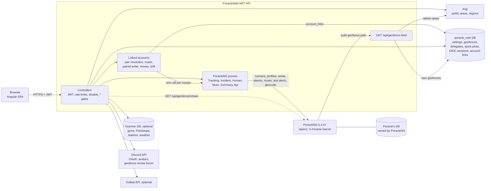

# Architecture Overview

PoracleWeb.NET is a full-stack application with a .NET 10 backend API and Angular 21 frontend SPA.

## Solution structure

```
Pgan.PoracleWebNet.slnx
├── Applications/
│   ├── Web.Api/                    ASP.NET Core host
│   │   ├── Controllers/            REST API controllers (all under /api/)
│   │   ├── Configuration/          DI registration, settings classes
│   │   └── Services/               Background services (avatar cache, DTS cache)
│   └── Web.App/ClientApp/          Angular 21 SPA
│       └── src/app/
│           ├── core/               Guards, services, interceptors, models
│           ├── modules/            Feature pages (dashboard, pokemon, raids, etc.)
│           └── shared/             Reusable components, utilities
├── Core/
│   ├── Core.Abstractions/          Interfaces (IService, and the six Poracle proxies:
│   │                               Tracking, Incident, Human, Mute, Summary, Api)
│   ├── Core.Models/                DTOs passed between layers
│   ├── Core.Mappings/              Mapping extension methods (alarm DTOs, poracle_web tables)
│   ├── Core.Repositories/          poracle_web data access (AccountLink, OidcSession,
│   │                               QuickPickAppliedState, QuickPickDefinition, SiteSetting,
│   │                               UserGeofence, WebhookDelegate)
│   └── Core.Services/              Business logic + PoracleNG API proxies
├── Data/
│   ├── Data/                       PoracleWebContext, entities, configurations, migrations
│   └── Data.Scanner/               ScannerContext for the optional scanner DB (Golbat)
└── Tests/
    └── Pgan.PoracleWebNet.Tests/     xUnit backend tests
```

## System context



PoracleWeb.NET has no line to Poracle's database: everything about humans, profiles, areas and alarms goes through PoracleNG. Its own state lives in `poracle_web`. `ScannerService` reads the scanner database directly through `ScannerContext` for the gym picker, station names and weather. PoracleNG pulls its geofences from PoracleWeb.NET's feed, and PoracleWeb.NET asks it to reload them after a geofence changes.

!!! info "All operations go through PoracleNG"
    Alarm tracking CRUD for ten of the eleven types (including Fort Change and Max Battle) is proxied via `IPoracleTrackingProxy`; Pokéstop Events go through `IPoracleIncidentProxy` instead, because that type exists only on PoracleNG's `/api/v2`. Single-user human/profile operations (reads, creates, location, areas, profile switch) are proxied via `IPoracleHumanProxy`. Humans, profiles, areas (including user-drawn geofence names) and the admin user list and delete all go through PoracleNG's `/api/v2`. PoracleWeb.NET has no connection to Poracle's database at all. The `poracle_web` database is its own. See [Backend](backend.md#areas). Optional integrations include Pokemon availability from the Golbat API and weather from the optional scanner database via `IScannerService`. See [PoracleNG API Proxy](poracleng-proxy.md) for details.

## Key design decisions

### Operations proxied through PoracleNG
All alarm tracking writes (create, update, delete) and single-user human/profile operations go through the PoracleNG REST API, not to Poracle's database. PoracleNG detects duplicates and takeovers (PoracleWeb.NET asks with a dry run before every create), keeps `humans.area` and `profiles.area` in step, and reloads its state after each write. PoracleNG fills a field only when it's absent, and the `*Create` models send every field they declare, so the defaults on those models are what gets stored. See [Backend Patterns](backend.md#monster-filter-defaults). Profile duplication, from either `POST /api/profile-overview/duplicate/{n}` or `POST /api/profiles/duplicate`, uses PoracleNG's copy endpoint; import writes each alarm straight to the new profile with `?profile=N`. The eleven supported alarm types are Pokemon, Raids, Eggs, Quests, Invasions, Lures, Nests, Gyms, Fort Changes, Max Battles and Pokéstop Events. PoracleNG 5.4.0 is the minimum; see [Version compatibility](poracleng-compatibility.md). Test alerts are sent via PoracleNG's `POST /api/test` endpoint, which formats and delivers a mock notification to the user. See [PoracleNG API Proxy](poracleng-proxy.md).

### Separate databases
PoracleWeb.NET doesn't connect to Poracle's database, which PoracleNG manages. Application-owned data (user geofences, site settings, webhook delegates, quick pick definitions) lives in a separate `poracle_web` database managed by EF Core migrations.

### Linked accounts on top of PoracleNG
A person who uses both Discord and Telegram has two PoracleNG humans. PoracleWeb.NET pairs them in its own `account_links` table and changes nothing in PoracleNG. `ILinkedAccount` resolves the pair live on each request (cached a minute), `LinkedAlarmRouter` merges both humans' alarms and sends each write to the human that owns it, `PairedHumanWriter` sends every person-level write to both, `AlarmMover` moves an alarm between them by creating before it deletes, and `PairDriftService` reports where bot commands have made the two differ. For an unlinked person every one of these makes exactly the calls it made before. See [Linked Accounts](linked-accounts.md).

### Unified geofence feed
PoracleWeb.NET acts as the single geofence source for PoracleNG. It fetches admin geofences from Koji, merges them with user-drawn geofences, and serves everything via one endpoint (`GET /api/geofence-feed`). No custom code needed in PoracleNG or Koji. User geofences support GeoJSON import/export for interoperability with external mapping tools.

### Manual mapping extensions
Mapping lives in static extension methods under `Core.Mappings/` -- there is no AutoMapper dependency. `AlarmMappingExtensions` provides `To*()` for `*Create` DTOs and `ApplyUpdate()` for `*Update` DTOs; `EntityMappingExtensions` provides `ToModel()`, `ToEntity()`, and `ApplyTo()` for the `poracle_web` tables (user geofences, site settings, webhook delegates, quick-pick definitions and applied state). Update models use nullable properties and `ApplyUpdate` skips nulls, so partial updates don't zero out unset fields. Alarm data itself flows as raw JSON through the PoracleNG API proxy. See [Backend Patterns](backend.md).

### Gym picker
The `GymPickerComponent` (shared) lets users search for specific gyms when creating team, raid, or egg alarms. It calls the `ScannerService` (frontend) which hits scanner gym search endpoints on the backend (`ScannerController`). Search results use the `GymSearchResult` model and include photo thumbnails and area names resolved via the `PointInPolygon` geo utility. The scanner DB is optional — when not configured, the gym picker is hidden.

### Partitioned rate limiting
The seven rate-limit policies partition by user or by IP, never one global bucket. This prevents one user's activity from locking out others. See [Backend Patterns](backend.md#rate-limiting).
