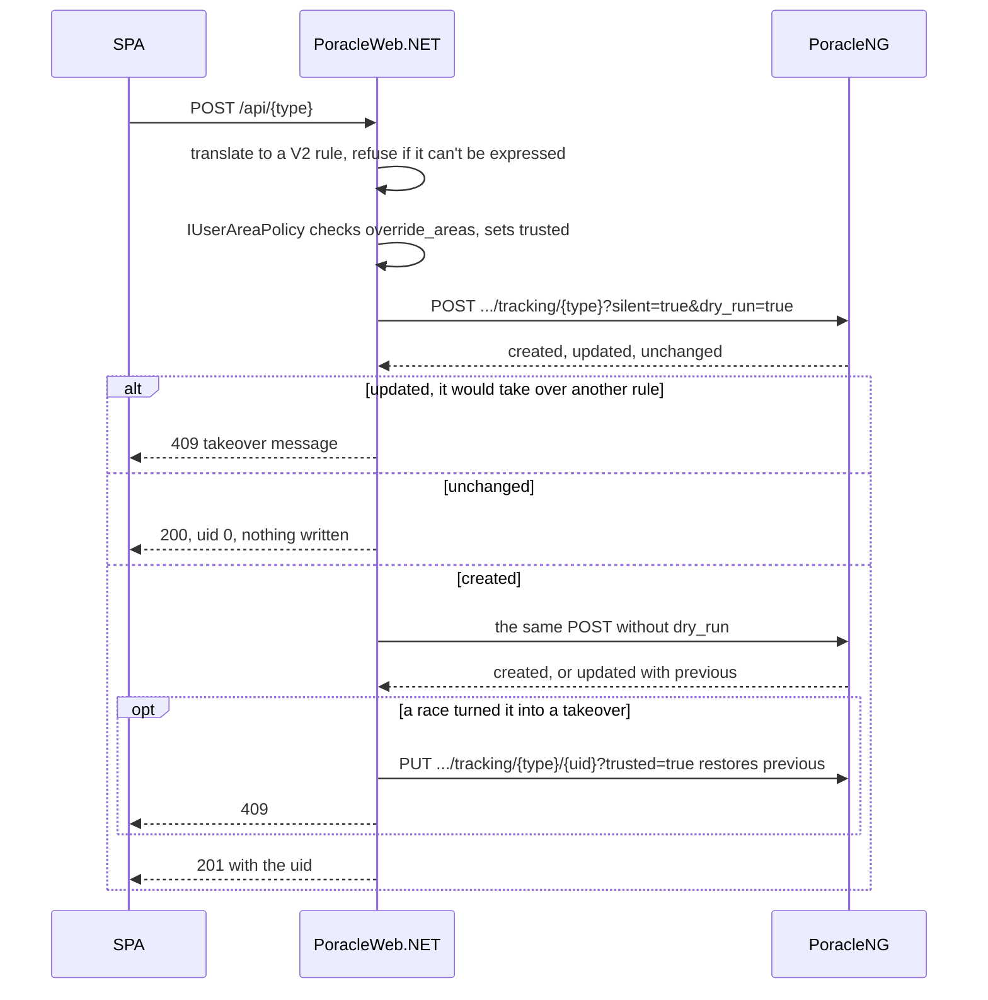

# PoracleNG API Proxy

All alarm tracking operations (create, read, update, delete) are proxied through PoracleNG's REST API instead of writing to Poracle's MySQL database. PoracleNG then owns duplicate detection, validation and the state reload after every change.

!!! warning "PoracleNG 5.4.0 or newer"
    `PoracleServerProfile.MinimumSupported` is 5.4.0. Against anything older PoracleWeb.NET still runs, but the [server capability probe](backend.md#server-capability-probe) logs an error at startup and warns an admin, and the human, profile, area, place and mute calls answer with a message naming the version they need. See [Version compatibility](poracleng-compatibility.md).

## Why we migrated

On March 31, 2026, a NULL `template` column written directly by PoracleWeb.NET crashed PoracleNG's state reload for 15 hours. PoracleNG's Go SQL scanner cannot handle `NULL` in the `template` column of the `monsters` table, causing the entire state reload to fail. All users received stale alarm state and unwanted DM floods until PoracleNG was manually restarted.

Direct database writes bypassed everything PoracleNG does on its own write path, including filling an absent `template` with the configured default. Going through the API removes that class of bug. It doesn't make PoracleWeb.NET's own defaults irrelevant: PoracleNG fills only fields that are absent, and the `*Create` models send every field they declare (see [Backend → Monster filter defaults](backend.md#monster-filter-defaults)).

## Request flow

```
Frontend (Angular)
    |
    v
ASP.NET Core Controllers  (/api/pokemon, /api/raids, etc.)
    |
    v
Alarm Services  (MonsterService, RaidService, etc.)
    |
    v
IPoracleTrackingProxy  (PoracleTrackingProxy)
    |  HTTP + X-Poracle-Secret header
    v
PoracleNG REST API  (/api/v2/humans/{id}/tracking/*)
    |
    v
MySQL (Poracle DB)  +  State Reload
```

## What goes through the proxy

All alarm tracking CRUD for these types:

| Type | PoracleNG tracking type | Service |
|---|---|---|
| Pokemon | `pokemon` | `MonsterService` |
| Raids | `raid` | `RaidService` |
| Eggs | `egg` | `EggService` |
| Quests | `quest` | `QuestService` |
| Invasions | `invasion` | `InvasionService` |
| Lures | `lure` | `LureService` |
| Nests | `nest` | `NestService` |
| Gyms | `gym` | `GymService` |
| Fort Changes | `fort` | `FortChangeService` |
| Max Battles | `maxbattle` | `MaxBattleService` |

There is an eleventh tracking type, Pokéstop Events (`incident`), and it is **not** in that table. It
has no v1 route at all, so it goes through its own `IPoracleIncidentProxy` against
`/api/v2/humans/{id}/tracking/incident`. Its rows live in the same `invasion` table as invasion rows,
told apart only by `grunt_type` carrying an event name. PoracleNG's two v2 endpoints each filter to
their own rows. The invasion read the application uses folds the `incident` rules back into the invasion
list, the way v1 returned them, and `InvasionService` splits them out again. When the Pokéstop Events page
is switched off it doesn't, so those rules stay visible on the invasion page. See
[Database](database.md).

Also proxied:

| Operation | How |
|---|---|
| Dashboard counts | One read of the v2 tracking snapshot (`GET /api/v2/humans/{userId}/tracking`), counted per type |
| Cleaning toggle | One v2 `PATCH` per type naming the uids and the clean bit |
| Admin delete of all alarms | Reads the uids per type and bulk-deletes them through the proxy |
| Bulk distance | One v2 `PATCH` per type naming the uids and the new `distance`. Max battles included; they're no longer deleted and re-created |

### Read-only calls that shape the UI

PoracleNG's own config and master data are read for things other than tracking. Each read degrades to a
usable default rather than failing the request:

| Call | Used for | If it fails |
|---|---|---|
| `GET /api/masterdata/monsters?locale={code}` | Pokemon names, types, form names and evolution chains, translated into the display language | Falls back to the English [WatWowMap masterfile](https://github.com/WatWowMap/Masterfile-Generator) cached server-side, so the pickers stay populated |
| `GET /api/config/poracleWeb` &rarr; `disabledHooks` | The per-type disable flags Poracle sets in its own config, honoured here as a floor under the site settings | Empty set: the local `disable_*` settings are in sole charge. Fails **open**, deliberately |
| `GET /api/config/values` &rarr; `general.disable_showcase` | Whether the Pokéstop Events page exists at all | Only `true` hides the page; absent or unreadable leaves it on, because every supported PoracleNG serves the v2 `incident` route |
| `GET /api/config/values` &rarr; `tracking.quest_summary_enabled` | Whether quest summary delivery is offered | Treated as off, so the control is hidden rather than saving into a delivery nothing performs |

Fort changes arrive in `disabledHooks` as `fort`
([jfberry/PoracleNG#197](https://github.com/jfberry/PoracleNG/issues/197)). A second read of
`general.disable_fort_update` covered servers before 5.2.1; it is gone.

The locale on the first row is the display language, which is why switching language re-fetches the
map — Poracle owns the translations, so this site does not carry Pokemon names of its own.

## Insert, update or duplicate

PoracleNG decides what a tracking POST does by diffing the submitted row against the ones already
stored. The outcome is not obvious from the request:

| Diff result | Outcome |
|---|---|
| No differences | Duplicate. Nothing is written, reported as `alreadyPresent` |
| Exactly one difference, and it is an updatable field | **Update of that existing row** |
| Anything else | New insert |

The updatable set is `clean`, `distance` and `template`, plus `slot_changes` and `battle_changes` on
gyms. Everything else identifies the alarm. The consequence that kept biting: an Add that differs from a
**different** alarm by exactly one updatable field takes that alarm over, and one alarm exists where
there were two.

PoracleWeb.NET no longer reconstructs that rule. Since 5.4.0 PoracleNG reports what a create would do:
`POST ?dry_run=true` classifies each row as inserted, updated or unchanged without writing, and a
colliding edit comes back 409. The proxy acts on the answer:

- A single Add the dry run calls an update is refused with "Another alarm of this type already uses
  those settings. Edit or remove that one instead." (`TrackingConflictException`, mapped to 409).
- A single Add that is unchanged writes nothing and answers 200 with uid 0.
- Anything else commits. If the commit itself reports a takeover (another request got there between
  the dry run and the write), the other alarm is restored from the `previous` PoracleNG returns and the
  Add is refused.
- A batch (quick picks, profile import) is dry-run whole first. If every row is new it commits; if none
  is, it writes nothing. Only a mixed answer dry-runs each row alone, because PoracleNG classifies the
  batch against stored rules and can't say which row was which. Then only the new rows are created, and
  identical rows and would-be takeovers are skipped.
- Max battles get the same protection. 5.4.0 merges max battles on v2 creates, so an Add of the same
  boss differing only by radius is refused where v1 used to stack it.



The `...` is `/api/v2/humans/{id}`. Pokemon has one quirk here: an Add that differs from an existing
rule only in its clean setting comes back as already tracked (200, uid 0) and changes nothing, so a
clean-only change has to be made by editing that rule.

No client-side takeover check is left. Bulk distance sends a PATCH, and PoracleNG refuses a rule whose
new radius would make it clash with another, naming it as a `conflict`. `TrackingFieldPreserver` still merges the stored row into an edit, because a v2 PUT is a full replace;
see [Backend → Update pattern](backend.md#update-pattern).

<a id="the-v2-pilot"></a>

## The v2 write path

PoracleNG 5.2.0 added a second tracking surface at `/api/v2` and left v1 frozen. **Every read, create,
edit and delete for all eleven types now goes through it.** Bulk distance and the cleaning
toggle use v2's `PATCH /api/v2/humans/{id}/tracking/{type}` with `{uids, set}`: one request per type, the
one setting named, every rule keeping its uid. PoracleNG answers per rule, so a rule it refuses
(`conflict`, `invalid`, `not_found`) doesn't fail the rest; conflicts come back to the SPA as
`skippedConflict`. No v1 tracking call remains.

Every PATCH is sent `?trusted=true`. PoracleNG re-validates the whole stored rule on a PATCH, and untrusted
its area check allows only `userSelectable` fences, so a rule limited to the user's own drawn fence came
back `invalid` and kept its old setting. Trusting the PATCH grants nothing new: its set has no
`override_areas`, so the only areas re-checked are the ones already on the rule.

Pokéstop Events have their own proxy (`PoracleIncidentProxy`), whose only surface is v2. Invasion rules
go to the invasion routes, except the event grunts (`kecleon`, `gold-stop`, `showcase`), which are saved
from the invasion page to the incident routes. The steel grunt used to be saved as `metal`, which matched
nothing on v1 and which v2 refuses; it is `steel` now, and a stored `metal` rule is saved as `steel` on
its next edit.

**Reads and deletes go through v2.** `TrackingV2Translator.ToV1Row` rebuilds the v1 row from a v2 rule:
enums back to integers, booleans to 0/1, the three clean booleans to the `CleanFlags` bitmask, and every
`null` to a default from `DefaultsFor`, which follows PoracleNG's own read translation where it differs
from ours (fort `include_empty` null is 1, raid and max battle `level` null is 9000 with a pokemon and 90
without). A property the table doesn't know is carried through, so a field PoracleNG's own `/openapi.json` declares that
PoracleWeb.NET doesn't model (a personal-shiny flag, say) isn't dropped, and an edit sends it back.
The whole-profile reads use the v2 snapshot; the all-profiles read adds the active profile's rules itself
when that profile has no `profiles` row, since PoracleNG only lists profiles that have one. Pokéstop
event rules come from `incident` and are folded into the invasion list as v1 returned them. Deletes use
the uid route, a `{uids}` body for bulk; a uid on a profile other than the active one is looked up with one
all-profiles read and deleted with `?profile=N`, and an invasion delete retries leftovers as `incident`.

**Creates run the dry-run protocol above.** The uid-addressed PUT 404s when the uid is not that human's
and 409s when the replacement would duplicate or take over another rule, so the server enforces what the
old client-side mirror had to reconstruct.

**A v2 PUT is a full replace.** Omitting `min_iv` wipes a stored 90, verified live against 5.2.1. That
makes `TrackingFieldPreserver` load-bearing in a stronger way than it was on v1, where PoracleNG merged.

**The uid is read back on every edit.** The v2 engine is delete-then-insert, then reassigns the old uid
(jfberry/PoracleNG #303, in 5.4.0). A failed reassignment still answers 200 with a new uid, so the response
is always read.
`TrackingV2Replacement.ApplyAsync` calls `ITrackedUidRemapper` for every type but pokemon,
and `MonsterService` does the same after its own update, but only when the uid actually moved, so
quick-pick applied state follows the row rather than pointing at a uid that is gone.

**Max battle edits are one PUT.** v1 could only delete and recreate, which left a window where the alarm
existed nowhere.

### What changes at the wire

`TrackingV2Translator` rewrites a v1-shaped row into what that type's `V2*Rule` accepts, once, at the
proxy boundary. Everything inside PoracleWeb.NET keeps v1's shape as its single internal currency.

Each type has its own field table, never a shared one: `V2PokemonRule` declares 28 integer filters,
`V2FortRule` declares one and has no `clean` field at all. Four kinds of field change shape:

| v1 | v2 |
|---|---|
| `clean`, a 3-bit mask | three booleans — `clean`, `edit`, `summary` |
| 0/1 columns: `exclusive`, `slot_changes`, `battle_changes`, `gmax`, `shiny`, `include_empty` | real booleans |
| `team`, `gender` and `rsvp_changes` as integers | string enums |
| `change_types`, stored as a JSON string | an array |

`uid`, `id`, `profile_no` and `description` have no place in a v2 rule body — they are addressing and
presentation, and v2 reconstructs all of it. Every `V2*Rule` sets `additionalProperties: false`, so one
stray property is a 422 and the write fails outright.

Defaults go out as absent. A v2 rule stores nothing for a field at its wildcard, so the translator omits
a property whose value equals the type's read default unless the schema marks it required. A
boss-specific raid or max battle (stored level 9000) is sent without `level`, so boss edits no longer
depend on the older API.

**A row the translator can't express is refused, never sent elsewhere.** A property it does not know, a
gender outside 0-3, a `pvp_ranking_league` outside `{0, 500, 1500, 2500}`, an egg with no level: it
raises `AlarmValidationException("PoracleNG can't store this alarm as it is: {reason}. Nothing was
changed.")`. Dropping the field silently would be the #730 field-loss bug again.

`ping` is a real column on every type and v2 declares it on every rule (jfberry/PoracleNG#249, in
5.4.0), so a role or user mention survives an edit. The earlier refusal for an edit that would have
dropped it went with the v1 path it protected against. The SPA shows the Mention field in edit dialogs
for webhooks and nowhere else.

### Choosing the surface

There is no setting for it. `Poracle:TrackingApiVersion` and `PORACLE_TRACKING_API_VERSION` are gone, and
a leftover value is ignored. A v2 tracking route that answers gin's plaintext `404 page not found` raises
`PoracleUnsupportedException("saving alarms", ...)`, the same as the human routes.

## Reading a refusal

PoracleNG speaks two error dialects and `PoracleProblemDetails.Describe` reads both:

| Surface | Status | Body |
|---|---|---|
| v1 | 400 | `{"message": "...", "status": "error"}` |
| v2 | **422**, not 400 | RFC 9457 `application/problem+json`: `{title, status, detail}`, plus an `errors[]` array on a schema violation |

Precedence is `errors[]` first, because a field error names the field that was refused; then `detail`,
`message`, `error`, `title`. `status` is never used as the message: v1's is the word `error` and v2's is
a number. Field-error locations are JSON pointers whose prefix moves with the route (`body.pokemon_id`
on the single-object PUT, `body[0].pokemon_id` on the array POST), so both prefixes are trimmed. At most
three are quoted, with a count of the rest. A body that is not JSON is echoed raw up to 300 characters.
The fallback is "Poracle rejected the alarm."

`PoracleTrackingProxy` treats 422 as the caller's problem alongside 400, so a v2 validation
failure surfaces as a sentence rather than an opaque 500.

!!! warning "A v1-shaped error reader renders blank against v2"
    Anything reading `err.error.error` is reading v1's shape and shows nothing when v2 refuses. Use
    `PoracleProblemDetails.Describe` for any new v2 call site.

## When the server is too old

`PoracleUnsupportedException` carries a feature name and what the server would need, in words, and the
global `PoracleUnsupportedExceptionFilter` turns it into **409 Conflict** with
`{error, feature, requires}`. 409 rather than 403 because 403 is the `disable_*` path and keys off
`disableKey` in the body; 409 has no interceptor branch, so the message lands beside the control that
asked for it. `PoracleHumanProxy` and the areas and geocode calls on `PoracleApiProxy` throw it for a
plaintext 404 from a route 5.4.0 added; a problem+json 404 keeps its ordinary meaning. See
[Version compatibility](poracleng-compatibility.md#when-a-request-cannot-be-served).

When PoracleNG cannot be reached at all, `PoracleUnreachableExceptionFilter` answers 503 with a message on
the mute and location controllers and all eleven alarm controllers.

## What PoracleWeb.NET reads from a database

None of it is Poracle's.

| Operation | Reason |
|---|---|
| `poracle_web` database (geofences, settings, webhook delegates, quick picks) | Application-owned data, not managed by PoracleNG |
| Scanner database (gym search, weather) | Read-only, separate database |

No Poracle table is read or written directly. Per-alarm `override_areas` go through PoracleNG with `?trusted=true` after `IUserAreaPolicy` has authorised them (see [Backend → Areas](backend.md#areas)). The [Database](database.md) page describes the same set.

!!! note "Every human and profile operation is proxied"
    `HumanService` and `ProfileService` read and write a single human through `IPoracleHumanProxy` with **no DB fallback**, and so do the admin-bulk operations: the full user list, the webhook list, the batch read that resolves geofence owners' names, and user deletion use `GET /api/v2/humans` (with `?type=` and `?id=a,b,c`) and `DELETE /api/v2/humans/{id}`. `HumanRepository` and `ProfileRepository` no longer exist. The existence check the purge runs first reads the proxy too: its human read answers null only for a 404 and throws for anything else, the same contract as `GetAdminRolesAsync`, so an unreachable PoracleNG is not reported to the admin as "already gone" ([#994](https://github.com/PGAN-Dev/PoracleWeb.NET/issues/994)).

    **A new profile's areas and location** are written by `NewProfileGeography` through `POST /api/v2/humans/{id}/areas?profile=N` and `.../location?profile=N`, because PoracleNG's add ignores both ([#993](https://github.com/PGAN-Dev/PoracleWeb.NET/issues/993)). Names PoracleNG rejects are logged and dropped, create first filters the list through the same allowed-name check as the Areas page (`IUserAreaWriter.FilterAllowedAsync`), both duplicates send the caller's own source profile's list unfiltered, import sends none, and whatever is sent is always `trusted`, so the profile keeps the user's drawn fences whatever `area_security` is, and a refusal of either write deletes the profile just created and returns the original error, since there is no direct write left to repair it with.

    **Rename** is `PATCH /api/v2/humans/{id}/profiles/{n}`, and it sends only the `active_hours` the caller submitted, so renaming a profile whose stored schedule v2 would refuse still works.

## Which human operations use /api/v2

All of them, with no fallback. A route 5.4.0 added that answers gin's plaintext `404 page not found` is a
`PoracleUnsupportedException`, not a retry on v1.

| Operation | Route |
|---|---|
| Get human | `GET /v2/humans/{id}` |
| Create human | `POST /v2/humans` |
| Admin list / delete | `GET /v2/humans`, `DELETE /v2/humans/{id}` |
| Enable / disable | `POST .../enable`, `.../disable` |
| Admin disable | `POST .../admin-disable` `{disabled}` |
| Set location | `POST .../location` `{latitude,longitude}` |
| Switch profile | `POST .../profile` `{profile_no}` |
| Set language | `POST .../language` |
| List / add / move / delete saved place | `GET`, `POST .../locations`, `PUT`, `DELETE .../locations/{label}` |
| Admin roles | `GET .../admin-roles` |
| Save areas, toggle a fence, create | `POST .../areas` `{areas, trusted: true}`, after `IUserAreaWriter` has checked every name (see [Backend → Areas](backend.md#areas)). Names PoracleNG has no fence for come back in `rejected` and are not an error |
| Delete a fence | `DELETE .../areas?name=&all_profiles=true`, preceded by a `dry_run=true` call that reports the alarms scoped to that fence alone. Alarms the user chose to delete go first, per profile, through the tracking bulk delete with `?profile=N` |
| Rename a fence | `PATCH .../areas?from=&to=&all_profiles=true&trusted=true`, after a geofence reload so `to` is loaded |
| Available areas | `GET .../areas` |
| List profiles | `GET .../profiles`, translated back to v1's `{"profile":[...]}` with `area` and `active_hours` as strings |
| Create / rename profile | `POST .../profiles` (returns the number), `PATCH .../profiles/{n}` |
| Delete profile | `DELETE .../profiles/{n}` |
| Copy profile | `POST .../profiles/{to}/copy` `{from_profile}` |
| A new profile's geography | `POST .../areas?profile=N`, `POST .../location?profile=N` |

Three things are worth knowing about how a missing route is told from a missing record:

- **The content type is the only thing separating them.** gin answers a route it does not have with the plaintext `404 page not found`; the v2 surface answers a missing human or place with problem+json at the same status. `PoracleProblemDetails.IsProblemJson` is consulted before concluding anything.
- **Every webhook id in a path goes through `Uri.EscapeDataString`**, because the id is a URL.
- **Bodies differ from v1 in more than shape.** `admin-disable` renames `state` to `disabled`. The location writes take `latitude`/`longitude`, matching what every read answers (jfberry/PoracleNG#303). The profile create and update bodies are translated, never forwarded: `V2AddProfileBody` and `V2UpdateProfileBody` declare `name` and `active_hours` under `additionalProperties: false`, and `active_hours` is the entry array rather than the JSON string stored here.

The profile list restates the v2 answer in v1's shape before `ProfileService` sees it: the wrapper key changes from `profile` to `profiles`, and `active_hours` and `area` arrive as arrays. Copy inverts its arguments (destination in the path, source as `from_profile`) and replaces the destination's rules, which the tests pin. Both surfaces' copy replaces, so copying from a profile with no rules empties the destination. Delete cascades the profile's rules and moves `current_profile_no` off a deleted active profile.

A `?profile=N` write for a profile number that does not exist answers 200 and writes nothing, on both routes, so a geography write can't report "no such profile"; callers pass the number PoracleNG has just assigned.

## IPoracleTrackingProxy interface

```csharp
public interface IPoracleTrackingProxy
{
    Task<JsonElement> GetByUserAsync(string type, string userId);
    Task<TrackingCreateResult> CreateAsync(string type, string userId, JsonElement body);
    Task<TrackingCreateResult> CreateOnProfileAsync(string type, string userId, JsonElement body, int profileNo);
    Task<TrackingUpdateResult> UpdateByUidAsync(string type, string userId, int uid, JsonElement body);
    Task<TrackingPatchResult> PatchAsync(string type, string userId, IReadOnlyList<int> uids, TrackingPatchSet settings);
    Task DeleteByUidAsync(string type, string userId, int uid);
    Task BulkDeleteByUidsAsync(string type, string userId, IEnumerable<int> uids);
    Task<JsonElement> GetAllTrackingAsync(string userId);
    Task<JsonElement> GetAllTrackingAllProfilesAsync(string userId);
    Task<IReadOnlyList<StoredRule>> GetStoredRulesAsync(string userId);
    Task<StoredRuleReplaceOutcome> ReplaceStoredRuleAsync(string type, string userId, int uid, int profileNo, JsonElement v1Row, bool dryRun);
    Task<IReadOnlyList<int>> BulkDeleteByUidsOnProfileAsync(string type, string userId, IReadOnlyList<int> uids, int profileNo);
    Task ReloadStateAsync();
}
```

Key design points:

| Point | Detail |
|---|---|
| `JsonElement` throughout | Alarm data flows as raw JSON. Services deserialize with `JsonNamingPolicy.SnakeCaseLower` to map C# PascalCase models to PoracleNG's snake_case |
| `?silent=true` on create, update and delete | Suppresses PoracleNG's DM confirmation. Without it on the delete routes, clearing a list DMed the user one filter dump per row removed, so a bulk delete, a cleaning reset or an admin delete-all could each send dozens |
| `X-Poracle-Secret` header | Authenticates every request, from `Poracle:ApiSecret` |
| One update entry point | `UpdateByUidAsync` is a v2 PUT and nothing else. Every service calls it through `TrackingV2Replacement.ApplyAsync`, which follows a moved uid. It returns the uid the rule now lives under, which may differ from the one that went in. See [The v2 write path](#the-v2-write-path) |
| `CreateOnProfileAsync` | `CreateAsync` with `?profile=N`. Only profile import uses it, so it writes to the target profile without switching the active one |
| `GetStoredRulesAsync`, `ReplaceStoredRuleAsync` | Serve the rule repair: every rule on every profile exactly as v2 returns it, and a trusted PUT on the rule's own profile (`?profile=N`, optionally `&dry_run=true`) that skips the area policy because it restores what PoracleNG already holds |
| `BulkDeleteByUidsOnProfileAsync` | Deletes on a named profile, for a geofence delete that takes the alarms limited to it |
| `uid`, `profile_no`, `id`, `description` never sent | `PoracleJsonHelper.SerializeToElement()` strips `"uid":0` and `profile_no`, and the translator drops all four from every rule body. `profile_no` matters most: PoracleNG takes a submitted one at face value while scoping reads to `current_profile_no`, and a stale JWT claim stamped onto writes stranded alarms that were invisible and undeletable. Without it each alarm is filed under the live active profile |
| URL-encoded user ids | `PoracleTrackingProxy` and `PoracleHumanProxy` pass user ids through `Uri.EscapeDataString()`. A webhook id is a full URL whose slashes would otherwise break routing |

## snake_case JSON serialization

PoracleNG's API uses snake_case field names (`pokemon_id`, `min_iv`, `max_cp`). PoracleWeb.NET's C# models use PascalCase (`PokemonId`, `MinIv`, `MaxCp`). The shared `PoracleJsonHelper` class provides a centralized `SnakeCaseOptions` instance:

```csharp
// PoracleJsonHelper.cs
public static readonly JsonSerializerOptions SnakeCaseOptions = new()
{
    PropertyNamingPolicy = JsonNamingPolicy.SnakeCaseLower,
    PropertyNameCaseInsensitive = true,
};
```

All alarm services use `PoracleJsonHelper.SerializeToElement()` for serialization (which also strips `uid:0`) and `PoracleJsonHelper.DeserializeList<T>()` for deserialization.

## PoracleNG response wrapper format

PoracleNG wraps certain responses in container objects:

| Response | Shape |
|---|---|
| Human | `GET /api/v2/humans/{id}` returns `{ "human": { ... } }`; `PoracleHumanProxy.GetHumanAsync()` unwraps it |
| Profiles | `GET /api/v2/humans/{id}/profiles` returns `{ "profiles": [...] }`, restated in v1's `{ "profile": [...] }` shape for `ProfileService` |
| Tracking | `GET /api/v2/humans/{id}/tracking/{type}` returns the rules under a named envelope, and `GET /api/v2/humans/{id}/tracking` a snapshot keyed by type. The proxy restates both as v1 rows |

When adding new proxy methods, check the actual PoracleNG response shape and unwrap accordingly.

## Active hours translation

`active_hours` is stored as a JSON string on the profile, and the SPA and `ProfileController` work with that string. v2 takes the entry array instead, under `additionalProperties: false`, so `PoracleHumanProxy.V2ProfileBody` parses the string and sends the array, and the profile list translates the array back to a string on the way in. A schedule v2 would refuse is answered with an error rather than sent. "No schedule" goes out as `[]`, because v2 reads an omitted `active_hours` as "leave it as it is".

PoracleNG's profile scheduler evaluates these rules; PoracleWeb.NET validates, displays and edits them.

## Known gaps and workarounds

These operations lack dedicated PoracleNG endpoints and use workarounds:

| Operation | Workaround | Impact |
|---|---|---|
| Dashboard counts | One read of the v2 tracking snapshot | Returns full alarm payloads just to count them |
| Admin delete all alarms | Fetch UIDs per type, bulk delete each | Multiple API calls instead of one |

See [PoracleNG Enhancement Requests](../poracleng-enhancement-requests.md) for the full gap analysis and proposed endpoints.

## How to add a new alarm type

1. Add a service following `MonsterService.cs`: inject `IPoracleTrackingProxy` and `IFeatureGate`, define the `TrackingType` constant (PoracleNG's tracking type name), call `EnsureEnabledAsync` at the top of `CreateAsync`, `BulkCreateAsync` and `UpdateAsync`, and send edits through `TrackingV2Replacement.ApplyAsync`.
2. Add the type's field table to `TrackingV2Translator.Specs`, listing exactly the properties its `V2*Rule` declares, and its read defaults (what `DefaultsFor` returns for a null). `TrackingV2TypeTranslationTests` checks the table against the schema in both directions.
3. Add the `*Create` and `*Update` DTOs with validation attributes and defaults that match what the column stores for "no filter" (see [Backend → Monster filter defaults](backend.md#monster-filter-defaults)), and their `AlarmMappingExtensions`.
4. Add a `DisableFeatureKeys` constant and its `ByTrackingType` entry, then the controller under `Controllers/` with `[RequireFeatureEnabled(...)]` and `[TypeFilter(typeof(PoracleUnreachableExceptionFilter))]` on the class.
5. Register the service in `ServiceCollectionExtensions.cs`.
6. In the SPA, add the route with a `disabledFeatureGuard`, the nav item with the same `disableKey`, and the toggle in the admin settings. Add the key to `SettingsMigrationService` too.

No repository or entity is needed for an alarm type. PoracleNG stores the rules.

## Registration

```csharp
// In ServiceCollectionExtensions.cs
services.AddHttpClient<IPoracleTrackingProxy, PoracleTrackingProxy>();

services.AddHttpClient<IPoracleIncidentProxy, PoracleIncidentProxy>();
services.AddHttpClient<IPoracleHumanProxy, PoracleHumanProxy>();
services.AddHttpClient<IPoracleSummaryProxy, PoracleSummaryProxy>();
services.AddHttpClient<IPoracleMuteProxy, PoracleMuteProxy>();
services.AddHttpClient<IPoracleApiProxy, PoracleApiProxy>();
```

There are six Poracle proxies. Tracking, incident, human and mute speak `/api/v2`. Summary covers the
quest summary schedule. `IPoracleApiProxy` covers everything else: config and config values, templates,
masterdata, geofence maps, hashes and reload, test alerts, and geocoding through `/api/geocode`.

The `HttpClient` instances are managed by the .NET HTTP client factory, providing connection pooling and DNS rotation.

### Override areas are authorised in the proxy

`PoracleTrackingProxy` is registered undecorated. When a create or an edit names `override_areas`, it
checks the scope (`OverrideScope`: a place and a set of areas cannot both be set, areas cannot coexist
with a radius, a place needs one), asks `IUserAreaPolicy` to authorise each name, and sends the write
with `?trusted=true`. A write that names no override area sends no flag. Nothing is written to PoracleNG's
database.
