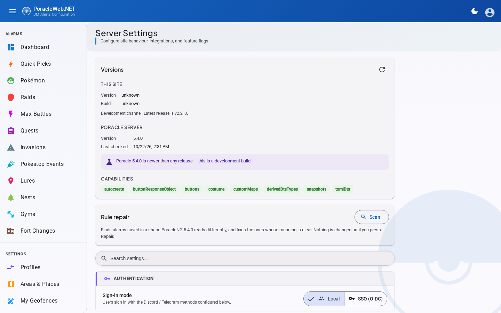
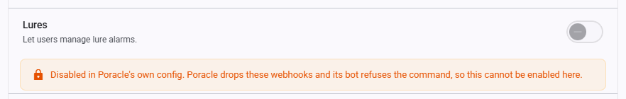
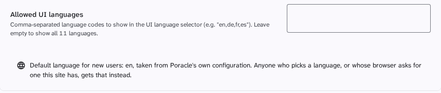

# Site Settings

Site settings are admin-configurable runtime settings stored in the `poracle_web.site_settings` database table. Unlike [appsettings.json configuration](reference.md) which requires a restart, site settings are changed at runtime via the **Admin > Server settings** page and take effect immediately.

!!! info "First-time setup"
    On startup PoracleWeb.NET writes one row, `custom_title` (`PoracleWeb.NET`), if it's missing, and never overwrites a value you've set. Every other setting has no row until an admin saves it. The server reads a missing row as that setting's default: a missing `disable_*` key leaves the feature on, and `enable_discord` and `enable_telegram` count as on unless they're stored as `false`.

## How it works

Settings live in the `poracle_web.site_settings` table (`category`, `key`, `value`, `value_type`), and **Admin > Server settings** edits them in groups. A change takes effect immediately, with no restart. Booleans are stored as the strings `"True"` and `"False"`.

Keys beginning `disable_` store the *disabled* state, but the admin page shows them as positive switches: the switch is on when the feature is available. The value is inverted on read and write, so the tables below describe the key, not the switch. Some settings only appear when another is on; `allowed_role_ids`, for example, shows once `enable_roles` is enabled.

---

## Admin settings cards

A status line under the search on **Admin > Server settings** sums up two cards ("PoracleWeb.NET 2.30 · PoracleNG 5.4.0 · Rules: nothing to repair") and turns amber or red when one needs a look; **Details** opens them. The Versions card reports the running PoracleWeb.NET and PoracleNG versions and whether PoracleNG meets the minimum. The Rule repair card scans for stored alarms that PoracleNG 5.4.0 reads differently (invasions saved as `metal`, raids saved with Pokémon 0, raids and max battles for any boss saved as Pokémon 9000) and repairs them on request, and lists the rules 5.4.0 won't save at all under "Cannot be edited", to fix by hand. Nothing is written before you press Repair. See [Upgrading to PoracleNG 5.4.0](../getting-started/upgrading-to-poracleng-5-4.md#run-the-rule-repair).

## Branding

Customize the appearance and navigation of your PoracleWeb.NET instance.

| Key | Label | Type | Description |
|---|---|---|---|
| `custom_title` | Site Title | string | Name shown in the browser tab and page header. One of the six keys served without authentication, alongside `allowed_languages`, `enable_discord`, `enable_telegram`, `favicon_url` and `signup_url`. |
| `header_logo_url` | Header Logo URL | url | URL for a custom logo image in the header (replaces the default Pokeball). Leave empty for the default logo. |
| `hide_header_logo` | Hide Header Logo | boolean | Hide the logo from the header entirely. |
| `favicon_url` | Favicon URL | url | URL for the browser-tab icon. Square image recommended (32×32 minimum). Supports `.ico`, `.png`, and `.svg`. Leave empty to use the bundled default. Also loads on the public login page. See [Favicon caveats](#favicon-caveats) below. |
| `custom_page_name` | Nav Link Label | string | Label for a custom navigation link in the sidebar (e.g., "Back To Map"). Leave empty to hide. |
| `custom_page_url` | Nav Link URL | url | URL the custom nav link points to. |
| `custom_page_icon` | Nav Link Icon | string | FontAwesome class for the nav link icon (e.g., `fas fa-map`). |

### Favicon caveats

- **Browser cache.** Browsers cache favicons aggressively and often ignore normal reloads. After changing `favicon_url`, users must clear their browser cache or hard-refresh (<kbd>Ctrl</kbd>+<kbd>F5</kbd> / <kbd>Cmd</kbd>+<kbd>Shift</kbd>+<kbd>R</kbd>) to see the new icon. Mobile browsers may require removing and re-adding any home-screen bookmark.
- **Content Security Policy.** If the instance is served behind a reverse proxy or CDN that adds a CSP header, the favicon URL's origin must be allowed by the `img-src` directive. When the fetch is blocked, the browser silently falls back to the bundled default — the preview in the admin UI will show the error state to help diagnose this.
- **Supported formats.** `.ico`, `.png`, and `.svg` are reliably supported by current browsers. Avoid animated GIFs — support is inconsistent.
- **Hosting.** Any HTTPS URL works. If you want to serve the favicon alongside PoracleWeb.NET itself, drop the file into the container's `wwwroot/` and reference it by relative path (e.g. `my-favicon.png`).

---

## Alarm Types

Control which alarm categories are available to users. Disabling a type hides it from the sidebar navigation and prevents access.

| Key | Label | Type | Description |
|---|---|---|---|
| `disable_mons` | Pokémon | boolean | Hide Pokémon alarms from all users. The page, the sidebar item and the API all go; rules already stored stay dormant and return if you switch it back on. |
| `disable_raids` | Raids | boolean | Hide raid alarms from all users. The page, the sidebar item and the API all go; rules already stored stay dormant and return if you switch it back on. |
| `disable_quests` | Quests | boolean | Hide quest alarms from all users. The page, the sidebar item and the API all go; rules already stored stay dormant and return if you switch it back on. |
| `disable_invasions` | Invasions | boolean | Hide invasion alarms from all users. The page, the sidebar item and the API all go; rules already stored stay dormant and return if you switch it back on. |
| `disable_lures` | Lures | boolean | Hide lure alarms from all users. The page, the sidebar item and the API all go; rules already stored stay dormant and return if you switch it back on. |
| `disable_nests` | Nests | boolean | Hide nest alarms from all users. The page, the sidebar item and the API all go; rules already stored stay dormant and return if you switch it back on. |
| `disable_gyms` | Gyms | boolean | Hide gym alarms from all users. The page, the sidebar item and the API all go; rules already stored stay dormant and return if you switch it back on. |
| `disable_fort_changes` | Fort changes | boolean | Hide fort-change alarms from all users. The page, the sidebar item and the API all go; rules already stored stay dormant and return if you switch it back on. |
| `disable_maxbattles` | Max battles | boolean | Hide max-battle alarms from all users. The page, the sidebar item and the API all go; rules already stored stay dormant and return if you switch it back on. |
| `disable_showcase` | Pokéstop events (Showcase, Kecleon, Gold Stop) | boolean | Hide Showcase, Kecleon and Gold Stop alarms from all users. The page, the sidebar item and the API all go; rules already stored stay dormant and return if you switch it back on. PoracleNG's own `[general] disable_showcase = true` also forces this off. Absent or unreadable, it leaves the page on. While the page is off, the three events stay available from the invasion add dialog. |

!!! info "A disabled type disappears completely"
    The sidebar item, the dashboard count, the **New alarm** menu entry and the page all go, and every endpoint for that type answers
    403 — reads, writes and deletes alike. Admins are not exempt.

    Rules a user already had are **not deleted**. They stay in Poracle's database, dormant: a disabled
    type's alerts are dropped upstream, so nothing fires. Switch the type back on and everything
    reappears exactly as it was.

!!! warning "Poracle can switch these off too, and it wins"
    Poracle has its own per-type flags (`disable_pokemon`, `disable_raid`, `disable_quest`, `disable_invasion`, `disable_lure`, `disable_nest`, `disable_gym`, `disable_max_battle`, `disable_fort_update`). When one of those is set, its processor drops the webhook and its bot refuses the command, so the type can never fire — and this site now honours that. A type is off if **either** side disables it.

    The toggle for a type Poracle has disabled renders off and greyed, with a note saying where the decision came from; switching it on here would promise something every write refuses. This is also the case where leaving existing alarms deletable matters most: Poracle's bot refuses the matching command while the type is off, so this page is the only place left to clean up.

     Your own toggles still work for everything Poracle leaves enabled, and they gate features Poracle has no opinion about.

    If Poracle is unreachable, or too old to report its flags, the settings on this page are in sole charge — the gate fails **open** rather than disabling every type because a server was down.

---

## Features

Toggle user-facing features on or off.

| Key | Label | Type | Description |
|---|---|---|---|
| `disable_areas` | Areas | boolean | Prevent users from managing their area subscriptions. |
| `disable_profiles` | Profiles | boolean | Prevent users from creating and switching alarm profiles. |
| `disable_location` | Location | boolean | Gates the whole location API, not just the pin. Users cannot set their pin, and saved places, static and distance map images, and the weather lookups on the dashboard all stop with it. Since "Near a place" delivery scope measures from a saved place or the pin, alarms already using it keep working but nothing new can be pointed at a place. |
| `disable_nominatim` | Geocoding | boolean | Stops address search and reverse lookup. Both go to PoracleNG's `/api/geocode` routes, which call whichever geocoder PoracleNG is configured for; with this on they answer 403 and the location dialog hides its search box. Users can still set a pin by coordinates or on the map. The key keeps its old name, though Nominatim is no longer called directly. |
| `disable_update_check` | Check for updates | boolean | Controls the version check against `api.github.com` and `raw.githubusercontent.com`, which runs when an admin opens the Versions card and is cached six hours afterwards. Two anonymous GETs, no identifiers and no payload. Like every `disable_` key the switch reads the positive way round: **Check for updates** on (key absent or `False`) runs the check; off (key `True`) stops it, and the Versions card still reports the running versions but can't say whether they're current. |
| `disable_user_geofences` | Custom Geofences | boolean | Hides the My Geofences page and the admin review queue, and 403s the create, rename, import, submit, activate and deactivate endpoints. Delete is deliberately left open, so a user can still clear out a geofence they no longer want. Geofences that already exist keep being served in the [geofence feed](../features/custom-geofences/index.md) and keep matching. See [Admin operations](../features/custom-geofences/admin-operations.md). |
| `enable_templates` | Templates | boolean | Allow users to choose notification message templates. |
| `allowed_languages` | Allowed UI languages | csv | Comma-separated language codes users can select (e.g., `en,de,fr`). Leave empty to show all 11 languages. Applies to the signed-out login page as well. English is always available. |

Beneath that row the page reports Poracle's own configured locale, which is the language a
first-time visitor lands on when neither a stored choice nor their browser can answer. It is read
from Poracle and cannot be set here — see [Values that are not settings](#values-that-are-not-settings).

---

## Maps

Which tiles every map on the site draws with: the areas map, the location picker, the geofence
detail map and the geofence thumbnails.

!!! tip "If you just want working maps, do nothing"
    A fresh install draws OpenStreetMap without any configuration. Everything below is for choosing
    something else.

### Settings

| Key | Label | Type | Description |
|---|---|---|---|
| `basemap_provider` | Basemap Provider | string | Provider id: `osm`, `esri-street`, `esri-canvas`, `esri-imagery`, `carto-positron`, `carto-voyager`, `stadia-smooth`, or `custom` for your own tile URL. Empty means nothing has been chosen — see [What "not set" means](#what-not-set-means). |
| `basemap_key` | Basemap API Key | string | API key for the chosen provider. Required by CARTO and Stadia, ignored by the rest. **Not a secret** — see [The key is public](#the-key-is-public). |
| `basemap_name` | Custom Basemap Name | string | What `custom` is called in the layers menu on each map. Empty renders as "Custom", which tells a viewer nothing about the map they are being offered. Capped at 40 characters and always rendered as text, never as markup. |
| `basemap_url` | Basemap Tile URL | url | Tile template for `custom`. Must be an absolute `http(s)` URL. Put `{key}` where the provider expects the key; `{s}`, `{z}`, `{x}`, `{y}` and `{r}` are Leaflet's. |
| `basemap_url_dark` | Basemap Tile URL (Dark) | url | Optional. Used in place of `basemap_url` while a viewer has the dark theme on. |
| `basemap_attribution` | Basemap Attribution | string | Attribution for `custom`. Rendered as plain text, so a link in it shows as text rather than a link. Built-in providers carry their own and ignore this. |

### Choosing a provider

Pick the provider first. What you fill in after that follows from the pick, and the admin page hides
the fields that do not apply — so the section never shows you a box with no bearing on your choice.

| Provider | What to fill in |
|---|---|
| OpenStreetMap, Esri Streets, Esri Gray Canvas, Esri World Imagery | Nothing. They are keyless and carry their own URL, attribution and zoom limit. |
| CARTO Positron, CARTO Voyager, Stadia Alidade Smooth | **Basemap API key**, and nothing else. |
| Custom tile URL | **Name**, **Tile URL**, optionally a **dark** URL, and **Attribution**. The key field appears only if your URL contains `{key}`. |

Picking a name sets the URL, the attribution and the zoom limit together, so there is one decision
rather than three chances to get it wrong.

| Id | Provider | Needs a key | Dark variant | Max zoom |
|---|---|---|---|---|
| `osm` | OpenStreetMap | no | — | 19 |
| `esri-street` | Esri Streets | no | — | 19 |
| `esri-canvas` | Esri Gray Canvas | no | yes | **16** |
| `esri-imagery` | Esri World Imagery (satellite) | no | — | 19 |
| `carto-positron` | CARTO Positron | yes | yes (Dark Matter) | 20 |
| `carto-voyager` | CARTO Voyager | yes | yes (Dark Matter) | 20 |
| `stadia-smooth` | Stadia Alidade Smooth | yes | yes | 20 |

In the dark theme, a viewer on the site default gets a dark map. A provider with its own dark variant
draws that (CARTO Dark Matter for both CARTO entries). One without (OpenStreetMap, Esri Streets) is
swapped for Esri's dark gray, the dark half of Esri Gray Canvas, which needs no key. Two are left as they
are: Esri World Imagery, which is photographs, and a custom tile URL, since your viewers shouldn't be sent
to Esri behind your back; set **Basemap tile URL (dark)** to give a custom basemap a dark style. A viewer
who picked a basemap from the layers button gets what they picked in both themes, and the menu's
**Site default** entry names what the dark theme is drawing.

Esri Gray Canvas, and so the dark default, only has real tiles up to zoom 16. Past that the map keeps
zooming to 19 by enlarging the zoom-16 tiles, so streets look softer when you zoom right in.

A key unlocks every style in the same family, so a CARTO key gives you both CARTO entries. It never
unlocks another vendor's: one key cannot be a CARTO key and a Stadia key at once, so the styles you
have no key for are not offered.

### What "not set" means

Leaving the provider empty is a real state, not a missing one — it is what every install configured
before this setting existed has. It resolves by what else is set:

| Also set | Resolves to | Why |
|---|---|---|
| nothing | OpenStreetMap | A provider that needs no key, rather than one that reports a missing key nobody asked for. |
| `basemap_key` only | CARTO Positron | Before the provider setting existed, a key was the only way to say "use CARTO". Upgrading does not move a working CARTO install onto something else. |
| `basemap_url` only | Custom | Same reason: a tile URL on its own meant "use this URL". |

The admin page says which of these applies, so you can leave it or make it explicit.

### The key is public

`basemap_key` travels in every tile URL the browser requests, so every signed-in user receives it.
That is how a client-side basemap works and there is no way around it; restrict the key by referrer
or domain at the provider rather than trying to hide it.

It is served to non-admins deliberately, under the `basemap_` prefix in the settings allowlist.
Withholding it would protect nothing and would leave every non-admin looking at a different basemap
from the admin checking the site.

### When the chosen basemap cannot be drawn

Maps fall back to OpenStreetMap, and both the Maps section and the layers menu say so. Two things
cause it:

- **The provider needs a key and none is set.** CARTO answers **200** to a keyless request and
  returns working tiles with `API KEY REQUIRED` drawn into the image, so nothing logs and no health
  check notices ([#842](https://github.com/PGAN-Dev/PoracleWeb.NET/issues/842)). Rather than serve
  that, the site does not request it.
- **The provider cannot be resolved at all.** That's `custom` with a blank or malformed tile URL, which is
  what picking it and saving before filling the field leaves behind, or a provider id this build does
  not know after a downgrade.

Neither produces an error to notice. A URL that is not a tile template is simply never requested.

!!! warning "A wrong key is not detectable"
    Only a *missing* key can be caught. CARTO answers 200 and watermarks identically whether the key
    is absent or invalid, so a typo gets you a watermarked map with nothing to report it. If the
    watermark persists after setting a key, check the key itself.

### Each viewer can choose their own

From the layers button in the top-right corner of any interactive map. The choice is theirs alone and
is kept in their browser, like the theme and the accent colour. On offer are the keyless built-ins,
the custom URL if one is set — under the name you gave it — and the keyed styles in whichever family
your key belongs to.

!!! warning "A viewer's own choice outranks this setting, including yours"
    The menu's first entry is **Site default**, which names the provider set here and clears the
    viewer's choice. This matters most for whoever configures the setting: click the layers button
    once while testing, and every later change to `basemap_provider` will appear to do nothing on
    your own screen, because you are no longer on the site default. The Maps section says so when it
    applies to you.

### OpenStreetMap and the referrer

OSM's [tile usage policy](https://operations.osmfoundation.org/policies/tiles/) refuses a request it
cannot identify, and this site sends `Referrer-Policy: same-origin` so that remote image hosts cannot
learn where a private instance lives. Refererless tile requests come back **200** with "Access
blocked" drawn into the image — the CARTO watermark's failure mode wearing a different hat.

So the OpenStreetMap entry sets `referrerPolicy="origin"` on its own tile images: your site's host, no
path, on map tiles alone. Every other remote request the page makes — uicons, Discord avatars, fonts
— stays as unidentified as before, and nothing else in the catalogue needs the exception.

Since OpenStreetMap is what an unconfigured install draws, that disclosure is the default. If you
would rather your instance's address never reached a tile provider, pick one that needs neither a key
nor a referrer: Esri Streets, Esri Gray Canvas and Esri World Imagery all return the same bytes with
or without one. OSM also asks that heavy users run their own tiles rather than lean on its
volunteers, which is worth knowing if your instance is a busy one.

### Custom tile URLs

!!! warning "The CARTO parameter is `key`, not `api_key`"
    Both spellings return 200 and both watermark, so it is easy to "fix" this and change nothing. The
    built-in CARTO entries have it right; only a `custom` URL can get it wrong.

!!! note "Custom tile URLs must be HTTPS"
    The site's Content-Security-Policy allows images from any `https:` origin and nothing over plain
    `http:`. A custom tile server on `http://` is blocked by the browser with no error on the page —
    the map simply stays blank.

!!! info "These are the same tiles ReactMap draws"
    OSM, Satellite and Dark Matter use the URLs from ReactMap's `config/default.json`, and CARTO
    Voyager uses its `voyager_labels_under` variant, so the same basemap looks the same on both
    sites. `basemap.service.spec.ts` pins those four URLs against a catalogue edit drifting away from
    it. The one difference is the key: the CARTO entries here carry one, which is what keeps the
    watermark off them.

---

## Administration

Access control.

| Key | Label | Type | Description |
|---|---|---|---|
| `enable_roles` | Enable Role-Based Access | boolean | Only allow users with specific Discord roles to log in. Requires `Discord:BotToken` and `Discord:GuildId` in [appsettings](reference.md). |
| `allowed_role_ids` | Allowed Role IDs | csv | Comma-separated Discord role IDs (e.g., `123456789,987654321`). A user needs **at least one** of these roles to log in. Leave empty to allow all. Only visible when `enable_roles` is enabled. |
| `delegation_poracle_channels` | Follow Poracle's channel admins | boolean | Off when unset. When on, anyone PoracleNG lists in `[[discord.delegated_admins]]` or `[[telegram.delegated_admins]]` as admin of a channel can manage that channel's alarms here as a delegate, provided the channel is registered as a destination on this site. A guild-wide entry covers only the registered channels. Saving it takes effect straight away rather than after the one-minute role cache. See [Following Poracle's channel admins](../features/webhooks.md#following-poracles-channel-admins). |

!!! warning "Role-based access prerequisites"
    Role-based access requires `Discord:BotToken` and `Discord:GuildId` to be configured in appsettings. Without these, role checks cannot be performed and the setting has no effect.

!!! note "Formatting `allowed_role_ids`"
    Enter the IDs bare: `123456789,987654321`. Surrounding quotes are stripped, but any entry that is not a numeric Discord role ID is ignored and logged as a warning. If nothing usable is left, non-admin logins are denied with `role_check_failed` rather than silently allowing everyone. Admins can always log in, so a bad value can be corrected from the admin panel.

---

## Discord

| Key | Label | Type | Description |
|---|---|---|---|
| `enable_discord` | Enable Discord Login | boolean | Allow Discord sign-in. Requires `Discord:ClientId` and `Discord:ClientSecret` in [appsettings](reference.md). Nothing here affects PoracleNG's bot delivery — it only controls the login button. |

!!! note "Admins are exempt"
    The check runs only for non-admins, and only when the value is explicitly `"false"`. An absent key
    allows Discord login. Admins can always sign in with Discord, so switching this off by mistake is
    recoverable from the admin panel rather than a lockout.

---

## Telegram

Configure Telegram authentication alongside or instead of Discord.

| Key | Label | Type | Description |
|---|---|---|---|
| `enable_telegram` | Enable Telegram Login | boolean | Allow users to log in and manage alarms via Telegram. |
| `telegram_bot` | Bot Username | string | Telegram bot username (without the `@` prefix). Used as a **fallback** — see the note below. |

!!! note "Backend configuration also required"
    Enabling Telegram in site settings also requires `Telegram:BotToken` and `Telegram:BotUsername` to be set in [appsettings](reference.md).

!!! info "`telegram_bot` is a fallback, not an override"
    The login widget takes its bot username from `Telegram:BotUsername` (`TELEGRAM_BOT_USERNAME`) when
    that is set, and falls back to this setting when it is not. Configuration deliberately wins: before
    v2.14.0 nothing read this field at all, so a deployment may hold a stale value someone typed in while
    it was inert, and letting that override a working environment variable would break Telegram login.

---

## Authentication

Runtime toggles for the generic external SSO / OIDC sign-in flow. See [External SSO / OIDC](external-sso.md) for the full provider setup and [OIDC Refresh Tokens](oidc-refresh-tokens.md) for silent session refresh.

| Key | Label | Type | Description |
|---|---|---|---|
| `enable_oidc` | Authentication Mode (Local ⇄ SSO) | boolean | Controls the admin **Authentication** Local ⇄ SSO mode switch. **Opt-in:** SSO is active only when this is explicitly the string `"true"`. When the setting is **absent** (or `"false"`), the instance stays in **Local mode** — this is the default. Admins can always sign in via local auth even when SSO is on, so they can switch the mode back if the provider breaks. |
| `enable_oidc_slo` | Single Logout (Sign Out Everywhere) | boolean | Toggles RP-initiated single logout ("Sign out everywhere"). When **absent** this is **on** once an end-session endpoint is configured (`OIDC_END_SESSION_URL` in [appsettings](reference.md)). Set to `"false"` to disable single logout and fall back to a local logout. |

!!! note "Absent = default"
    These two settings differ from most boolean toggles on this page: their behaviour depends on whether the key is **present**. `enable_oidc` defaults **off** (Local mode) and must be explicitly `"true"` to enable SSO. `enable_oidc_slo` defaults **on** once an end-session endpoint is configured in [appsettings](reference.md), and only turns off when explicitly set to `"false"`.

!!! info "Silent refresh has no runtime toggle"
    Whether silent session refresh is active is controlled solely by the `OIDC_USE_REFRESH_TOKENS` [appsettings](reference.md) flag — there is intentionally **no** `enable_oidc_refresh` site setting. Refresh is coupled to the per-login JWT lifetime, so it's a deploy-time decision (turning it off at runtime would strand the short-lived tokens of users who are already signed in). See [OIDC Refresh Tokens](oidc-refresh-tokens.md).

---

## Analytics & Links

| Key | Label | Type | Description |
|---|---|---|---|
| `signup_url` | Signup URL | url | External registration page. When set, someone who reaches the login page without a Poracle account gets a sign-up button pointing here. Served on the public login page before anyone signs in, so treat it as public. Leave empty to hide the button. |
| `support_url` | Support URL | url | Where your members go for help: a support channel, a ticket channel or a help page. Linked from the disabled-account banner ("Still disabled? Contact support") and the Help page footer. Leave empty and neither shows a link; the footer then tells members to contact the team that runs the site. Served to every signed-in user. |

---

## Retired keys

Ten keys were withdrawn from the admin UI once it became clear nothing in the product read them. They
saved, persisted and read back while their descriptions promised behaviour the app does not have:

`disable_geomap`, `disable_geomap_select`, `register_command`, `location_command`, `provider_url`,
`gAnalyticsId`, `patreonUrl`, `paypalUrl`, `site_is_https`, `debug`.

Existing rows are left in `site_settings` rather than deleted, and the settings UI filters them out of
its "Other" catch-all. Nothing reads them, so their values have no effect either way. See #547, #560
and #589.

`disable_geomap` and `disable_geomap_select` are legacy PoracleJS keys describing a map picker this app
does not have. `provider_url` still exists in the Poracle bot's own config, which is where the geocoder
URL is actually read from — the site setting was a duplicate that fed nothing.

---

## Hidden Areas

| Key | Type | Description |
|---|---|---|
| `hidden_areas` | json | Area names taken off the menu, as a JSON array of lowercase strings. |

Managed from **Admin → Areas** rather than edited by hand. A name listed here is served with
`userSelectable: false` in the geofence feed, which removes it from Areas & places, from the per-alarm
scope picker and from the bot's area list at once.

It does not unsubscribe anyone already using the area. See
[Hiding an area from your users](../features/custom-geofences/koji-and-regions.md#hiding-an-area-from-your-users).

A value this site cannot parse hides nothing, rather than hiding everything: the setting is read inside
the geofence feed, and failing the other way would take alerting down quietly.

---

## Icon Repository

Icon URLs are configured through the visual **Icon Repository** picker in the admin settings UI. Picking
a pack writes all six keys at once; you can also set them individually.

| Key | Type | Description |
|---|---|---|
| `uicons_pkmn` | url | Base URL for Pokémon icon images. |
| `uicons_gym` | url | Base URL for gym icon images. |
| `uicons_raid` | url | Base URL for raid icon images. Egg icons are read from `raid/egg/`. |
| `uicons_reward` | url | Base URL for quest reward images. Items are read from `reward/item/`. |
| `uicons_type` | url | Base URL for Pokémon type icons, used by the filter chips. |
| `uicons_invasion` | url | Base URL for Team Rocket grunt artwork. |

All six must point somewhere. They are independent rows, so setting five of them leaves the sixth on
the built-in default — which is how type icons on a fully configured instance ended up resolving to a
repository that had been deleted. The picker writes every key precisely so this cannot happen; a
hand-edited row can still get it wrong.

`uicons_invasion` is new. Grunt icons were built from a base hardcoded in the invasion pages rather
than read from a setting, so they ignored whichever pack the operator had chosen and went on
requesting the deleted one. They now come from this key like everything else.

There is no `uicons_item`. Items live under `reward/item/` in every UICONS pack, so the item URL is
built from `uicons_reward`. A row of that name was read for a while and never used; if your database
still has one, nothing reads it.

### The pack list

The picker starts with four packs, all in the [UICONS](https://github.com/UIcons/UIcons) format:

| Pack | Style |
|---|---|
| Nileplumb (Home) | Pokémon HOME |
| Nileplumb (Shuffle) | Pokémon Shuffle |
| Jms412 (Home) | An alternative HOME style, and what an unconfigured install uses |
| Jms412 (Pokedex) | Pokédex |

**The list is editable.** *Add pack* takes a name and the URL of a pack's UICONS folder — the one with
`pokemon/`, `gym/` and `type/` inside it — and each entry has a pencil and a bin. Your own pack on your
own network is as valid an entry as a GitHub one; plain `http://` is accepted for exactly that reason.

Adding a pack requires **Check pack** to pass first. It loads one file per category from the URL you
gave and refuses the pack if any category comes back with nothing, which is the failure this is here
to prevent: a URL that looks right, saves cleanly, and renders empty squares. It uses image loads
rather than reading the pack's `index.json`, because that would be a cross-origin request and a pack
served off your own web server very likely sends no CORS headers — refusing it would be refusing
something that works.

**Removing a pack does not change your icon settings.** If you remove the pack the site is currently
using, the icons carry on exactly as they were; the pack simply stops being offered, and reappears as
a card marked *In use* that you can add back. The same card shows up when an instance is pointed at a
pack that was never in the list, so a hand-configured instance does not look unconfigured.

*Restore built-in list* puts the four back. An empty list stays empty — it is a choice, not a missing
value — so the four do not creep back on the next page load.

The list is stored in the `icon_repos` setting as a JSON array of `{ name, base }`. It is admin-only,
and the API refuses a value it could not render: a base must be an absolute `http` or `https` URL, and
the list holds at most 25 entries.

**Whitewillem (Ingame) was removed**: the `whitewillem/PogoAssets` repository no longer exists on
GitHub. It was both the first entry in this list and the source of every built-in default, so an
instance that had never touched these settings was pointing at a dead host. That removing it took a
release is why the list is editable now. See #877.

---

## Internal Settings

The following settings exist in the database but are **not shown** in the admin settings UI. They are
managed automatically by the application and should not be modified manually.

`migration_completed` is blocked by the API for both reads and writes. `quick_picks_seeded` is not: the
SPA's auto-seed guard has to read it, so admins receive it from `GET /api/settings` and it is hidden in
the UI layer instead. Neither is visible to non-admins.

| Key | Category | Description |
|---|---|---|
| `migration_completed` | system | Left by older versions to mark the one-time copy out of `pweb_settings`. Nothing writes or reads it now, and it can stay. |
| `quick_picks_seeded` | admin | Sentinel flag indicating that the built-in quick picks have been created once. Written by `POST /api/quick-picks/seed` after a successful seed, and backfilled at startup for installations that already hold global picks. Without it an admin who deliberately deletes every preset gets them all back on their next visit. Admin-readable via the API (the SPA guard needs it) but hidden from the settings UI. |

## Values that are not settings

Some keys arrive on the settings response without being stored anywhere. They are **projections** of
another system's configuration, present so the SPA can read them like any other value.

| Key | Source | What it is |
|---|---|---|
| `poracle_locale` | Poracle's `general.locale` | The language a first-time visitor lands on, when neither a stored choice nor their browser can answer. See [Internationalization](../features/internationalization.md). |
| `poracle_alert_languages` | `availableLanguages` on Poracle's `/api/config/poracleWeb` | The language codes Poracle will accept for a user's *alert* language, comma-separated. Absent when Poracle restricts nothing, which is also what a server too old to report the field sends — the SPA reads absent as "offer everything". Nothing to do with `allowed_languages`, which restricts the *display* language. |

Both are read fresh from Poracle on one config call, cached five minutes, and **cannot be written**.
`PUT /api/settings/poracle_locale` and `PUT /api/settings/poracle_alert_languages` answer 400, and the
admin page renders the locale as a read-only line under Allowed UI languages rather than as an editable
box. The refusal matters more than it looks: a stored row would take precedence over the projected
value, so a single accidental save would pin the language default permanently and stop the site
tracking Poracle's configuration at all.

There is also `GET /api/settings/upstream-disabled`, which lists the `disable_*` keys Poracle's own
config is forcing off. Any signed-in user can read it — the nav and the route guards need it — and it
is empty when Poracle is unreachable.

---

## Sensitive Settings

Credential-bearing rows carried over from PoracleJS installs. They are hidden from the admin settings
UI groups but **are** readable by admins through the API. Prefer configuring the equivalents via
[appsettings](reference.md) environment variables instead.

| Key | Category | Description |
|---|---|---|
| `api_address` | api | Poracle API address. Prefer `Poracle:ApiAddress` in [appsettings](reference.md). |
| `api_secret` | api | Poracle API shared secret. Prefer `Poracle:ApiSecret` in [appsettings](reference.md). |
| `telegram_bot_token` | telegram | Telegram bot token. Prefer `Telegram:BotToken` in [appsettings](reference.md). |
| `scan_dbhost`, `scan_dbport`, `scan_dbname`, `scan_dbuser`, `scan_dbpass` | other | Scanner database host, port, name, user and password. Prefer `ConnectionStrings:ScannerDb` in [appsettings](reference.md). |
| `cf_id`, `cf_secret` | other | Cloudflare Access service token used by some PoracleJS deployments. |

Neither the scanner keys nor the Cloudflare pair has a named category, so rows carried over from `pweb_settings` by earlier versions sit in the catch-all `other` category.

`GET /api/settings` decides what a non-admin sees with an **allowlist**, not a denylist: the exact keys
in `SettingsController.UserVisibleKeys` plus anything beginning `basemap_`, `disable_`, `enable_` or
`uicons_`.
Everything else is admin-only. That direction matters — the previous denylist named a key `scan_db`
that matches no real row and never mentioned `cf_id` / `cf_secret`, so a scanner password and a
Cloudflare token were served to every signed-in session. With an allowlist, a new credential key is
hidden until someone deliberately adds it.
