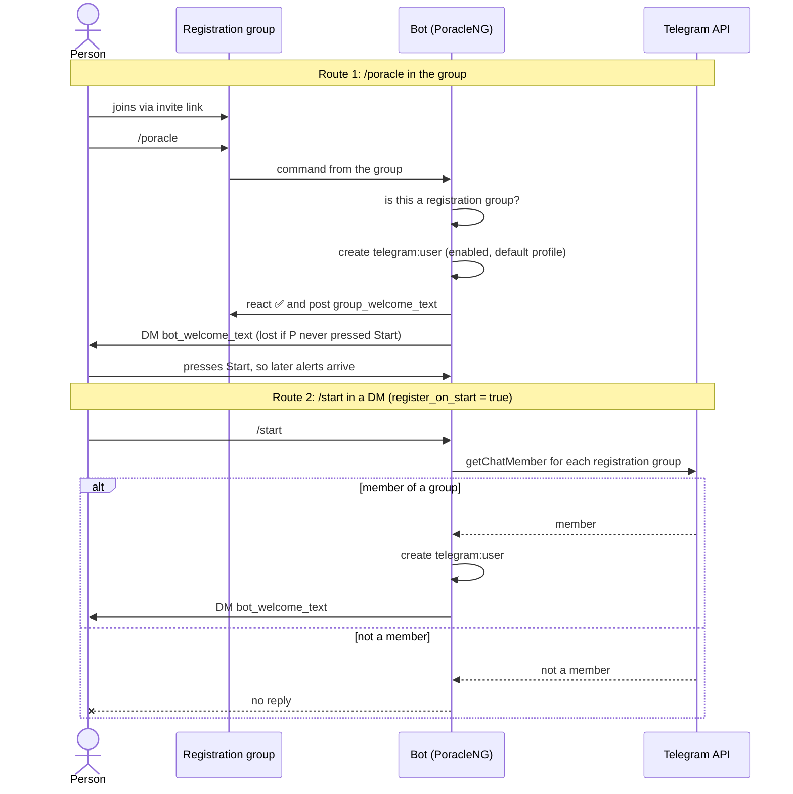

# Telegram

This page sets up Telegram on both halves: PoracleNG's bot, which registers people and sends alerts, and
PoracleWeb.NET's sign-in, which lets them manage those alerts on the web. Do the PoracleNG part first.
Nobody can sign in to PoracleWeb.NET with Telegram until PoracleNG has registered them.

For how Telegram compares with Discord, see [Discord and Telegram](../features/discord-and-telegram.md).

## 1. Create the bot

1. Message [@BotFather](https://t.me/BotFather), send `/newbot`, and follow the prompts. Note the username
   (for example `@ExampleAlertsBot`) and the token it gives you.
2. In PoracleNG's `config.toml`, set:

    ```toml
    [telegram]
    enabled = true
    token = "123456789:AA...your token..."
    ```

3. Restart PoracleNG and DM the bot `/identify`. It answers with your Telegram id. Put it in `admins`:

    ```toml
    admins = ["111111111"]
    ```

## 2. Make a registration group

PoracleNG registers only people who are members of a registration group, and it checks membership itself
with Telegram's `getChatMember`. The bot has to be in every registration group for that check to work.
Telegram bots can't list a group's members, so nothing registers people in bulk: each person registers once.

1. Create a group in Telegram and add the bot to it.
2. Send `/identify` in the group. The bot answers with the group's id, a negative number. Supergroups start
   with `-100`, and upgrading a basic group to a supergroup changes its id, so identify it again after an
   upgrade.
3. Add the id to `channels`:

    ```toml
    [telegram]
    channels = ["-1001234567890"]
    group_welcome_text = "Welcome {user}, remember to click on me and 'start bot' to be able to receive messages"
    bot_welcome_text = "You are now registered with Poracle"
    ```

4. Share the group's invite link with your members.

### With area security

When `[area_security] enabled = true`, the global `channels` list is ignored. Each community lists its own
registration groups, and joining one of them is what puts a person in that community:

```toml
[[area_security.communities]]
name = "oldtown"
allowed_areas = ["old town", "riverside"]
location_fence = ["old town"]
telegram = { channels = ["-1001234567890"] }

[[area_security.communities]]
name = "northside"
allowed_areas = ["northside"]
location_fence = ["northside"]
telegram = { channels = ["-1009876543210"] }
```

## How people register

There are three ways a `telegram:user` comes to exist.

| Route | What the person does | What happens |
|---|---|---|
| `/poracle` in a registration group | Sends `/poracle` in the group | The standard route. PoracleNG creates the account (enabled, default profile, community when area security is on), reacts ✅, posts `group_welcome_text` in the group and DMs `bot_welcome_text` |
| `/start` in a DM | Presses **Start** in a chat with the bot | Registers only when `register_on_start = true` **and** the person is already in a registration group |
| Created by an admin | Nothing | PoracleNG's API, the operator's own tools, or PoracleWeb.NET's [`link_register_missing`](#linking-with-a-missing-account). Skips the group rule |

What `/poracle` and `/start` say when they don't register someone:

| Sent | Where | Answer |
|---|---|---|
| `/poracle` | In a DM | Refused: it only works in a registration group |
| `/poracle` | In a group that isn't a registration group | "Wrong channel" |
| `/start` | DM, `register_on_start` off, not registered | "You are not registered. Please register first." |
| `/start` | DM, `register_on_start` on, not in any registration group | Nothing at all. PoracleNG stays silent (filed upstream as jfberry/PoracleNG#335) |
| `/start` | DM, already registered | Resumes alerts |

Telegram only lets a bot DM someone who has started a chat with it. Pressing **Start** in the bot's chat
counts, and so does allowing the bot to message you in PoracleWeb.NET's login widget (the site asks for
that permission). Without either, the account exists but no alert arrives, including the welcome DM.

This sequence diagram shows both self-service routes, from the person's first message to a working account.



## Removing people who leave

`check_role` re-checks every registered Telegram user's group membership every `check_role_interval` hours.
It only ever switches people off, never creates anyone, and it does nothing at all unless
`[general] role_check_mode` says what to do:

| `role_check_mode` | Someone who left every registration group |
|---|---|
| `ignore` (default) | Logged, nothing changes |
| `disable-user` | Disabled; re-enabled if they rejoin, alarms kept |
| `delete` | Deleted with their alarms |

```toml
[general]
role_check_mode = "disable-user"

[telegram]
check_role = true
check_role_interval = 6
```

Turn it on once your members have registered, not before.

## 3. Turn on Telegram sign-in in PoracleWeb.NET

1. In @BotFather, send `/setdomain`, pick the bot, and enter the site's own domain (for example
   `alerts.example.org`). The login widget works on exactly one domain, so a site served on two hostnames
   gets a working button on only one of them.
2. In PoracleWeb.NET's `.env`:

    ```bash
    TELEGRAM_ENABLED=true
    TELEGRAM_BOT_TOKEN=123456789:AA...your token...
    TELEGRAM_BOT_USERNAME=ExampleAlertsBot
    ```

    The token is the same bot's: PoracleWeb.NET uses it to check the login widget's signature. Restart after
    changing `.env`.
3. Under **Admin > Server settings > Telegram**, leave **Enable Telegram login** (`enable_telegram`) on. It's
   an immediate on/off switch on top of `TELEGRAM_ENABLED`. **Bot username** (`telegram_bot`) is only used when
   `TELEGRAM_BOT_USERNAME` is empty; see [Site settings](site-settings.md#telegram).

The widget runs in redirect mode: Telegram sends the browser back to the site with signed fields, and the
server checks them. It does not use the widget's callback mode, which needs `eval` and is refused by the
site's Content Security Policy.

## 4. Linked accounts

Members who use both apps can [link](../features/linked-accounts.md) their Discord and Telegram accounts. The
settings are under **Admin > Server settings > Linked accounts**.

- **Telegram registration group link** (`telegram_registration_url`). Set it to the group's invite link,
  such as `https://t.me/+abc123`. It must be an `https://` link on `t.me` or `telegram.me`. While someone's
  Telegram side is waiting to register, Linked accounts shows a **Join the Telegram group** button that opens
  it. With area security, use the group most of your members should join; the page shows one link.

### Linking with a missing account

**Register the other account when linking** (`link_register_missing`) is off by default. Off, someone who
links a Telegram account PoracleNG doesn't know sees it as "Waiting to register" until they send `/poracle`
in the group. On, PoracleWeb.NET creates the `telegram:user` straight away and copies areas, location,
profiles (on the same numbers) and saved places from the Discord account. That skips the group rule. With
`role_check_mode` set to `disable-user` or `delete` and `check_role` on, the next check switches off or
deletes an account created this way unless the person also joins a registration group.

## Troubleshooting

| Symptom | Cause | Fix |
|---|---|---|
| No Telegram button on the login page or on Linked accounts | `TELEGRAM_ENABLED` isn't `true`, `enable_telegram` is off, or no bot username is set | Set all three, then restart for `.env` changes |
| The button says "Bot domain invalid" | The bot's domain doesn't match the site | `/setdomain` in @BotFather with the exact hostname people use |
| Telegram sign-in says the account isn't registered | The person never registered with PoracleNG | Join the registration group and send `/poracle` there |
| `/poracle` answers "wrong channel" | That group's id isn't in `channels` (or the community's `telegram.channels`) | `/identify` in the group and add the id; re-check after a supergroup upgrade |
| `/start` does nothing | `register_on_start` is on and the person isn't in a registration group | Join the group first, or send `/poracle` there |
| `/start` says "You are not registered" | `register_on_start` is off | Send `/poracle` in the registration group |
| Registered, but no alerts arrive | The person never started a chat with the bot | Press **Start** in the bot's chat |
| People are never removed after leaving | `role_check_mode` is `ignore` (the default) or `check_role` is off | Set both, as above |

More in [Troubleshooting](../troubleshooting.md#telegram-and-linked-accounts).
