# Alarm Management

PoracleWeb.NET provides a browser-based UI for managing Poracle notification filters. Users create alarms that tell Poracle which Pokemon, Raids, Quests, and other events to send as DM notifications.

All alarm CRUD operations are proxied through PoracleNG's REST API, which handles duplicate detection and reloads its state after every change. See [PoracleNG API Proxy](../architecture/poracleng-proxy.md) for technical details.

If PoracleNG doesn't answer, every alarm endpoint answers 503 ("PoracleNG could not be reached. Try again shortly.") and the page shows a "temporarily unavailable" message rather than an empty list. Nothing is cached locally, so nothing can be edited until it's back.

## Alarm types

| Type | Description |
|---|---|
| Pokemon | Filter by species, IV, CP, level, PVP rank, gender, size, costume. See [Costume filter](#costume-filter). |
| Raids | Filter by raid boss, level, move, evolution, costume, EX eligibility, specific gym, RSVP notification mode. See [Raid level selector](#raid-level-selector) and [Costume filter](#costume-filter). |
| Eggs | Filter by egg level, EX eligibility, specific gym, RSVP notification mode. See [Raid level selector](#raid-level-selector). |
| Quests | Filter by reward — Pokemon encounter, item, mega energy, candy, stardust or PokéCoins — with an optional minimum amount. See [Quest alarm filters](#quest-alarm-filters). |
| Invasions | Filter by grunt type and gender. See [Invasion alarm filters](#invasion-alarm-filters). |
| Pokéstop Events | Showcase, Kecleon and Gold Stop events at a pokestop. See [Pokéstop Event alarms](#pokestop-event-alarms). |
| Lures | Filter by lure type. See [Lure alarm filters](#lure-alarm-filters). |
| Nests | Filter by nesting Pokemon species and spawn rate. See [Nest alarm filters](#nest-alarm-filters). |
| Gyms | Filter by team changes, open slots, battle activity, specific gym. See [Gym alarm filters](#gym-alarm-filters). |
| Fort Changes | Filter by fort type (pokestop/gym), change types (name, location, image, description, removal, new) |
| Max Battles | Filter by battle level (1-5 Dynamax, 7/8 Gigantamax), specific Pokemon, Gigantamax-only toggle. See [Max Battle alarm filters](#max-battle-alarm-filters). |

## Creating alarms

Each alarm type has a dedicated page accessible from the sidebar navigation. The creation flow:

1. Click the **+** (add) button
2. Select the Pokemon/raid/quest target using the selector dialog
3. Configure filter options (IV range, CP range, level, etc.)
4. On the **Delivery** tab, answer "Where should this alert reach you?" — see [Where an alert reaches you](#where-an-alert-reaches-you)
5. Optionally select a **template** for notification formatting
6. Save the alarm

## Editing alarms

Open an alarm's edit dialog from its card. Changing anything and saving replaces the rule upstream.

All eleven types take a uid-addressed replace: the rule is swapped in one call rather than
deleted and re-created, so there is no window in which the alarm does not exist. Lure and max battle
edits used to have exactly that window and no longer do.

!!! note "An edit keeps the alarm's internal id"
    PoracleNG 5.4.0 puts the replaced rule back under its old `uid`, so the card, its filters and its
    scope are all unchanged after a save. If PoracleNG can't reassign the id it logs that and the rule
    comes back under a new one, which is rare; [Quick Pick](#quick-picks) applied state follows the new
    id, so a pick's remove button keeps working on a rule you have since edited. The card also stays
    where it was in the grid; see [Card order](#card-order).

## Where an alert reaches you

Every alarm answers the same question, and the **Delivery** tab of every add and edit dialog asks it outright: *Where should this alert reach you?* Three options, one radio group.

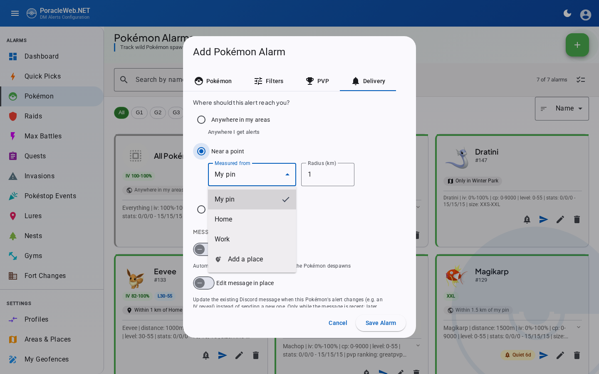

| Option | What it means |
|---|---|
| **Anywhere in my areas** | The alarm inherits whatever areas the active profile subscribes to. This is the default and the behaviour every alarm had before per-alarm scope existed. |
| **Near a point** | A radius around one fixed point. **Measured from** picks the point: your pin, or any [saved place](#saved-places). **Add a place** in the same select opens the map picker without losing the alarm you are editing. |
| **Only in specific areas** | A list of areas for this alarm alone. It *replaces* the profile's area list rather than narrowing it, and geofences you drew yourself are offered alongside the admin areas. |

The list under **Only in specific areas** holds the areas the active profile subscribes to, not every
area on the instance, plus your own drawn geofences. On a server shared between communities the whole
list is hundreds of areas from places you have nothing to do with, and this option narrows an alarm
within what you already get rather than subscribing you to something new. An area the alarm already
carries stays on the list even if you have since unsubscribed from it, so editing that alarm does not
quietly drop it. Matching is case-insensitive, because subscriptions are stored lowercased while the
area list carries the published name.

The three are exclusive rather than combinable, because PoracleNG refuses every mixture of them: a place with areas, areas with a radius, and a place without a radius are all rejected upstream. Modelling the choice as a radio group means those states can't be typed in the first place.

Under the hood the picker writes three fields. "Anywhere in my areas" clears both overrides and sends `distance = 0`. "Near a point" sends the radius in metres, plus `override_location_label` when a saved place is chosen and nothing when the pin is. "Only in specific areas" sends `override_areas` and forces `distance` to 0. Both overrides are always sent explicitly, including empty, because a null means "leave what's stored" on the write path. Without that you could set an override and never take it off.

A radius you type runs from 0.1 to 100 km. Outside that the field says so and Save stays off. An alarm already stored with a radius outside that range (the API itself allows up to half the Earth's circumference) keeps it, to the metre, through an edit that leaves the radius alone; only a changed radius is held to the range. To set a radius past 100 km on existing alarms, use the bulk **Change radius**.

If you choose "Near a point" without ever having set a pin, the picker says so and offers a **Set your pin** button in place, rather than saving an alarm that measures from 0,0.

!!! note "Your own geofences work here"
    PoracleWeb.NET serves user-drawn geofences with `userSelectable: false` to keep them out of the bot's `!area` picker, so PoracleNG would normally refuse them in `override_areas`. PoracleWeb.NET checks each name itself (selectable for you, one of your own drawn geofences, on your active profile, or already on the alarm you're editing) and then asks PoracleNG to save the alarm with those names trusted. A geofence you drew can scope one alarm whether or not your profile subscribes to it, and nothing is written to PoracleNG's database directly. See [Custom geofences](custom-geofences/key-concepts.md).

!!! note "An Add that would replace another alarm is refused"
    PoracleNG treats an alarm that differs from one you already have in a single setting (the distance, the template or the clean flag) as an update of that alarm, not a new one. Before saving, PoracleWeb.NET asks PoracleNG what an Add would do. If it would take another alarm over, you get "Another alarm of this type already uses those settings. Edit or remove that one instead." and nothing changes. If the alarm already exists exactly, nothing is written. Editing an alarm into a copy of another one is refused the same way. Max battles follow the same rule, so a second alarm for the same boss that differs only by radius is refused where it used to stack.

    Pokemon is the exception for the clean setting. An Add that matches an existing Pokemon rule in everything but Clean mode comes back as "already tracked" and the stored rule keeps its old setting. To change Clean mode on a Pokemon rule, edit it.

    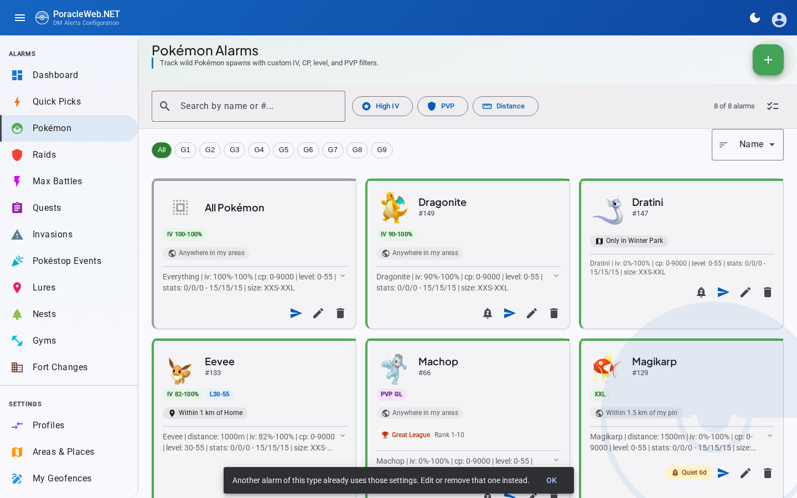

!!! note "An alarm PoracleNG can't store is refused whole"
    A few shapes have no v2 representation: an egg without a level (old quick picks and import files can carry one), an invasion limited to gender 3, a PVP league other than 500, 1500 or 2500. Saving one fails with "PoracleNG can't store this alarm as it is: ... Nothing was changed." naming the field, rather than dropping the part PoracleNG can't hold.

### Saved places

A place is a named point ("home", "work", "the gym") that an alarm can measure from instead of your profile pin. They live on the **Areas & Places** page, below the pin and the area map. (`/places` still resolves; it redirects to `/areas`.)

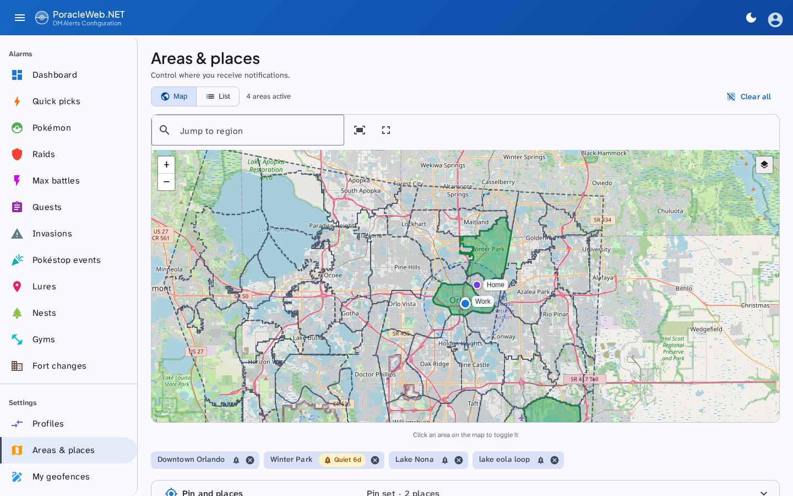

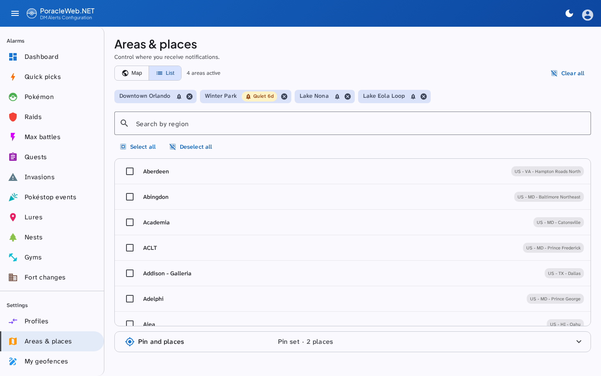

The pin is set from the **My pin** card on the same page, through a map picker with an address search; the search goes through PoracleNG's geocoder, and the `disable_nominatim` site setting hides it.

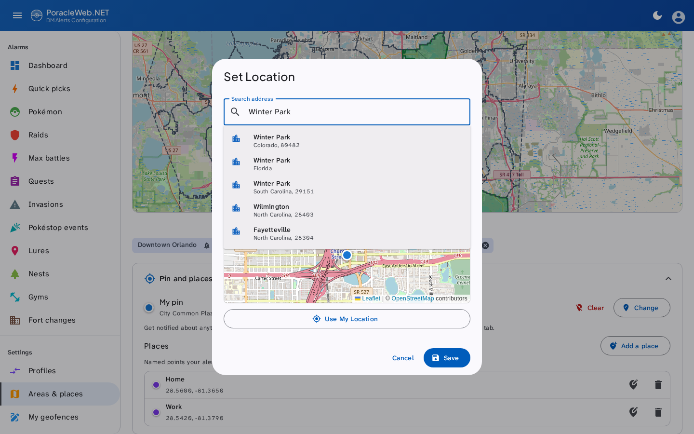

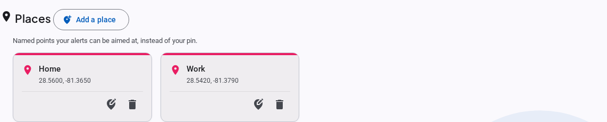

Add one with **Add a place**: drop the marker, then name it. Names are yours to choose and are what an alarm's `override_location_label` refers to. Places are user-scoped, not profile-scoped.

A name you already have is refused, and so is one longer than 64 characters — the column will not hold
it. Both come back with the reason against the field rather than as a server error.

To move one, use the pencil beside the bin on its card. It reopens the same map picker
adding one does, and the label is untouched, so every alarm aimed at that place follows it. There is
no naming step, because the label is what the alarms point at and changing it is a different act.

!!! note "Moving needs a reachable PoracleNG"
    Every supported PoracleNG (5.4.0 and later) has the endpoint, so the pencil is always there. If
    PoracleNG is unreachable the move fails with an error. Without the endpoint the only route would be
    delete-and-re-add, which is refused while any alarm still points at the place, so those alarms
    would have to be repointed first.

Deleting a place that alarms still point at is refused. `DELETE /api/location/places/{label}` answers 409 with a `referencingRules` list, and the UI names the alarms so you know what to repoint first.

The API is four endpoints on `LocationController`, all gated by `disable_location`:

| Endpoint | Purpose |
|---|---|
| `GET /api/location/places` | Every place plus the profile pin, as `{ default, named }`. `default` is null when the user has never set a pin. |
| `POST /api/location/places` | Saves a place. A label PoracleNG refuses comes back as a 400 the dialog shows against the field. |
| `PUT /api/location/places/{label}` | Moves a place, keeping its label. 409 with the version it needs on a server without the route. |
| `DELETE /api/location/places/{label}` | Deletes a place, or 409s with the alarms still using it. |

### Changing scope from a card

Every alarm card carries a scope chip reading the alarm's answer back to you: "Anywhere I get alerts" when the profile has no areas selected, otherwise "Anywhere in my areas", "Within 2 km of Home", "Only in Terrigal, Erina". Clicking it opens the same picker in a small dialog, so one alarm's scope can be changed without opening its edit dialog.

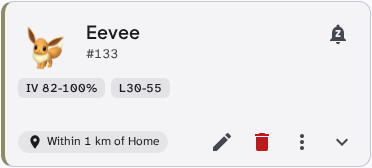

## Default delivery scope (Alert Defaults)

By default, every new alarm opens pre-set to **Areas** (geofence-based — the alarm sends `distance = 0`). If you usually track by radius, you can change that default so new alarms open on **Distance** with a radius you choose, instead of switching the location mode and re-typing a distance on every add.

Open the **user menu** (your avatar, top-right) and select **Alert Defaults**:

| Setting | What it does |
|---|---|
| Default mode | **Areas** or **Distance** for new alarms |
| Default distance | When Distance is the default, the radius (0.1–100 km) used to pre-fill new alarms. A live delivery preview shows what the choice covers |
| Measured from | Also Distance-only: the pin, or a [saved place](#saved-places) new alarms should measure from. Switching the default back to Areas clears it, since a place without a radius is a scope PoracleNG refuses |

The preference is **per-browser** (stored in `localStorage` under `poracle-default-alert-mode` / `poracle-default-alert-distance-km` / `poracle-default-alert-place`, the same pattern as the theme and language settings) and is read by the `AlertDefaultsService`. It seeds the scope picker in **every add-alarm dialog** and in the **[Quick Pick](#quick-picks) apply dialog**.

!!! note "Applies to new alarms only"
    Alert Defaults only changes what the add/apply dialogs open with. Existing alarms are untouched, and you can still set a different scope on any individual alarm before saving it. Because the preference lives in the browser, it does not sync across devices.

## Pokemon Availability

When a [Golbat scanner](../configuration/reference.md#golbat-api) is configured, the Pokemon selector shows which species are currently spawning in the wild. This helps users create alarms for Pokemon that are actually available to encounter.

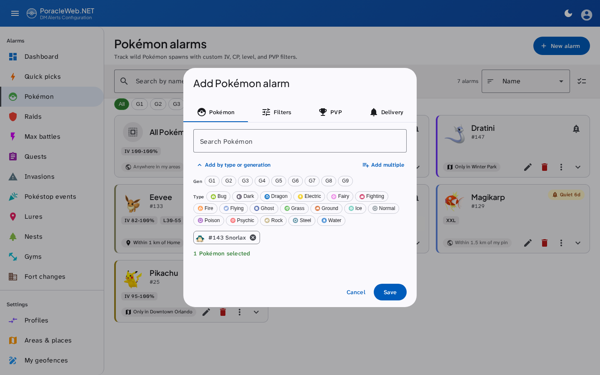

### How it works

1. The backend fetches spawn data from Golbat's `GET /api/pokemon/available` endpoint
2. Results are cached for 5 minutes with a stale-data fallback if Golbat goes down
3. The frontend fetches availability via `GET /api/pokemon-availability` and auto-refreshes every 5 minutes in the background
4. The Pokemon selector renders availability indicators when data is available

### What the user sees

A **Live > Spawning** toggle below the Gen and Type filter rows narrows the list to species spawning now. Small green dots mark available Pokemon in both the autocomplete dropdown and the tile grid, and unavailable ones get a muted grey dot. While any filter (Gen, Type or Spawning) is active, spawning species sort to the top, and a "X species active" label counts them.

### Feature gating

The availability UI is **automatically hidden** when Golbat is not configured. No admin toggle is needed — the feature is infrastructure-driven.

To turn it on, set `GOLBAT_API_ADDRESS` (the Golbat API's URL, for example `http://localhost:9001`) and `GOLBAT_API_SECRET` in your `.env`.

## Alarm cards

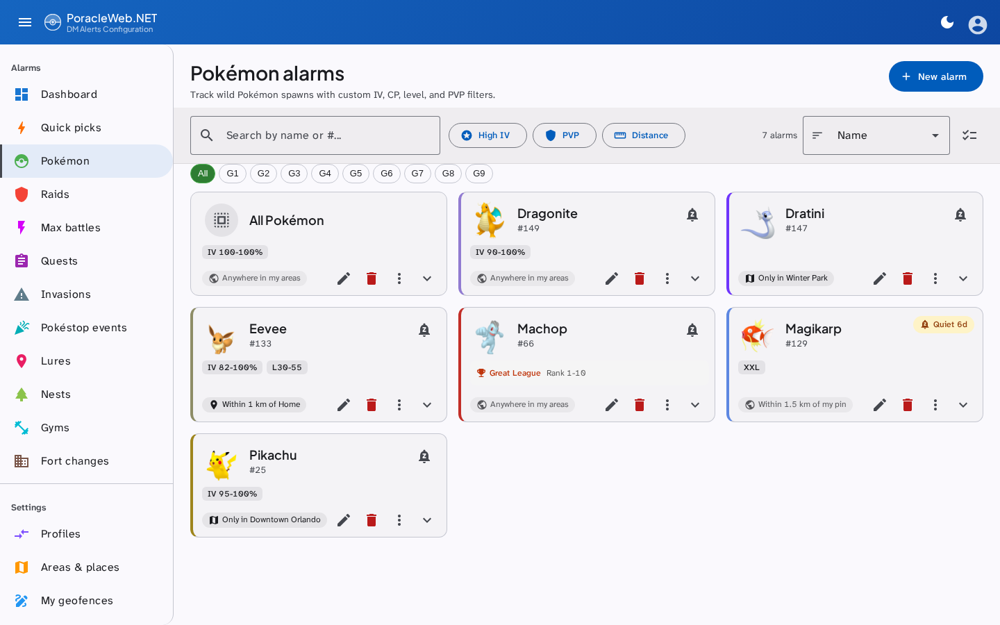

Alarms are displayed as a card grid. Each card shows:

- the Pokemon sprite or the raid, quest or lure icon
- filter pills for the active filters (IV, CP, level, PVP, gender, size, minimum time left)
- the scope chip, saying where the alert reaches you; click it to [change the scope from the card](#changing-scope-from-a-card)
- the template name
- on gym, raid and egg cards, the name of the targeted gym when one was picked
- the [rule summary](#what-this-rule-does-in-poracles-words)
- edit and delete actions, and on the types that name a subject, a [quiet chip](quiet-periods.md)

### What this rule does, in Poracle's words

Under a hairline below the filter pills, each card carries the sentence PoracleNG itself uses to
describe that rule. It states things the pills leave out — attack and defence floors, weight, the PVP
CP cap — at the cost of restating some of what they already show. Long summaries are clamped to two
lines with an expand control.

Nine surfaces carry it: Pokemon, raids (both raid and egg cards), quests, invasions, lures, nests,
gyms and Max Battles. Fort Changes does not, because upstream renders a raw JSON array there rather
than a sentence. Pokéstop Events has no line either.

The sentence follows your **Alert language**, not your display language, because Poracle writes it.
When the two differ the line is hidden entirely rather than putting one language's prose under another
language's chips. It is also absent when Poracle sends no description, in which case the card is
exactly what it was before. Nothing extra is fetched for it — the field was already on the response.

### Card order

Raids, eggs, quests, lures, nests, gyms, max battles, fort changes and Pokéstop Events each sort their
grid on what the card is titled by: Pokemon and level for raids and max battles, level for eggs, reward
for quests, lure type, species for nests, team for gyms, change type for fort changes, event type for
Pokéstop Events. An edited card therefore stays where it was instead of jumping to the end of the grid,
even in the rare case where an [edit gives the rule a new id](#editing-alarms).

The keys are the raw fields — dex number rather than species name, reward type rather than reward name
— so the grid does not re-order itself once the master data arrives, and the order does not change with
the display language. The Pokemon list already sorted itself on its own controls and is unchanged.
Invasions are not sorted this way yet, so in that rare case an edited invasion card can still move to the
end of the grid.

## Bulk operations

Each alarm list page has a **select mode** toggle (checklist icon in the toolbar):

1. Toggle select mode on
2. Check individual alarms or use **Select All**
3. Use the bulk toolbar: **Change radius** sets a new radius (anything above zero, up to the API's cap of half the Earth's circumference), or no radius, on the selected alarms, and **Delete** removes them. The radius dialog names how many alarms you selected.

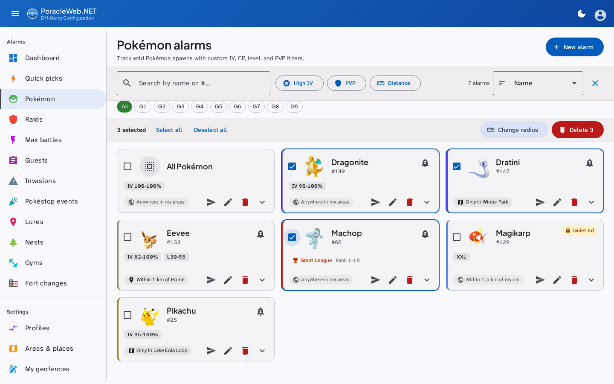

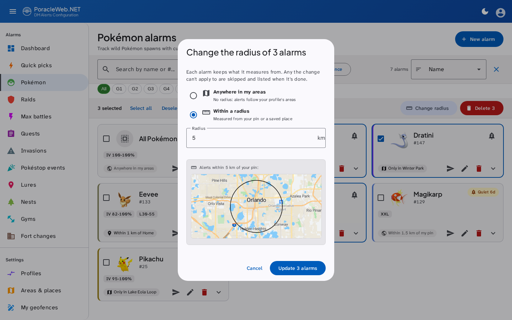

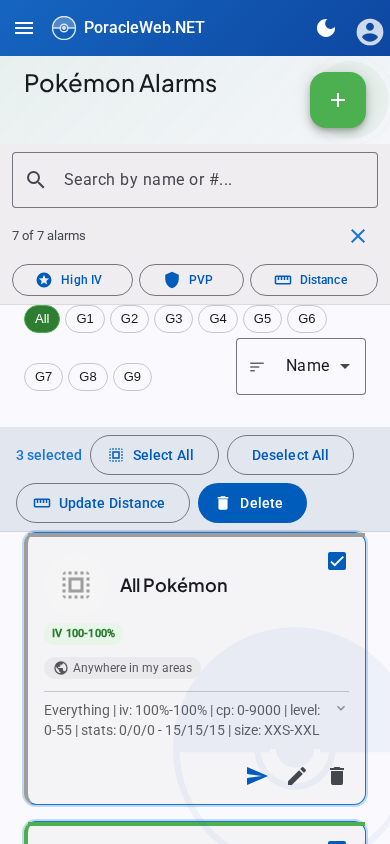{ width="320" }

!!! tip "Bulk distance changes only the distance"
    A bulk distance update asks PoracleNG to change the distance on the selected alarms and nothing else, so every other setting on them stays as it is. PoracleNG checks each alarm separately: one it refuses doesn't stop the rest, and the confirmation says how many were skipped and why.

    | Message | Why |
    |---|---|
    | "Skipped N limited to areas: a radius doesn't apply to them." | The alarm is limited to specific areas, which can't take a radius |
    | "Skipped N measured from a saved place: they need a radius." | The alarm measures from a saved place, so a zero can't apply |
    | "Skipped N that would clash with another rule." | At the new radius it would match another alarm you have exactly, or close enough that PoracleNG would merge the two. A refusal PoracleNG gives no clearer reason for is counted here too |

    Every alarm that was changed keeps its id. The cleaning toggle works the same way, changing only the clean setting.

    The flow, for developers, is in [Backend → Bulk operations](../architecture/backend.md#bulk-operations).

## Profiles

Users can maintain multiple alarm profiles. Only one profile is active at a time.

The **Profiles** page shows every alarm on every profile in one overview, and switches, edits, duplicates, deletes, exports and imports profiles from the same page. Each alarm belongs to a `profile_no`, and PoracleNG tracks the active one in `humans.current_profile_no`. [Profiles](profiles.md) covers the page in full.

### Cross-Profile Overview

The Profiles page uses PoracleNG's v2 tracking snapshot (`GET /api/v2/humans/{id}/tracking?all_profiles=true&include_descriptions=true`) to fetch all alarms across all profiles in a single call. Alarms are grouped by profile (expandable accordion panels) and by type within each profile.

### Duplicating a profile

The **Duplicate** button on each profile panel creates a new profile with all alarms copied from the source profile:

1. Click the :material-content-copy: **Duplicate** button on any profile panel
2. Enter a name for the new profile (pre-filled as `"<source name> (Copy)"`)
3. Click **Duplicate**

The new profile inherits the source profile's areas, location, active hours and all alarm filters, including a role or user mention on a webhook's alarms. The copy is PoracleNG's own profile copy, and your active profile doesn't change while it runs. If the alarm copy step fails, the empty profile is rolled back (deleted) so you never end up with a shell profile.

!!! tip "Duplicate vs. Create"
    Use **Duplicate** when you want to start with an existing set of alarms and tweak them. Use **Create** when you want a blank profile.

### Profile Backup & Restore

Export writes a per-profile JSON backup of every alarm filter, without the internal fields (`uid`, `id`, `profile_no`), in the form `{ version: 1, exportedAt, profileName, alarms: { pokemon: [...], raid: [...], ... } }`.

Import reads a backup into a new profile. The alarms are written straight to the new profile, so your active profile stays as it was, and every alarm is checked before the first one is saved. An alarm that already exists on the new profile, or would replace another, is skipped. Invasion rows that are really Pokéstop events (Kecleon, Gold Stop, Showcase) are saved as event rules, and a grunt saved as `metal` is imported as `steel`. A name you already use gets a numeric suffix, "Home (2)".

### Profile names

The server doesn't require profile names to be unique, and accepts up to 255 characters. The dialogs are stricter: the add, duplicate and import dialogs flag a name you already use as you type, the edit dialog checks when you save, and the add and edit dialogs stop at 32 characters. Only import changes a clashing name itself, by adding a numeric suffix.

## Pokemon alarm filters

### Size filter

The size filter uses special sentinel values:

| Value | Means |
|---|---|
| `size = -1` | No filter, all sizes. The default |
| `size = 1` to `5` | A specific size: 1 = XXS, 2 = XS, 3 = Normal, 4 = XL, 5 = XXL |
| `max_size = 5` | The default upper bound |

When a user selects a specific size, both `size` and `max_size` are set to the same value, creating an exact match. For example, selecting XXL sets `size = 5, max_size = 5`.

### Costume filter

A **Costume** select sits beside Form in both Pokemon dialogs, and on raid alarms that name a specific
boss. Three kinds of answer, and the sentinels are not the ones used elsewhere on this page:

| Value | Means |
|---|---|
| `9000` | Any costume, including none. The default. |
| `0` | No costume — the plain form only. |
| *N* | That costume and no other. |

Note that `0` means "uncostumed" here, where on most other filters `0` means "any". The wildcard is
`9000`, matching the raid and move sentinels rather than the size filter's `-1`.

On raids the control appears on the **By Boss** tab of the add dialog only, and in the edit dialog only
for a rule that names a boss. A by-level raid rule is always "any costume": PoracleNG forces the boss
to the wildcard on those, so there is no species for a costume to belong to. Eggs have no costume
column at all.

Costume names come from the WatWowMap masterfile — the same file PoracleNG reads for its own costume
lookups — and are **English in every interface language**. A costume too new for that file shows as its
number rather than a name. See [Game data names](internationalization.md#game-data-names).

!!! note "Always offered"
    The costume column exists in every supported PoracleNG (database migrations 6 for `monsters.costume`
    and 7 for `raid.costume` are in 5.4.0), so the select is always there and nothing asks the server
    first.

### Minior

Minior's IVs, CP and level are rerolled for each player when it's caught, so a scanner may report it without stats, and a rule that filters on them never fires. Picking Minior in the Pokemon picker shows a note saying so, and the edit dialog of a Minior alarm shows it too. Track Minior with IV, CP and level left open.

### Level range

The default maximum level is **55** (not 40 or 50), matching Poracle's support for shadow/purified/best-buddy boosted levels.

### Minimum time left

Under **More Filters**, **Minimum Time Left** skips spawns that will despawn before you could reach them. The field is a select rather than a free number, offering Any, 1, 2, 5, 10, 15 and 20 minutes. PoracleNG stores seconds (`min_time`), and a free field invited two silent failures: typing `5` meaning minutes asks for five seconds, and a value longer than a spawn lives mutes the alarm with no error. A value set from the bot that isn't one of the presets is kept and offered in the list rather than being overwritten on the next save.

When set, the card shows a "5 min left" pill alongside the IV and CP pills.

### PVP mega evolution

On the **PVP** tab, once a league is selected, **Mega evolution** chooses which form the rank applies to: Base, Mega, Mega X or Mega Y (`pvp_ranking_evolution` 0–3). Megas are ranked separately from their base forms, so a Mega rule will not match a base-form spawn. Pick Base unless you specifically want mega rankings.

The chosen form appears as a suffix on the card's PVP badge ("Great League · Mega X").

## Raid level selector

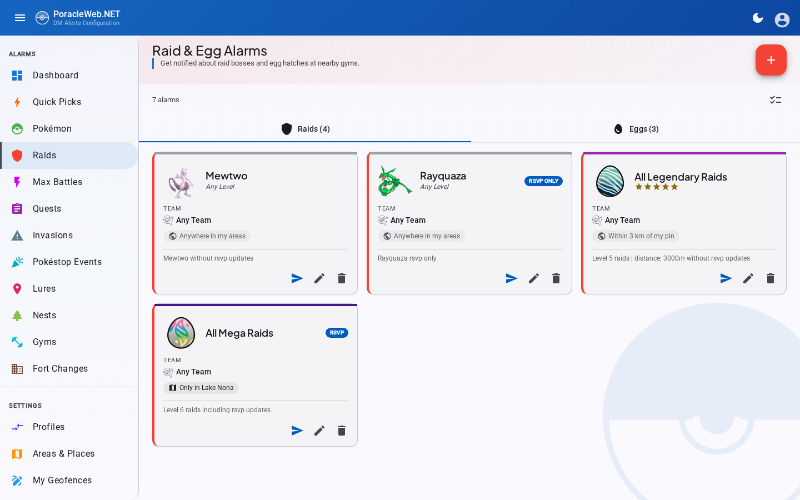

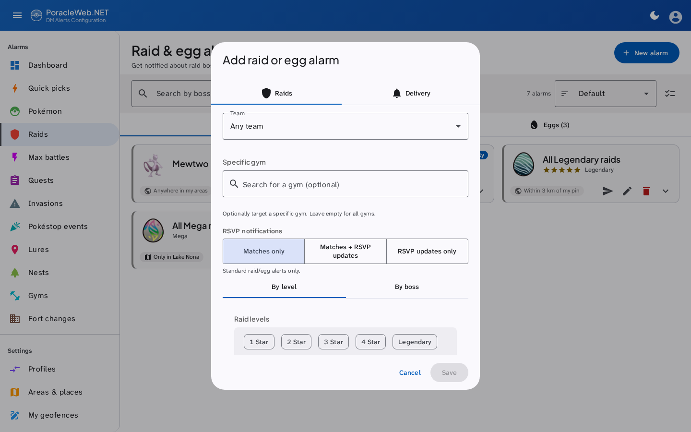

The raid and egg pickers share the `<app-level-selector>` chip component. The vocabulary follows the [WatWowMap masterfile](https://github.com/WatWowMap/Masterfile-Generator/blob/main/master-latest-poracle-v2.json) — the same source PoracleNG uses for in-DM notification text — so the names you see in the picker match what users receive in their alerts.

**Raid picker.** Multi-select. Primary chip row shows the seven most common types: `1 Star`, `2 Star`, `3 Star`, `4 Star`, `Legendary` (level 5), `Mega` (level 6), `Mega Legendary` (level 7). A `Any` chip selects the wildcard sentinel (level 9000) that matches every raid level. A **More raid types…** overflow menu surfaces the other 12 canonical types: `Ultra Beast` (8), `Elite` (9), `Primal` (10), `1–5 Shadow` (11–15), `4–5 Super Mega` (16–17), `Coordinated 1–2` (18–19).

**Egg picker.** Multi-select. Only the five Star tiers (1–5) are surfaced — Pokémon GO has no Mega/Shadow/Primal eggs.

**The "By Boss" tab has no level picker.** PoracleNG forces `level` to the wildcard 9000 for any raid
alarm carrying a specific `pokemon_id` (`trackingRaid.go`), so a level chosen alongside a boss could never
survive the request. The tab used to show a picker whose value was always discarded; it was removed in
v2.14.0. Track a boss to be alerted at whatever level it appears.

**`+ Add`.** Both pickers expose an inline numeric input for any positive integer not in the canonical list. Useful for forward compatibility — if Niantic introduces a new raid type (`raid_20`) before PoracleWeb.NET ships an update, you can already alarm on it. Typed values are **ephemeral** to the dialog session: close the dialog (or refresh the page) and the chip is gone. Saved alarms at custom levels re-seed the chip when you open the edit dialog.

The canonical list is served by the API at `GET /api/masterdata/raid-levels` (cached server-side; baked-in fallback if the masterfile fetch fails). Card titles like "All Mega Legendary Raids" compose by combining the modifier ("Mega Legendary") with the localized "Raids" suffix from `RAIDS.ALL_LEVEL_RAIDS`, so card text reads naturally without the doubled word that an unaltered masterfile string would produce.

## Raid alarm filters

Raid alarms support these fields beyond the basic level/boss selection:

| Field | Default | Description |
|---|---|---|
| `team` | `4` (any team) | Gym team controlling the raid |
| `move` | `9000` (any move) | Filter by raid boss move |
| `evolution` | `9000` (any) | Filter by evolution type (e.g., Mega, Primal) |
| `exclusive` | `false` | EX/exclusive raid flag |
| `gymId` | `null` (all gyms) | Track a specific gym by ID (set via gym picker) |
| `rsvpChanges` | `0` (matches only) | RSVP notification mode: `0` matches only, `1` matches + RSVP updates, `2` RSVP updates only. Selectable as a three-option toggle group in the raid add/edit dialog; shown as an "RSVP" / "RSVP only" status badge on raid cards (beside the auto-delete tag) when non-default. Selecting mode `1` or `2` also sets PoracleNG's edit-in-place bit (`clean` bit 2) so RSVP count changes edit the existing alert rather than sending a new message. Mode `2` requires the upstream scanner to emit RSVP webhooks — selecting it in deployments without one will silence the alarm. |

## Egg alarm filters

Egg alarms support:

| Field | Default | Description |
|---|---|---|
| `team` | `4` (any team) | Gym team controlling the egg |
| `exclusive` | `false` | EX/exclusive egg flag |
| `gymId` | `null` (all gyms) | Track a specific gym by ID (set via gym picker) |
| `rsvpChanges` | `0` (matches only) | RSVP notification mode: `0` matches only, `1` matches + RSVP updates, `2` RSVP updates only. Selectable as a three-option toggle group in the egg add/edit dialog; shown as an "RSVP" / "RSVP only" status badge on egg cards (beside the auto-delete tag) when non-default. Selecting mode `1` or `2` also sets PoracleNG's edit-in-place bit (`clean` bit 2) so RSVP count changes edit the existing alert rather than sending a new message. Mode `2` requires the upstream scanner to emit RSVP webhooks — selecting it in deployments without one will silence the alarm. |

## Quest alarm filters

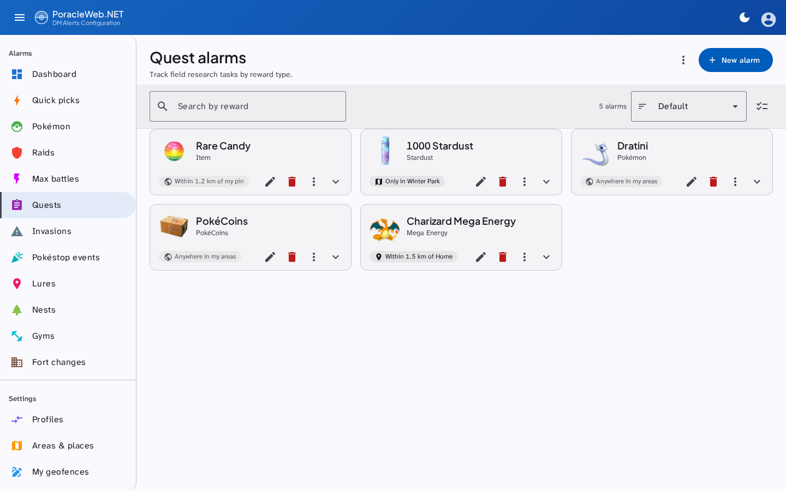

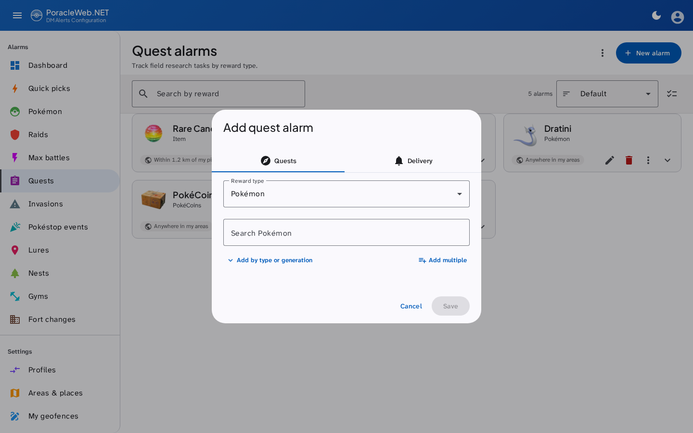

A quest alarm matches one reward. The **Reward type** dropdown on the Rewards tab decides the
`reward_type` PoracleNG stores, and where the number you type ends up. Choosing one swaps the controls
beneath it:

| Reward type | `reward_type` | What you pick | Minimum field |
|---|---|---|---|
| Pokemon | `7` | Species the quest rewards (`reward` = pokemon id) | — |
| Items | `2` | The item (`reward` = item id) | `amount` |
| Mega Energy | `12` | Species whose energy is rewarded | `amount` |
| Candy | `4` | Species whose candy is rewarded | `amount` |
| Stardust | `3` | Nothing; the amount is the whole rule | `reward` |
| PokéCoins | `8` | Nothing; the amount is the whole rule | `reward` |

**Minimum Amount** is the fewest of the reward the quest has to give; `0` means any. It only applies where a reward comes in a quantity: items, candy and mega energy. A Pokemon encounter has nothing to count.

Stardust and PokéCoins work differently from the rest, and identically to each other. There is nothing to pick — Poracle matches on the amount alone — so each offers a single number field, and PoracleNG reads the floor from `reward` rather than `amount`. On both, `amount` stays `0`.

Quest cards render the amount ahead of the reward name — "3× Rare Candy" — but only when it is above one; an amount of 1 shows the reward name on its own. Stardust cards read "25000 Stardust", from `reward`, and PokéCoin cards read the same way.

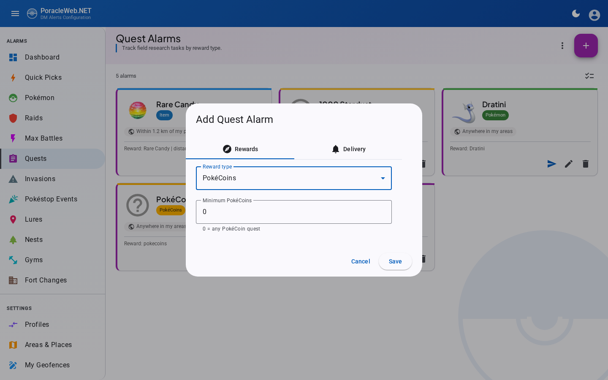

!!! note "PokéCoins is always offered"
    PokéCoins is the last entry in the dropdown. PoracleNG 5.2.0 widened its list of accepted reward
    types, so every supported release takes it and nothing asks the server first.

    Reads and deletes are never refused, so a PokéCoin rule set from the Discord bot stays visible and
    removable.

## Gym alarm filters

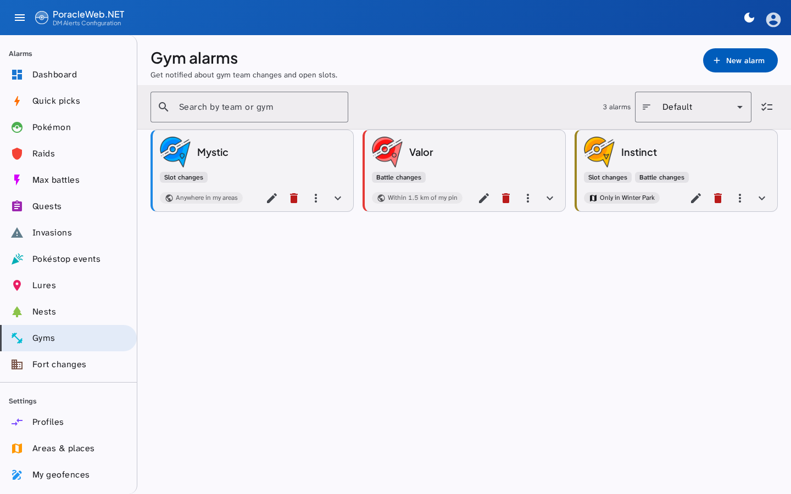

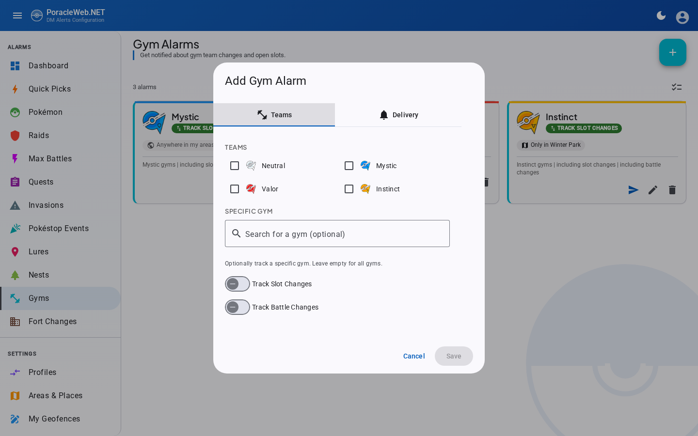

Gym alarms support:

| Field | Default | Description |
|---|---|---|
| `team` | `4` (any team) | Gym team to track |
| `slotChanges` | `false` | Notify when a slot opens at the gym |
| `battleChanges` | `false` | Notify on battle activity changes at the gym |
| `gymId` | `null` (all gyms) | Track a specific gym by ID (set via gym picker) |

## Lure alarm filters

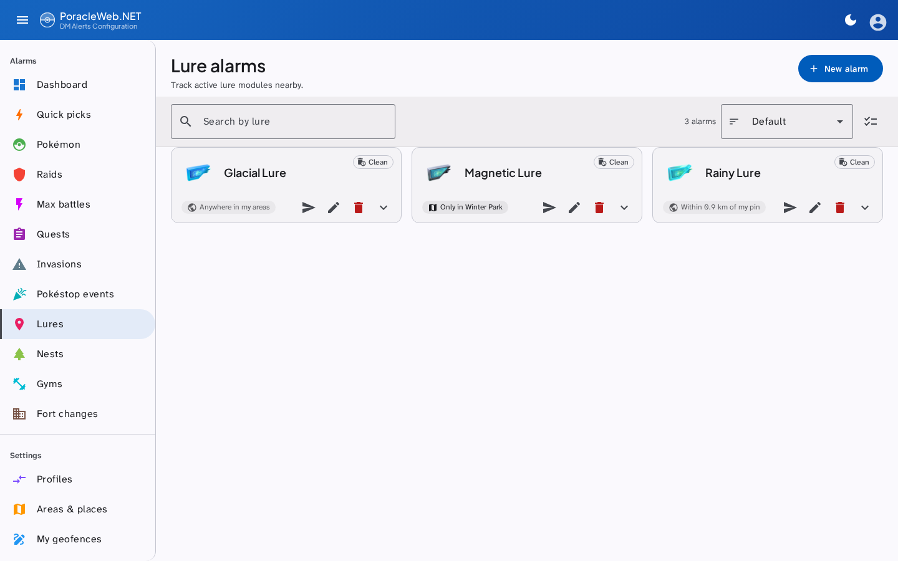

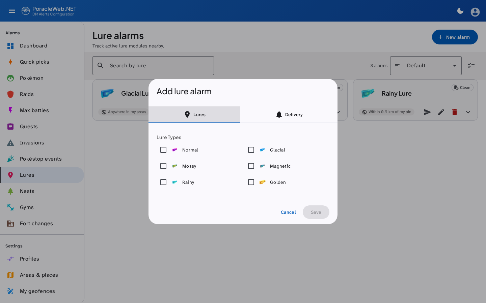

A lure alarm names one lure type (`lure_id`): Normal, Glacial, Mossy, Magnetic, Rainy or Golden. Ticking several in the add dialog creates one alarm per type. Lures support **Edit message in place**, so a lure that's renewed updates the alert you already have.

## Nest alarm filters

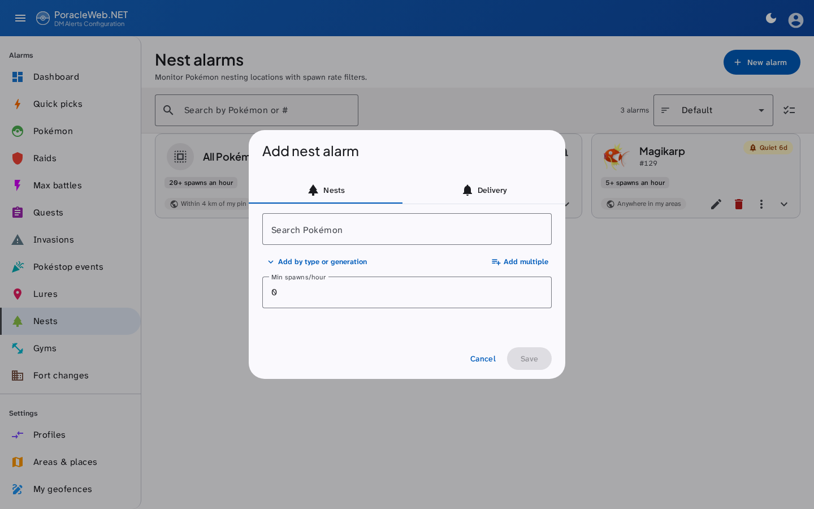

A nest alarm names the nesting species (and optionally its form) and a **minimum spawns per hour** (`min_spawn_avg`), so a nest too thin to be worth the trip stays quiet.

## Fort change alarm filters

Fort change alarms track changes to pokestops and gyms as points of interest (not activity at them). This includes name changes, location changes, image updates, description changes, removals, and new POI additions.

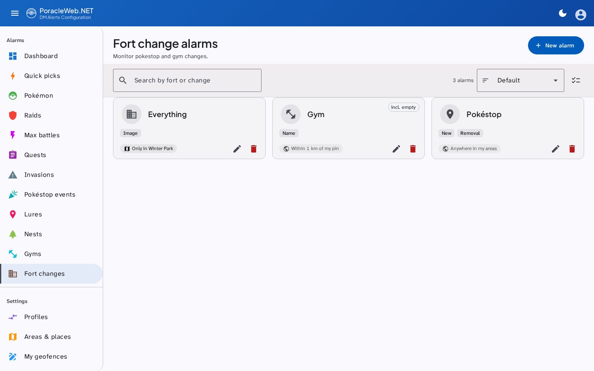

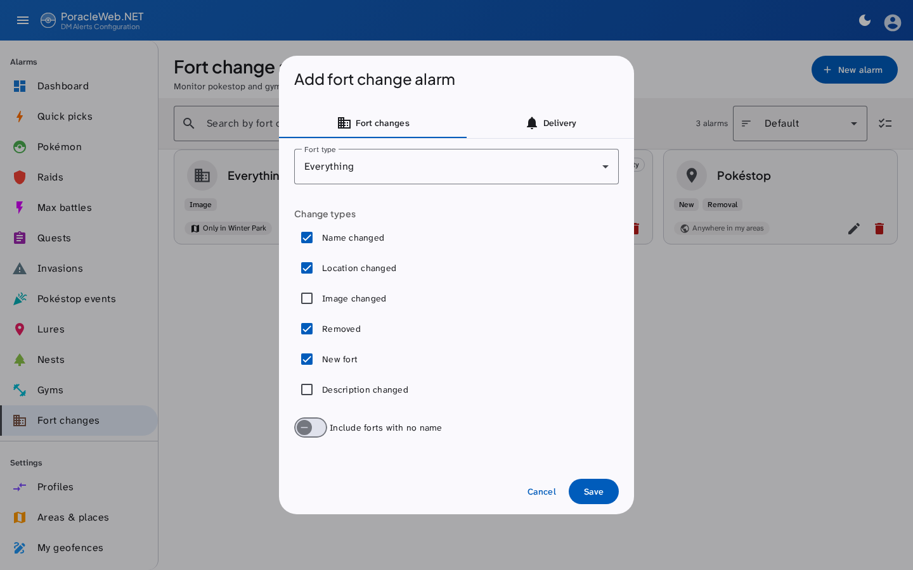

| Field | Default | Description |
|---|---|---|
| `fort_type` | `"everything"` | Fort type to track: `pokestop`, `gym`, or `everything` |
| `include_empty` | `0` (false) | Include forts with no name |
| `change_types` | `[]` (all) | JSON array of change types to monitor: `name`, `location`, `image_url`, `description`, `removal`, `new` |

Fort change alarms are proxied through PoracleNG using tracking type `"fort"`. The API endpoints follow the standard alarm CRUD pattern at `/api/fort-changes`.

## Max Battle alarm filters

Max Battle (Dynamax) alarms track battles at Power Spot stations. There are two tracking modes: **By Level** tracks any Pokemon at the tiers you pick, one alarm per level, and **By Pokemon** tracks the Pokemon you pick at every level.

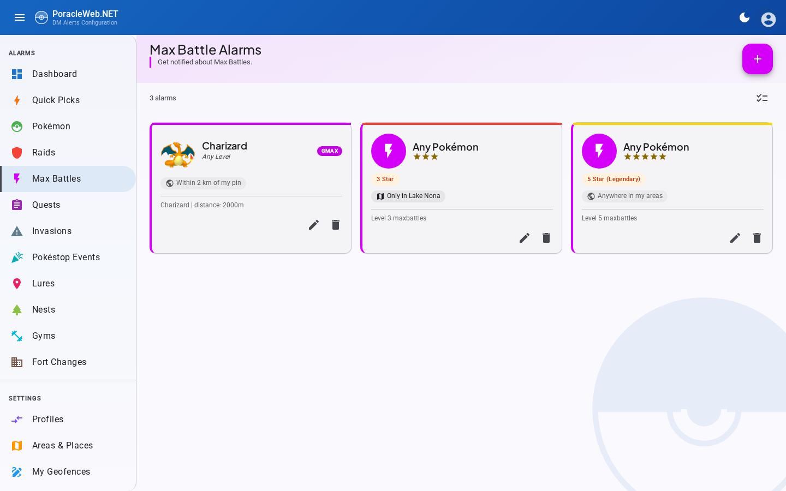

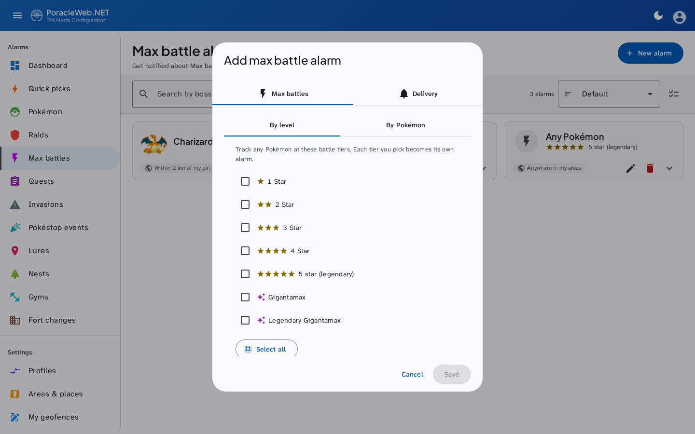

| Field | Default | Description |
|---|---|---|
| `pokemon_id` | `9000` (any) | Pokemon to track. `9000` = level-based tracking (any Pokemon). |
| `level` | `9000` (any) | Battle level. Only meaningful when `pokemon_id = 9000`. |
| `gmax` | `0` (any) | Gigantamax filter. `0` = matches all battles, `1` = Gigantamax only. |
| `form` | `0` (any) | Pokemon form filter. |

### Battle levels

Max Battle levels follow the PoracleNG `util.json` definitions:

| Level | Label | Type |
|---|---|---|
| 1 | 1 Star Max Battle | Dynamax |
| 2 | 2 Star Max Battle | Dynamax |
| 3 | 3 Star Max Battle | Dynamax |
| 4 | 4 Star Max Battle | Dynamax |
| 5 | Legendary Max Battle | Dynamax |
| 7 | Gigantamax Battle | Gigantamax |
| 8 | Legendary Gigantamax Battle | Gigantamax |

!!! note "No level 6"
    There is no level 6 in PoracleNG's max battle system. Levels 7 and 8 are Gigantamax battles where `gmax` is automatically derived (level > 6 = gmax).

### Duplicates and edits

PoracleNG's older max battle handler had no duplicate check, so every Add created a row and an edit had
to delete and re-create the alarm. PoracleNG 5.4.0 diffs max battles like every other type. An Add of a
boss you already track that differs only by radius would merge into the existing alarm, so it's refused
with the takeover message. An edit is one uid-addressed replace, a bulk distance change is a `PATCH`
that keeps the uid, and an edit that would land on another max battle's settings is refused with a 409
before anything changes.

### Scanner-based Pokemon filter

When the scanner database is configured, the "By Pokemon" tab queries the `station` table for distinct `battle_pokemon_id` values. This limits the Pokemon selector to species that have actually appeared in Max Battles. If the scanner DB is not configured, all Pokemon are shown.

!!! warning "GymCreate.Team default"
    `GymCreate.Team` must default to `4` (any team), matching Raid and Egg defaults. A C# `int` defaults to `0`, which maps to "Neutral only" in Poracle, causing new gym alarms to silently filter out all non-Neutral gyms.

## Gym picker

The **gym picker** is a shared component (`app-gym-picker`) that allows users to optionally target a specific gym when creating or editing **Gym**, **Raid**, or **Egg** alarms. When a gym is selected, alerts only fire for events at that particular gym.

### How it works

1. The picker displays a search field labeled "Search for a gym (optional)".
2. As the user types (minimum 2 characters), the component debounces input (300ms) and queries the scanner database via `GET /api/scanner/gyms?search=<term>&limit=20`.
3. Results appear in an autocomplete dropdown. Each option shows the gym's photo from the scanner DB (or a team icon when there's none), its name (or its ID when the name isn't set), and its area, found by checking which Koji geofence contains the gym (or its coordinates when none does).
4. Selecting a gym sets the `gymId` on the alarm. A compact chip displays the selected gym's photo, name, and area with a clear button to remove the selection.
5. In **edit mode**, the picker loads the existing gym's details from `GET /api/scanner/gyms/{id}` to display the name and photo.

### Requirements

- The **scanner database** must be configured (`ConnectionStrings:ScannerDb`). If not configured, the `IScannerService` is not registered and the search endpoints return empty results.
- The **Koji service** is optional. When available, it enriches results with area names by checking gym coordinates against Koji geofence polygons.

### Backend

- `ScannerController` exposes `GET /api/scanner/gyms` (search) and `GET /api/scanner/gyms/{id}` (lookup by ID).
- `IScannerService.SearchGymsAsync()` queries the scanner DB's gym table by name (LIKE match), returning `GymSearchResult` with `Id`, `Name`, `Url`, `Lat`, `Lon`, `TeamId`, and `Area`.
- Area enrichment runs server-side: for each gym result, the controller iterates Koji admin geofences and assigns the first matching fence name.

## Invasion alarm filters

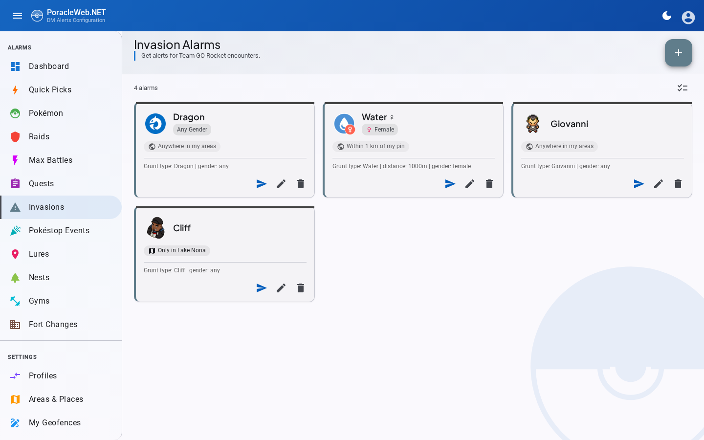

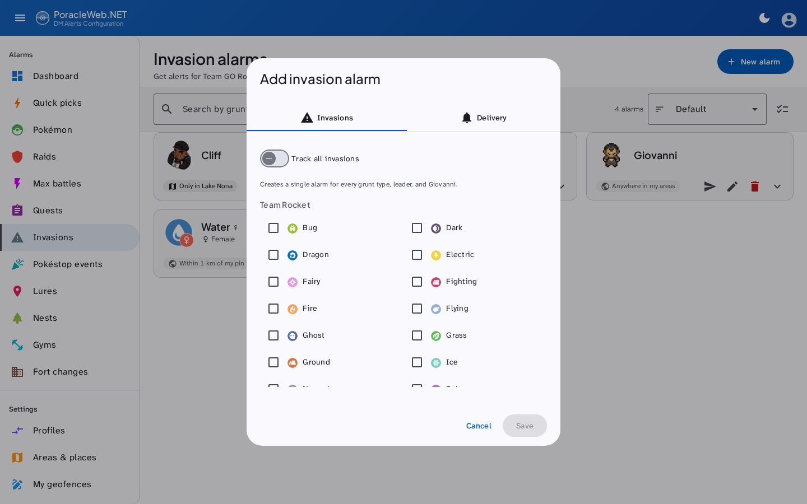

Invasion alarms filter by grunt type and gender. A few things happen to the grunt type on the way in:

- `metal` is saved as `steel`. PoracleNG's game data calls the grunt `steel`, and a `metal` rule never matched anything.
- Kecleon, Gold Stop and Showcase are Pokéstop events, so picking one here saves a [Pokéstop event rule](#pokestop-event-alarms) instead.
- PoracleNG stores a spaced name such as `player team leader` as `player_team_leader`.

Two catch-all rules, every grunt and every boss encounter, lose a gender limit the next time they're saved, because PoracleNG's v2 read doesn't report a gender on them ([jfberry/PoracleNG#331](https://github.com/jfberry/PoracleNG/pull/331), not yet merged, fixes the read). The web dialogs don't create that combination; it comes from the bot.

## Pokéstop Event alarms

Showcases, Kecleon sightings and Gold Stops are the eleventh alarm type, on its own page at
**Pokéstop Events** in the sidebar, directly after Invasions.

| Event | Stored as | What it is |
|---|---|---|
| Showcase | `showcase` | A showcase running at a pokestop |
| Kecleon | `kecleon` | A Kecleon hiding on a pokestop |
| Gold Stop | `gold-stop` | A pokestop that has turned gold |

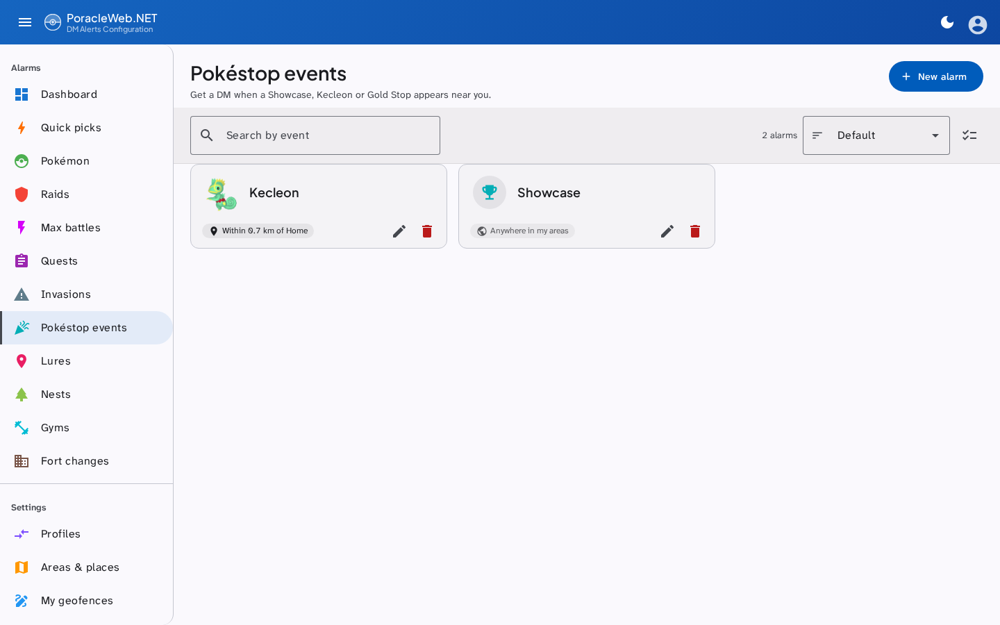

### Creating one

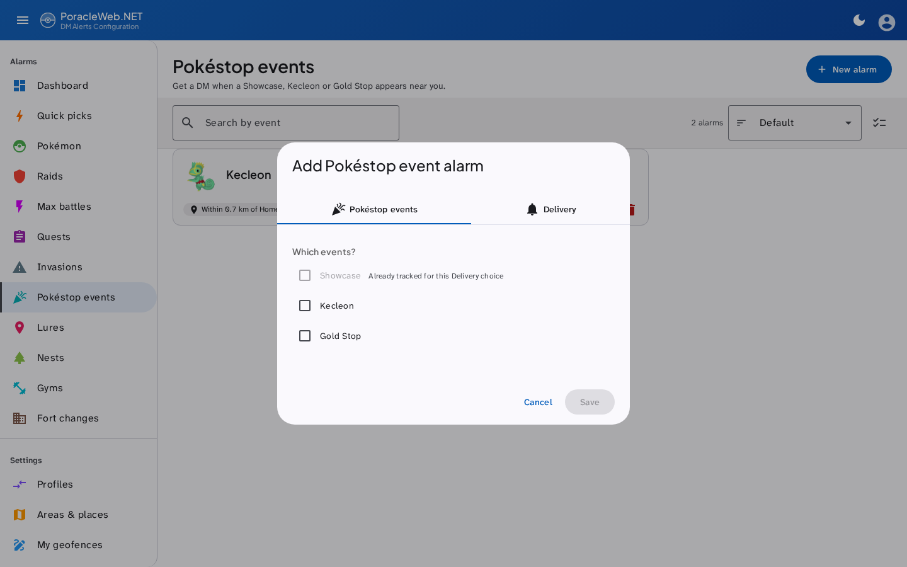

The add dialog has two tabs. **Settings** holds three checkboxes, one per event; an event you already
track is unticked, disabled and labelled "Already tracked", so you can't create a duplicate. **Delivery** is the usual
[scope picker](#where-an-alert-reaches-you), auto-delete toggle and template selector.

Ticking more than one event creates one rule per event, not one rule covering several. The edit dialog
handles a single rule, so it offers one **Event** select rather than checkboxes.

### Eleven types, ten tables

Pokéstop Event rules live in the **same `invasion` table** as invasion rules; the two are told apart by
the stored `grunt_type`. Everything else follows from that.

When you first see the Pokéstop Events page, your **Invasions count drops** by however many event
rules you already had, and a Pokéstop Events count appears holding them. Nothing was created, deleted
or moved — the same rows are being counted in two piles instead of one, and the overall total is
unchanged.

The split is conditional. Where the page is switched off (Poracle reports `disable_showcase = true`,
or an admin turned the type off), event rows stay listed and deletable under **Invasions**, and the invasion add dialog keeps
offering the three events. The dashboard counts agree with whichever page the rows are on.

The **Cleaning** page's invasion toggle leaves event rows alone — it would otherwise set the
auto-delete bit on rules belonging to a page it never mentions. Where the Pokéstop Events page is
unavailable (Poracle reports `disable_showcase = true`) it sweeps them along with the invasion
rules, because then that switch is the only control you have over them.

### What this type does not do

There's no test alert, because there's no mock payload builder for events, so no card carries the test button.

There's no separate section in the cross-profile overview either. Event rules appear there as invasion
rows whose grunt is the event name. A profile export folds them into the invasion list the same way, an
import saves them back as event rules, and a duplicate copies them with everything else.

!!! note "On unless Poracle says otherwise"
    The page is there unless Poracle's configuration says `general.disable_showcase = true`. Absent or
    unreadable leaves it on, because every supported PoracleNG serves the v2 `incident` route. Like every
    other upstream flag this fails open: a Poracle outage must not switch off an alarm type that works.

    Operators can also switch the type off here, independently of Poracle, with the **`disable_showcase`**
    site setting under **Admin → Settings → Alarms**.

## Delivery & message modes

Every alarm carries a `clean` field that PoracleNG reads as a **bitmask** controlling how the notification is delivered. PoracleWeb.NET surfaces the bits the bot actually acts on as per-alarm toggles in the add/edit dialogs (and shows them as status badges on the alarm cards):

| Mode (`clean` bit) | Applies to | What it does |
|---|---|---|
| Auto-delete (bit 1) | all alarm types except Fort Changes | Deletes the Discord notification after the event expires (e.g. a Pokemon despawns or a raid ends). Toggle per-alarm in the dialog, or in bulk from the **Cleaning** page. PoracleNG has no `clean` column for fort changes, so the setting does not exist for that type. |
| Edit message in place (bit 2) | Lures; Pokemon; Raids/Eggs (via RSVP mode) | Updates the existing Discord message when the event changes instead of sending a new one. For lures and Pokemon, enable the **"Edit message in place"** toggle in the alarm dialog; for raids/eggs it is set automatically when you choose an RSVP mode (see the `rsvpChanges` rows above). On Pokemon the toggle appears only when PoracleNG's `tracking.pokemon_edit` config value is `true` ([jfberry/PoracleNG#246](https://github.com/jfberry/PoracleNG/pull/246)); when it's off, absent or unreadable the control is hidden rather than offered as a no-op, and a bit set from the bot is kept. While shown, an edit only updates the message within a short window after it was sent (the PoracleNG operator configures how long) -- a later change to the same Pokemon arrives as a threaded reply instead. |
| Daily summary (bit 4) | Quests | Collects matching quests into a single summary message instead of one notification each. Enable the **"Daily summary"** toggle in the quest dialog. Requires a configured summary schedule on the bot. |

The modes combine (a quest can be both auto-delete and daily-summary, for example). PoracleWeb.NET **preserves any bits set elsewhere**: if you configured a delivery mode via the bot's `!command` interface that isn't surfaced in the web UI, editing the alarm in the browser will not wipe it.

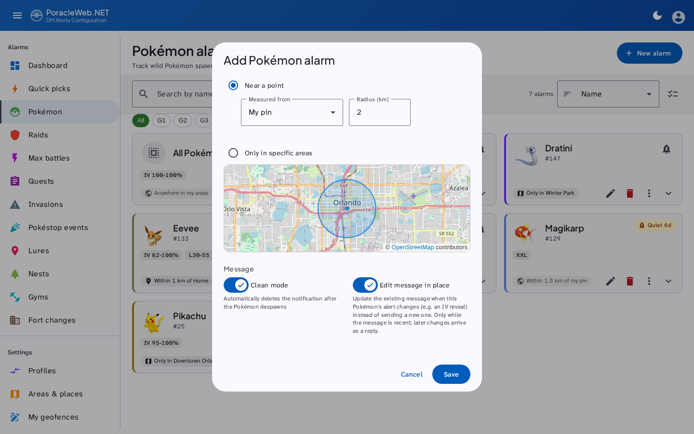{ loading=lazy }

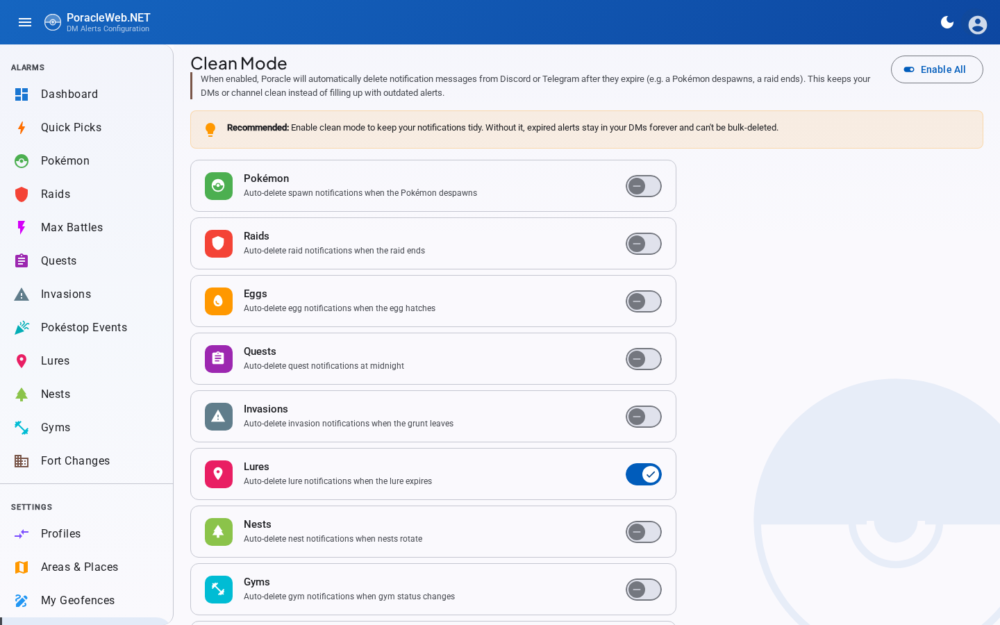{ loading=lazy }

### RSVP updates (raids & eggs)

Raid and egg alarms add a third delivery setting on top of auto-delete and edit-in-place: an **RSVP notification mode**, stored in the `rsvpChanges` field (see the `rsvpChanges` rows under the raid and egg filter tables above). Choose it from the three-option toggle group in the raid/egg add/edit dialog:

| Mode | What you get |
|---|---|
| Matches only (`0`, the default) | One notification when a raid or egg matches, and nothing further |
| Matches + RSVP updates (`1`) | The same match alert, plus a re-notification whenever the RSVP count changes |
| RSVP updates only (`2`) | No match alert; a notification only when RSVP counts change |

Picking mode `1` or `2` also turns on PoracleNG's edit-in-place behavior (`clean` bit 2), so RSVP count changes **edit the existing Discord alert in place** rather than sending a fresh message each time — your DMs stay to a single, updating notification per raid. When a non-default mode is set, the alarm card shows an **"RSVP"** (mode `1`) or **"RSVP only"** (mode `2`) status pill beside the auto-delete tag.

> **Scanner caveat:** RSVP updates only arrive if the upstream scanner emits RSVP webhooks. In a deployment without one, mode `2` ("RSVP updates only") suppresses the initial match but never receives RSVP events — the alarm goes completely silent. Use mode `2` only if you know your scanner reports RSVPs.

## Default values

All monster (Pokemon) alarm defaults:

| Field | Default | Description |
|---|---|---|
| `min_iv` | `0` | Minimum IV percentage |
| `max_iv` | `100` | Maximum IV percentage |
| `min_cp` | `0` | Minimum CP |
| `max_cp` | `9000` | Maximum CP |
| `min_level` | `0` | Minimum level |
| `max_level` | `55` | Maximum level |
| `min_weight` | `0` | Minimum weight |
| `max_weight` | `9000000` | Maximum weight |
| `atk` | `0` | Minimum attack IV |
| `def` | `0` | Minimum defense IV |
| `sta` | `0` | Minimum stamina IV |
| `max_atk` | `15` | Maximum attack IV |
| `max_def` | `15` | Maximum defense IV |
| `max_sta` | `15` | Maximum stamina IV |
| `pvp_ranking_best` | `1` | Best PVP ranking position. Ranks are 1-based; a stored legacy `0` reads as `1` |
| `pvp_ranking_worst` | `4096` | Worst PVP ranking position |
| `pvp_ranking_evolution` | `0` | PVP form to rank against (0 = base, 1 = mega, 2 = Mega X, 3 = Mega Y) |
| `min_time` | `0` | Minimum seconds of despawn time left (0 = no filter) |
| `gender` | `0` | Gender filter (0 = any) |
| `costume` | `9000` | Any costume |
| `size` | `-1` | Size filter (-1 = no filter / all sizes); a stored legacy `0` reads as `-1` |
| `max_size` | `5` | Maximum size upper bound |

Raid-specific defaults:

| Field | Default |
|---|---|
| `team` | `4` (any team) |
| `move` | `9000` (any move) |
| `evolution` | `9000` (any evolution) |

Egg-specific defaults:

| Field | Default |
|---|---|
| `team` | `4` (any team) |

Gym-specific defaults:

| Field | Default |
|---|---|
| `team` | `4` (any team) |

Max Battle-specific defaults:

| Field | Default |
|---|---|
| `pokemon_id` | `9000` (any Pokemon / level-based) |
| `level` | `9000` (any level) |
| `gmax` | `0` (any — not Gigantamax-only) |
| `move` | `9000` (any move) |
| `evolution` | `9000` (any — unused placeholder) |

## Test Alerts

Most alarm cards include a **test button** (send/paper plane icon) that triggers a sample notification for that alarm. This lets users verify their alarm filters and notification formatting without waiting for a real event to occur.

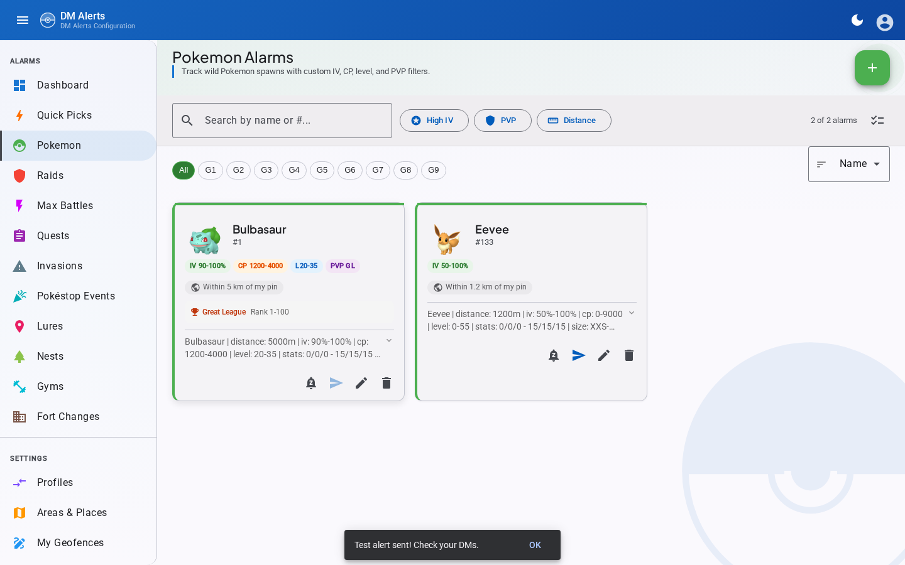{ loading=lazy }

### How it works

1. Click the send icon in the alarm card's action area
2. PoracleWeb.NET builds a **mock webhook payload** using the alarm's actual filter values (e.g., pokemon_id, raid_level, quest_reward) and the user's saved location as the event coordinates
3. The payload is sent to PoracleNG's `POST /api/test` endpoint, which formats and delivers the notification to the user via their configured webhook
4. A **snackbar** displays the result: success, error, or cooldown warning

### Supported alarm types

Test alerts are available for eight of the eleven alarm types:

- Pokemon
- Raid
- Egg
- Quest
- Invasion
- Lure
- Nest
- Gym

**Not** Fort Change, Max Battle or Pokéstop Event — `TestAlertController` rejects all three, and none of
those modules renders a test button. They have no mock payload builder, so there is nothing to send.

### Clearing a test notification

A test alert is a real DM sent by the bot. This site never sees it and cannot take it back. The bot
can: send it `poracle-clean` as a direct message, prefixed with your server's command prefix, and it
deletes its own recent messages from that conversation. That includes real alerts, not only the tests.
The FAQ on the **Help** page carries the same answer with your own instance's prefix filled in.

### Rate limiting

Test alerts are rate limited to prevent abuse:

The server allows 5 test alerts per 60 seconds per user (per IP address only for a request with no token). The browser adds a 15-second cooldown per alarm, and drops a repeat click while a request for that alarm is still in flight.

## Weather Display

The dashboard shows the current in-game weather conditions at the user's pin.

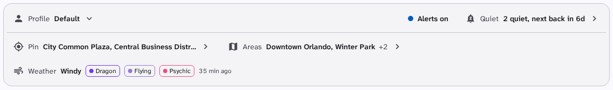

### Features

It shows the in-game weather at the pin and in each of your selected areas, with the time the data was last refreshed, and refreshes in the background.

!!! note "Pin required"
    The weather display requires a saved pin to function. Users who have not set one will not see weather information on the dashboard. Set a pin on the **Areas & Places** page or through the onboarding wizard.

## Quick Picks

Admins can define **Quick Pick** templates — pre-configured alarm sets that users can apply with one click. Useful for onboarding new users or sharing recommended configurations.

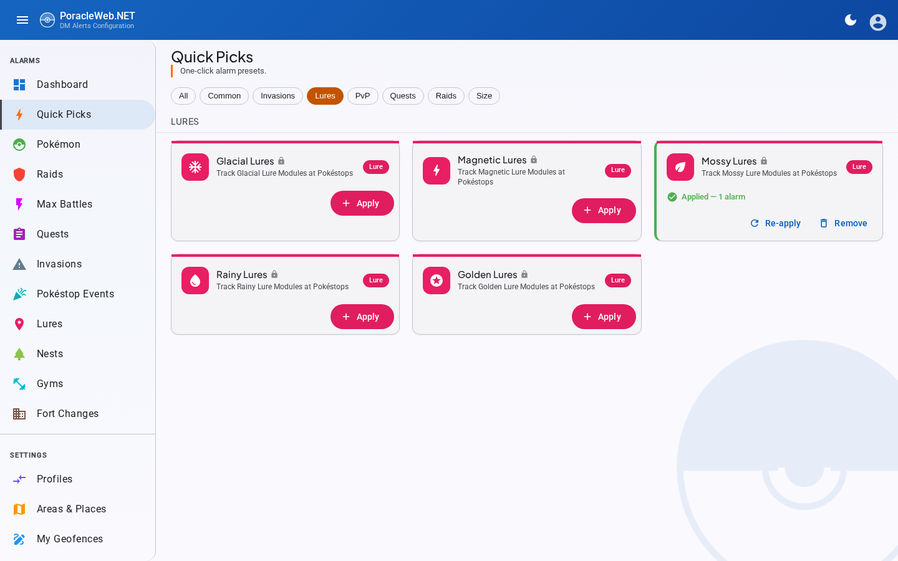

When applying a Quick Pick, the apply dialog's **Delivery** tab holds the same [scope picker](#where-an-alert-reaches-you) the add dialogs use, seeded from your [Alert Defaults](#default-delivery-scope-alert-defaults). Whatever you choose there (areas, a saved place, a radius, or a specific set of areas) applies to every alarm the pick creates.

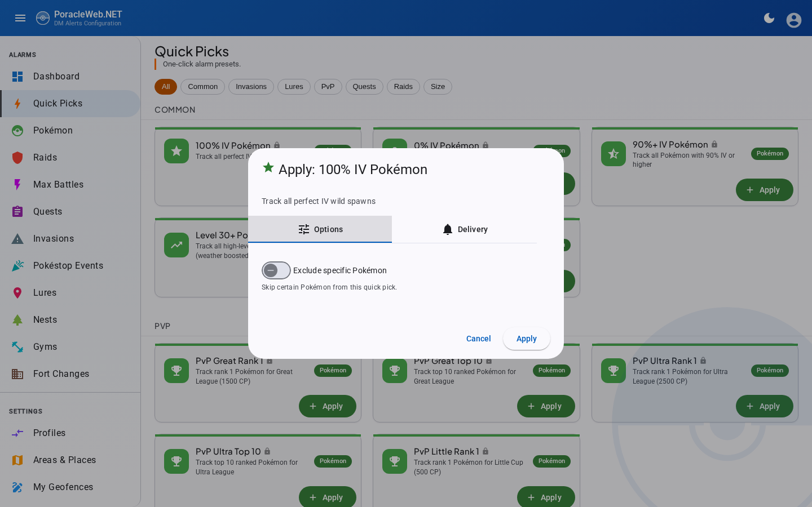

Applying a pick creates only the alarms that are new. One that already exists, or would replace another alarm of yours, is skipped, and the confirmation counts only the alarms it created.

## Related

- [Quiet Periods](quiet-periods.md) — silence one gym, area, species or station for a while without
  touching the alarms themselves
- [Quest Summary Delivery](quest-summary-schedules.md) — collecting matching quests into one digest
- [Profiles](profiles.md) — keeping separate alarm sets and switching between them
- [PoracleNG Version Compatibility](../architecture/poracleng-compatibility.md) — which features need
  which server
