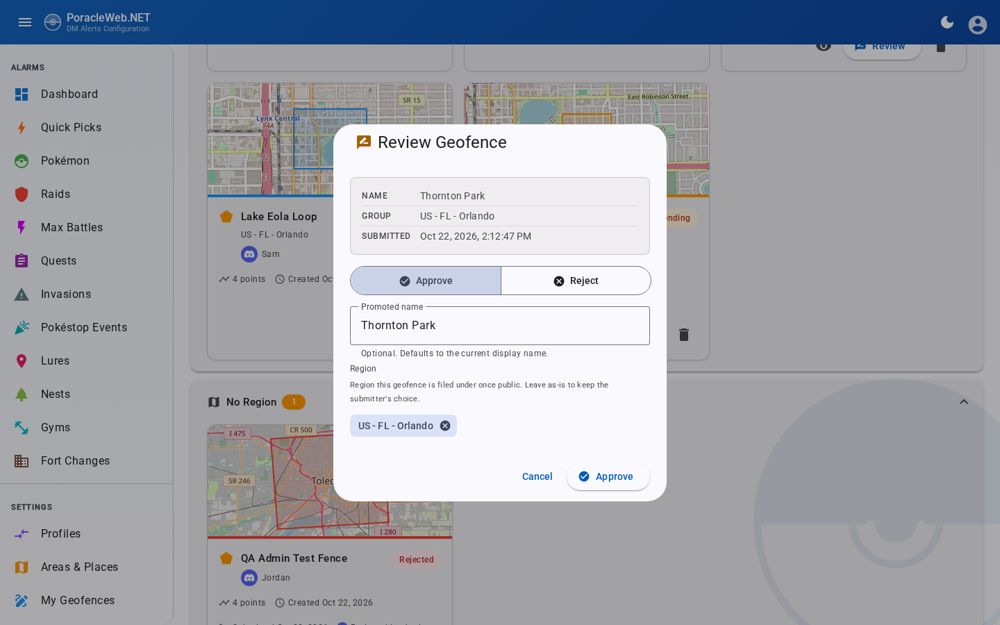
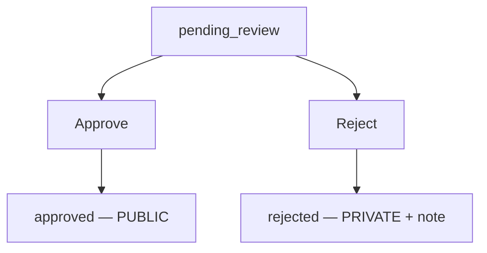
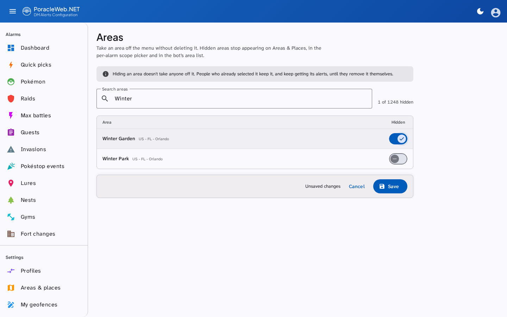

# Admin Operations

This page is the day-to-day admin reference: where to review submissions, how to approve/reject/delete, the optional Discord forum integration, and the limits that protect your deployment.

## The User Geofences screen

Admins get a **User Geofences** screen in the admin section of the sidebar. It opens on the review queue: every submission waiting for review, oldest first, one wide row each. The map takes the left of the row (click it for the full detail view), and the right says who submitted it, how many points and how many km² it covers, its region ("No region" when it has none), when it was submitted, and the public area its centre already falls inside, if any. **Reject…** and **Approve** open the review on that side.

Below the queue, every other geofence (active, approved and rejected) is in one sortable table: name, status, owner, region, points, created and submitted dates, and reviewer. Filter it by status. A rejected geofence keeps a Review button there, so a mistaken rejection can be reconsidered.

## Reviewing a submission

The queue row already shows the shape, the owner and the point count. **Approve** promotes it to a public Koji area, with a cleaner public name and optionally a region; [Private geofences & promotion](private-and-promotion.md#step-3a-approve-the-actual-promotion) has the full effect. **Reject** declines it with a short reason, and the geofence stays private for its owner.

### Choosing a region at approval time

If your Koji project has regions, the approval dialog shows a region picker, pre-filled with whatever region the submission already had. Keep it, pick a different region to file the area under, or clear it to promote the area ungrouped.

If your project has **no regions**, the picker simply doesn't appear, and the area is promoted ungrouped. You can always organize it in Koji afterward.

With `[area_security]` on in PoracleNG, the promoted name must also be in the owner's community `allowed_areas`. If it isn't, PoracleNG refuses to move the owner's subscription to the new name, and you see the "areas weren't moved" warning after approving. The approval stands; the owner picks the area on the Areas page.

## Deleting geofences

Admins can delete any geofence from the admin screen:

- If it's a **private** geofence, it's removed from PoracleWeb.NET and from every profile that had it switched on. If the owner has alarms limited to it, the dialog names the owner and asks whether to delete those alarms too (the default) or keep them on the owner's profile areas. If PoracleNG can't take the name off the owner's profiles, nothing is deleted and you can retry.
- If it was **ever promoted to Koji**, PoracleWeb.NET also removes it from the Koji project so it stops being a selectable public area. The test is "was this published?", not the current status — a geofence approved and later rejected still has to be pulled out of the shared project.

!!! warning "Project removal vs. full deletion"
    Removing a public geofence from the *project* stops it being selectable, but the geofence row may still exist in Koji's own database. To scrub it completely, delete it in the **Koji UI**. See [Troubleshooting](troubleshooting.md#removing-a-geofence-from-koji-completely).

## Optional: Discord forum integration

You can have PoracleWeb.NET open a **Discord forum thread** for each submission, so your admin team can discuss and track decisions in Discord. It's entirely optional — everything works without it.

| Config | What it does |
|---|---|
| `Discord:GeofenceForumChannelId` | The Discord **forum channel** where submission threads are created. Leave unset to disable. |
| `Site:PublicUrl` | Optional. The public URL of your site, no trailing slash. Makes the review card's title a link straight to the User Geofences screen. The link is omitted when unset. |

### The review card

**On submit**, a thread is created titled after the geofence, tagged **Pending**, with a card built to be decided on without leaving Discord:

| Field | Why it's there |
|---|---|
| **Size** | Area in km² plus a plain-language band (`a block or two`, `neighbourhood`, `district`, `city-sized`, `very large`). This is the main gate — approving publishes the area to everyone, so a neighbourhood is fine and a whole metro usually isn't. The map alone can't tell you: a static map auto-zooms to fit, so a park and a county look identical. |
| **Region** | The auto-detected Koji parent region, or `Not detected`. |
| **Publishes as** | The lowercase name the area would take in the shared public list. This is what approval actually publishes, so `zz my house` and `Bowie - Melford` are worth telling apart before you click. |
| **Location** | Centroid coordinates with a maps link. Matters most when the region wasn't detected. |
| **Already covered by** | Only shown when the area's centre falls inside an existing public area, naming it, so duplicates are visible without opening a map. It's a centre-point test, not a true overlap measurement — a partial overlap won't trigger it. |

The submitter appears in the card's author line, with a clickable mention in the message above it. The map is uploaded to Discord as an attachment rather than linked, so it doesn't expire when the tile server drops its cached copy.

The colour bar tracks state: **amber** while pending, **green** approved, **red** rejected.

**On approve/reject**, PoracleWeb.NET rewrites the original card in place — new colour, updated footer, the published name, and on rejection the reason — then posts the outcome as a reply, retags the thread **Approved**/**Rejected**, and **locks and archives** it. Rewriting the opening post means anyone opening the thread later sees the outcome immediately instead of scrolling for it.

If Discord is unreachable or the channel isn't set, the submission still works — the geofence still moves to `pending_review`/`approved`/`rejected`. The forum post is a convenience, never a blocker. The same applies to the individual pieces: a failed map download falls back to linking it, a failed card rewrite still posts the outcome reply, and a Koji outage just omits the "Already covered by" line.

!!! note "Bot token and tags"
    PoracleWeb.NET uses the Discord bot token from your PoracleNG server's Discord bot configuration. The forum tags (`Geofence - Pending` / `Approved` / `Rejected`) are created automatically the first time they're needed. If you rename those tags in Discord, restart PoracleWeb.NET so it re-reads them.

## Limits that protect your deployment

These are built in to keep things sane — you don't configure them, but it helps to know them when a user asks why something was blocked:

| Limit | Value | Why |
|---|---|---|
| Geofences per user | **10** | Stops any one user flooding the system. |
| Points per polygon | **3 – 500** | A polygon needs at least 3 points; 500 caps absurdly detailed shapes. |
| Name | 1–50 characters, letters/numbers/spaces and `- ' . ( ) &` | Keeps names clean and bot-safe. |
| GeoJSON import | ≤ 5 MB, ≤ 50 shapes per file | Bulk-import guardrails. |

Duplicate names are handled automatically — if a user picks a name that's taken, PoracleWeb.NET appends a number (`downtown 2`, `downtown 3`, …).

## Taking an area off the menu

Separate from anything users draw: **Admin → Areas** lists every area Koji serves and lets you hide
one without deleting it — staging fences, test polygons, a region you cover but do not advertise.

A hidden area leaves **Areas & Places**, the per-alarm delivery scope picker and the bot's own area
list together, because all three read the same flag. It does **not** unsubscribe anyone who already
selected it, and their later saves keep it; see
[Hiding an area from your users](koji-and-regions.md#hiding-an-area-from-your-users), and
[Troubleshooting](../../troubleshooting.md#an-area-i-hid-is-still-sending-alerts) for the symptom that
brings people to ask.

## Turning the whole feature off

If you don't want user-drawn geofences at all, there's an admin site setting (`disable_user_geofences`) that hides the whole feature — the user *My Geofences* page and the admin review queue both stop being reachable, and the create, rename, submit, import and per-profile toggle endpoints answer 403.

Existing geofences are **not** deleted and keep alerting: they stay in the geofence feed, and deleting and exporting them still works. What's frozen is making new ones and changing the ones that exist. Toggle it from the admin **Settings** page.
