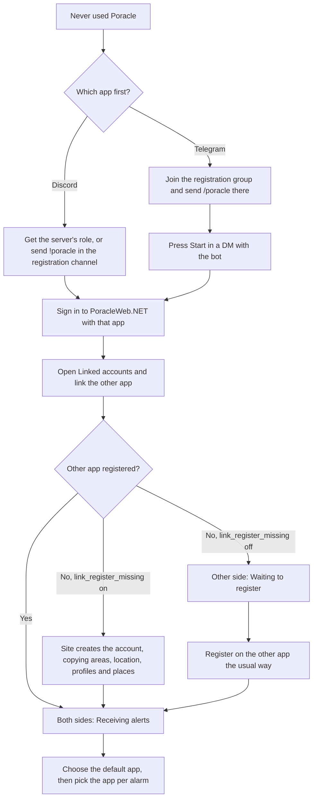

# Discord and Telegram

PoracleNG delivers alerts through two apps, Discord and Telegram, and a server can run either or both. Each
app keeps its own accounts. A person who uses both has two PoracleNG accounts, a `discord:user` and a
`telegram:user`, with their own alarms, areas, location and profiles. PoracleWeb.NET signs people in with
either, and [linking](linked-accounts.md) lets one person treat the two as one.

This page is for operators deciding what to offer and for members wondering which app to use. The Telegram
setup itself is in [Telegram](../configuration/telegram.md).

## What each app does

| | Discord | Telegram |
|---|---|---|
| Sign in to PoracleWeb.NET | Discord OAuth2 (see [Discord OAuth2](../getting-started/discord-oauth.md)) | Telegram's login widget, on the one domain set with `/setdomain` |
| Turn sign-in on | `DISCORD_CLIENT_ID` and secret (required to start, even on a Telegram-only site), plus the `enable_discord` site setting | `TELEGRAM_ENABLED`, `TELEGRAM_BOT_TOKEN`, `TELEGRAM_BOT_USERNAME`, plus the `enable_telegram` site setting |
| PoracleNG account type | `discord:user` | `telegram:user` |
| How a person registers | A registration channel (`!poracle`), or a role listed in `user_role` that grants access without registering | Sending `/poracle` in a registration group the bot is in; optionally `/start` in a DM with `register_on_start` |
| Bot commands | Prefix `!` by default (`!location`, `!profile`) | Prefix `/` (`/location`, `/profile`) |
| Direct messages | The bot can DM anyone who shares a server with it and allows DMs from server members | The bot can DM only someone who has started a chat with it (pressing **Start**, or allowing messages in the login widget) |
| Destinations | Webhooks, channels and threads | Channels, groups and topics |
| Mentions on an alarm | A role or a person, on a webhook, channel or thread (the **Mention** field) | Not offered |
| Periodic access check | `[discord] check_role`: still in a guild and holding a role | `[telegram] check_role`: still in a registration group |
| Area security communities | `discord = { channels, user_role }` | `telegram = { channels }` |

Test alerts, quiet periods, quest summaries, profiles and clean mode work the same on both. The message
itself comes from PoracleNG's templates, which can differ per app.

Destinations are covered in [Destinations & delegates](webhooks.md). They are never linked: a Telegram
group and a Discord channel stay separate destinations, each with its own alarms.

## Registering on each app

PoracleWeb.NET doesn't register anyone by default. A person has to exist in PoracleNG before they can sign
in, and signing in with an app they haven't registered on answers "Your account is not registered".

On **Discord**, the server's own setup decides. Usually it's a role from the community's Discord server
(PoracleNG's `user_role`, or a community's `user_role` with area security), or `!poracle` in a registration
channel.

On **Telegram**, PoracleNG only registers someone who is a member of a registration group, and only the bot
can check that. The usual route is to join the group and send `/poracle` there. The bot reacts, posts a
welcome in the group, and DMs a confirmation, which arrives only once the person has started a chat with the
bot. [Telegram](../configuration/telegram.md#how-people-register) has every route and what each one says.

The one exception is **Register the other account when linking** (`link_register_missing`). With it on,
linking creates the missing account on the other app, skipping that app's registration rules.

## From never used Poracle to both apps

This diagram follows a member who starts with neither account and ends with both linked and receiving
alerts. The Telegram branch is the same whether they link first or register first.

## What linking ties together

Linking pairs one `discord:user` with one `telegram:user`. Nothing is merged inside PoracleNG: there are still
two accounts, and PoracleNG still sends each alert from the account that holds the alarm. PoracleWeb.NET
does the joining.

- **Alarms** are listed together, each marked with its app, and each alarm goes to one app. You pick the app
  per alarm and can move alarms between apps.
- **Person-level settings** (location, saved places, areas, profiles, language, quiet periods, summary
  schedules, and alerts on or off) are saved to both accounts from the site.
- **Bot commands** change one account only. When the two drift apart, PoracleWeb.NET shows the difference
  and lets the person choose which app's setting to keep.

The full behaviour is in [Linked accounts](linked-accounts.md).

## Choosing what to offer

Running only Discord needs nothing on this page. Adding Telegram means a bot, a registration group and
Telegram sign-in on the site; [Telegram](../configuration/telegram.md) walks through it. Linking is on by
default once both sign-ins work, and the [Linked accounts settings](linked-accounts.md#settings) cover the
choices an operator makes.
