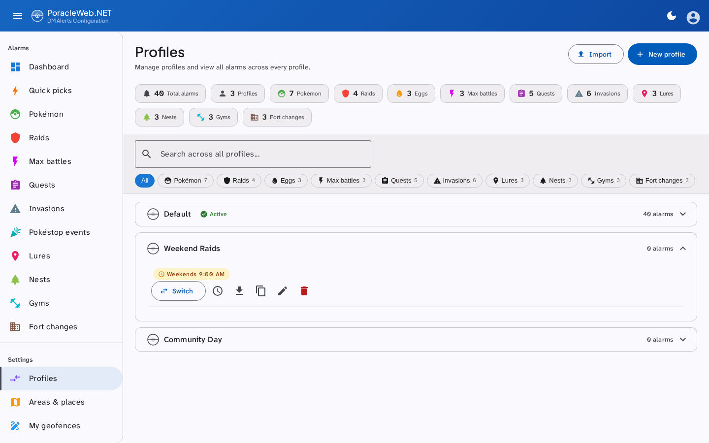
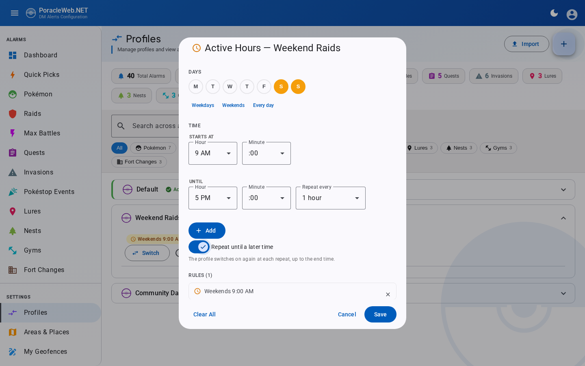

# Profile Management

Profiles let users maintain separate alarm configurations for different situations -- home, work, events, Pokemon GO Community Days, and more. Each profile has its own alarms, areas, location, and geofence activations, so switching between setups is instant.

## Cross-Profile Overview

The Profiles page provides a consolidated view of all profiles and their alarms in one place.

A stats bar at the top counts alarms per type across all profiles. The search bar filters every profile's alarms by name, Pokemon or other attributes, and ten type chips (Pokemon, Raids, Eggs, Max Battles, Quests, Invasions, Lures, Nests, Gyms and Fort Changes) narrow the view. Each profile is an expandable panel with its alarms grouped by type.

A rule that matches another rule of the same type carries an orange copy tag, so redundant filters stand out. Hovering the tag names the other profiles carrying it, or says the duplicates all sit on this one.

!!! tip
    Use the search bar and type filters together to quickly find a specific alarm across all your profiles. For example, search for "Gible" with the Pokemon filter chip active to see which profiles are tracking it.

!!! note "A duplicate is only ever a duplicate of the same type"
    Poracle numbers each alarm type separately, so a raid rule and a Pokemon rule can carry the same id
    without being related. Matching is done within a type for that reason. The summary chip beside
    **Total Alarms** and the **Duplicates** filter chip count the same thing — rules, not groups of
    them — so the number you click is the number of cards you get. Duplicates within a single profile
    count too: 30 copies of one Pokemon rule on one profile is 30 duplicates.

!!! warning "Pokéstop Event rules sit among the invasion rows"
    Showcase, Kecleon and Gold Stop rules have no section of their own in the overview. They are listed
    among the invasion rows, with the event name as the grunt. **Export** folds them into the invasion
    list the same way, **Import** saves them back as Pokéstop Event rules, and **Duplicate** copies them
    with the rest. Manage them from the [Pokéstop Events page](alarms.md#pokestop-event-alarms).

## Creating & Switching Profiles

Press **New profile** at the top right to create one. The dialog takes up to 32 characters and flags a name you already use; the server itself accepts up to 255 and doesn't insist on unique names. **Switch** makes a profile the active one, marked with a green badge. The pencil renames a profile, and the bin deletes one, except the active profile, which can't be deleted.

Each profile maintains its own independent:

- Alarm filters (Pokemon, Raids, Eggs, Quests, Invasions, Pokéstop Events, Lures, Nests, Gyms, Fort Changes, Max Battles)
- Area selections
- Saved location
- Custom geofence activations

!!! warning
    Switching profiles changes which alarms are active immediately. Make sure you are on the correct profile before modifying alarms or areas.

## Profile Duplication

The **copy icon** on any profile creates an exact duplicate with all alarm filters.

You're asked for a name, pre-filled as "<source name> (Copy)". Every alarm filter on the source profile is copied, Pokéstop Event rules and webhook mentions included, using PoracleNG's own profile copy ([#993](https://github.com/PGAN-Dev/PoracleWeb.NET/issues/993)). Area selections, location and active hours are copied too, and your active profile doesn't change.

!!! note "Duplication copies the whole profile, geography included"
    This changed in #503. `addProfile` upstream ignores area, latitude and longitude, so a copy used to
    silently inherit whatever the *active* profile had — the right alarms over the wrong map, and a
    location that also drives the active-hours timezone. The duplicate now carries the source profile's
    geography, so it starts alerting immediately. Change the areas afterwards if that is not what you
    wanted.

!!! note "Area limit"
    When PoracleNG caps how many areas a user can pick (`[tracking] max_areas`), a new or duplicated profile is
    held to that cap as a fresh list. One over it is refused with "You can select at most N areas. Remove one
    before adding another.", and the half-made profile is deleted, so nothing is left behind. A profile already
    over a lowered cap keeps its areas, but they can't be copied into another one, which is PoracleNG's own rule.
    Admins and destinations that aren't a person aren't limited. See [Alarms](alarms.md) for the per-alarm cap.

## Profile Export & Import

### Export

The **download icon** saves a JSON backup file containing all alarms from that profile. Internal IDs are stripped from the export to ensure portability across different PoracleWeb.NET installations.

### Import

1. Tap the **upload button** on the Profiles page
2. Select a previously exported JSON backup file
3. Choose a name for the new profile. A name you already use gets a numeric suffix, "Home (2)"

The alarms are written straight to the new profile, so your active profile stays as it is. Every alarm is checked before the first is saved, and one that already exists or would replace another is skipped. An import carries alarms only: the new profile starts with no areas, so pick them afterwards.

!!! tip
    Export your profiles before making major changes. The backup file can be used to restore your configuration if something goes wrong, or to share alarm setups with other users.

## Active Hours

Active hours let you schedule automatic profile switching based on time of day. Instead of manually switching between profiles, PoracleNG's built-in scheduler activates the right profile at the right time -- your "Work" profile turns on when you arrive at the office and your "Home" profile takes over when you leave.

### How the scheduler works

Each active hours rule defines a specific activation point: a day of the week, an hour, and a minute. PoracleNG checks every few minutes and switches to the profile whose most recent activation time matches the current local time (within a 10-minute matching window).

A rule's day runs from Monday (1) to Sunday (7), its hour from 0 to 23 and its minute from 0 to 59.

When multiple profiles have active hours configured, the scheduler treats them as a timeline. At 9:00 AM on Monday, if your "Work" profile has a rule for Monday at 9:00, PoracleNG activates it. At 6:00 PM, if your "Home" profile has a Monday 18:00 rule, it switches to that profile. The switch happens automatically with no user interaction.

!!! warning "Timezone is determined by profile coordinates"
    PoracleNG determines the local timezone from the profile's saved coordinates. If a profile has **0,0 coordinates** (no location set), PoracleNG falls back to **UTC**, which will cause schedule switches to happen at the wrong times relative to your actual timezone. Always set a location on each profile that uses active hours.

### Using the schedule editor

The schedule editor is accessed from the Profiles page by clicking the **clock icon** on any profile card.

#### Setting up a schedule

1. **Select days** using the circular day buttons (**M T W T F S S**). Several can be selected at once, and the **Weekdays**, **Weekends** and **Every day** presets select Monday to Friday, Saturday and Sunday, or all seven
2. **Choose a time** using the **hour** and **minute** dropdowns
3. Optionally turn on **Repeat until a later time** to make the rule repeat (see below)
4. Click **Add** to create entries for all selected days at the chosen time
5. Repeat to add additional activation times as needed

#### Repeating rules

A rule can fire more than once. Turn on **Repeat until a later time**, pick an end time and a repeat
interval, and the rule fires at its start time, then every *N* hours, up to and including the end.
A 9:00 AM to 5:00 PM rule repeating every 2 hours fires at 9, 11, 1, 3 and 5.

This is a repeat, not a continuous window. The profile is re-asserted at each of those moments; it is
not held on between them. Nothing else switches the profile off in the meantime, so in practice the
profile stays active until some other rule takes over -- but if you want a guaranteed hand-off, give the
other profile its own rule at the time you want it to take back over.

The end time must be later than the start time. A rule that spans midnight is not supported (this is
PoracleNG's rule, not ours); use two rules instead. Ranges set from the Poracle bot with
`!settime weekday:9-17/2` appear here exactly as you set them, and edit and save without being flattened.

#### Managing rules

- The **rules list** displays all configured rules, grouped by time when multiple days share the same activation time (e.g., "Mon-Fri at 9:00 AM" instead of five separate entries). A repeating rule carries a circular-arrow icon instead of the plain clock, and reads "Weekdays 9:00 AM-5:00 PM, every 2h"
- Each rule or group has a **remove button** to delete it
- **Clear all** removes every rule, so the profile is switched on only by hand
- **Save** sends the schedule to PoracleNG straight away, and **Cancel** discards unsaved changes

#### Mini weekly preview

Below the rules list, a visual timeline shows when each activation time occurs during the week. This gives a quick at-a-glance view of your schedule coverage across all seven days. A repeating rule draws a translucent band across its window with a dot at each repeat; past a dozen repeats the dots are dropped and the band shows on its own.

### Schedule display on profile cards

Each profile card on the Profiles page shows its schedule status:

Amber pills show the activation times, grouped by day pattern ("Mon-Fri 9:00 AM", "Sat-Sun 7:00 AM"). A repeating rule reads "Mon-Fri 9:00 AM-5:00 PM, every 2h", or "..., hourly" when the interval is one hour. A profile with no active hours says "Manual only": it becomes active only when you switch to it.

### Location warning

A red warning banner appears on a profile card when that profile has active hours configured but its coordinates are set to 0,0 (no location). This indicates the schedule may trigger at incorrect times because PoracleNG will use UTC instead of the user's local timezone.

To fix this, set the profile's pin from the **Dashboard** or the **Areas & places** page while that profile is active.

### Validation rules

| Rule | Constraint |
|---|---|
| Day | Must be 1-7 (Monday through Sunday) |
| Hour | Must be 0-23 |
| Minute | Must be 0-59 |
| Repeat interval | 1-23 hours when repeating; absent or 0 means a single activation |
| End time | Must be later than the start time when repeating; cannot span midnight |
| Maximum entries | 28 per profile (4 time slots per day x 7 days) |

!!! note
    The 28-entry limit allows up to 4 activation times per day across all 7 days. In practice, most users need far fewer -- typically 2-3 profiles with 1-2 activation times each.

### Example schedule

A typical three-profile setup for a user who plays Pokemon GO around their daily routine:

**Profile "Work"** -- Weekdays at 9:00 AM

:   Activates Monday through Friday at 9:00 AM. Configured with office-area geofences and Pokemon filters focused on nearby spawns during lunch breaks.

**Profile "Home"** -- Weekdays at 6:00 PM, Weekends at 7:00 AM

:   Takes over on weekday evenings and weekend mornings. Uses home-area geofences with broader Pokemon and raid filters for local play.

**Profile "Off"** -- Every day at 11:00 PM

:   Activates nightly to reduce notifications during sleep. Can be configured with no areas (silent) or with a minimal set of high-priority filters (e.g., only 100% IV Pokemon).

With this schedule, PoracleNG automatically cycles through the three profiles without any manual switching:

| Time | Mon | Tue | Wed | Thu | Fri | Sat | Sun |
|---|---|---|---|---|---|---|---|
| 7:00 AM | | | | | | Home | Home |
| 9:00 AM | Work | Work | Work | Work | Work | | |
| 6:00 PM | Home | Home | Home | Home | Home | | |
| 11:00 PM | Off | Off | Off | Off | Off | Off | Off |

!!! tip
    You do not need to cover every hour of the day. A profile stays active until the next scheduled activation time. In the example above, the "Off" profile remains active from 11:00 PM until 9:00 AM on weekdays (or 7:00 AM on weekends) when the next profile takes over.

## Weather Per Profile

The dashboard shows current weather conditions at your pin. Since each profile carries **its own pin**, weather information varies by profile.

For example, a "Home" profile with a residential location and a "Work" profile with an office location will each display the weather relevant to their respective area, helping you understand which weather-boosted Pokemon to expect at each location.
