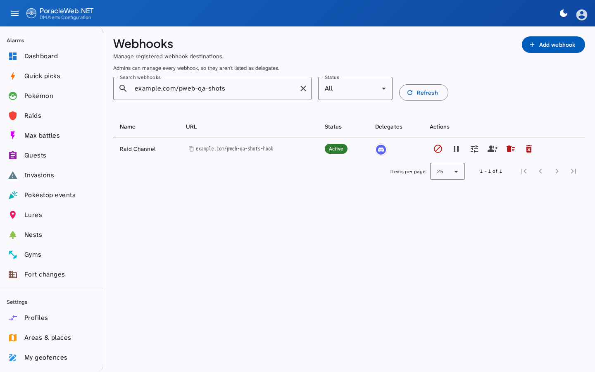
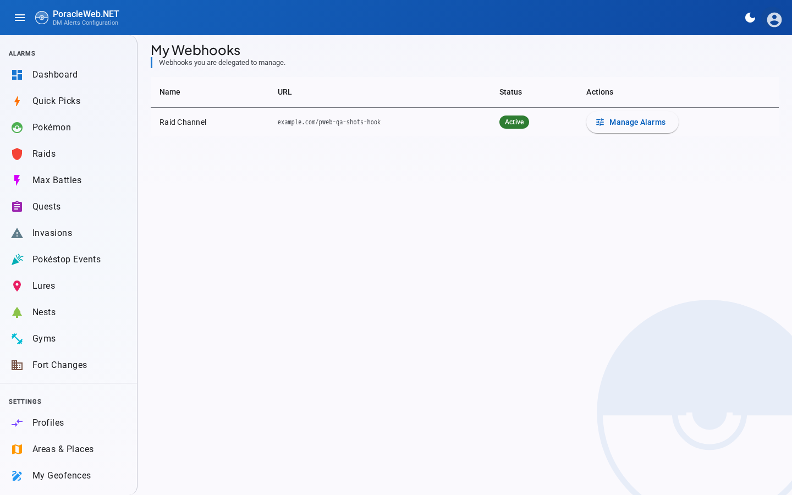

# Destinations and delegates

A **destination** is a Poracle account that alerts are posted into rather than sent to a person. It
holds alarms exactly as a person does (profiles, areas, a pin, filters), but nobody signs in as it.
The commonest kind is a **webhook**: an account whose id is a Discord webhook URL. Communities use one
per feed: a raids channel, a hundo channel, a nests channel.

A **delegate** is a person allowed to manage one of those accounts without being an administrator of
this site.

## People and destinations

Poracle keeps people and destinations in one table, told apart by a type. **Admin → Users** lists the
people. **Admin → Destinations** lists everything else, so a Discord channel or a Telegram group never
shows up as a user you could block or impersonate by mistake. The Users page links across to
Destinations.

| Kind | Poracle type | Listed under |
|---|---|---|
| Person | `discord:user`, `telegram:user`, or no type at all (older accounts) | Users |
| Webhook | `webhook` | Destinations |
| Discord channel | `discord:channel` | Destinations |
| Discord thread | `discord:thread` | Destinations |
| Telegram channel | `telegram:channel` | Destinations |
| Telegram group | `telegram:group` | Destinations |
| Telegram topic | `telegram:topic` | Destinations |

Anything else Poracle holds with a type that isn't a person also lands on Destinations, shown with
its raw type, rather than on neither page. That covers an operator's typo or a type added later. Only
webhook rows take delegates.

The Destinations page has a search box and a filter by type (the chips appear only when more than one
type is present), plus the usual status filter. Each row has a button that copies its id, which for a
webhook is the whole URL even though the page shows it shortened.

## Creating a webhook

**Admin → Destinations → Add destination**, with a display name and the Discord webhook URL. The URL is the
account id, so it must be unique; an existing one is refused rather than merged. If Poracle rejects
the account, the half-written record is removed, so a failure means nothing was created and a retry
is safe.

The same page can pause, resume, block, delete the account's alarms, delete the account outright, and
open its alarms directly (see [what a delegate can do](#what-a-delegate-can-do)).

Deleting a webhook takes everything it owned with it, delegate grants included. Recreating the same
URL later starts clean rather than adopting the old grants.

## Adding a delegate

**Admin → Destinations →** the group-add icon on the webhook's row. Only webhooks take delegates.

Both accounts have to exist first, and the delegate has to be a person: a channel or group can't sign
in, so a grant to one is refused. The person must have registered with the Poracle bot and signed in
at least once, so there is an account to grant; a grant naming an account that does not exist is
refused rather than stored.

Search for them and select. The grant is written immediately, and they can reach the webhook on their
next page load — no sign-out, no restart.

The dialog shows three kinds of chip:

| Chip | Source | Removable here |
|---|---|---|
| Locked, "global admin" | Poracle's `admins` list, or `PORACLE_ADMIN_IDS` | No |
| Locked, "config delegate" | Poracle's own config | No |
| Removable | This site's `webhook_delegates` table | Yes |

The locked ones are shown so you can see who already has access, not so you can change it. They come
from somewhere this site does not write.

## What a delegate can do

**Settings → My Webhooks** lists the webhooks they manage (for now it covers webhooks only, not the other kinds of destination). **Manage alarms** switches the session to
that webhook: from there they see the site as it does, and can set up alarms, areas, profiles, its
pin, and send test alerts. A banner names the account being viewed, and the button on it returns them
to their own.

A delegate **cannot** create or delete webhooks, grant delegation to anyone else, or reach any admin
page. Their access is exactly the webhooks granted to them and nothing more, re-checked on every
attempt rather than trusted from their sign-in.

## Mentions on a webhook's alarms

A webhook's alerts land in a channel, so an alarm can mention a role or a person when it fires. While
you're managing another account (a delegate on a webhook, or an admin viewing one), the edit dialogs
have a **Mention** field taking a Discord role (`<@&123456789012345678>`) or a person
(`<@123456789012345678>`). Every type has it except Pokéstop Events. It isn't offered on your own
alarms, where it would have nobody to notify, and it isn't in the add dialogs: add the alarm, then
edit it to set the mention.

The mention is stored as the rule's `ping`. Later edits from the web, a bulk distance change and the
cleaning toggle keep it, and duplicating a profile copies it.

## Viewing as another account

The same session switch is open to admins for any account. **Admin → Users** lists every person Poracle
knows. **View** on a row opens the site as that account, and the row's menu stops or starts their
alerts, blocks them, or deletes their alarms or the account.

While viewing, a banner reads "Viewing as" and the account's name, with **Back to your account** to
return. Quiet-period writes are refused in that session, so an admin checking why someone gets nothing
can't silence them by accident.

## Do you need to edit Poracle's config?

**For managing the webhook on this site, no.** Alarm writes reach Poracle over a server-to-server
secret, and the authorisation happens here. A row in this site's own table is enough, which is what
the admin dialog writes.

**For managing it through the Discord bot, yes.** That is `discord.webhook_admins` in Poracle's
config, and it needs a Poracle restart. This site cannot grant it.

The two are independent, and someone who should have both needs both. This site accepts either as
proof for its own access: a delegate configured in Poracle gets **My Webhooks** here without anyone
adding a row.

## Where delegation is resolved from

Three sources, unioned on every check:

| Source | Covers |
|---|---|
| Poracle's `getAdministrationRoles` | `discord.webhook_admins` and any Discord guild-role delegation Poracle performs |
| This site's `webhook_delegates` table | What the admin dialog writes |
| Administrators, from `PORACLE_ADMIN_IDS` or Poracle's `admins` list | Every webhook. They're never listed as delegates of a particular one |

A Poracle-side grant names its webhook however the operator wrote it in `webhook_admins` — by the
webhook's name, or by its URL. Either is resolved to the webhook it names before anything is decided,
so both work. A grant naming a webhook this Poracle has no account for is ignored: it grants access to
nothing, and counting it would put **My Webhooks** in the sidebar over an empty page.

The answer is cached for a minute per person, so granting or revoking takes effect within about that
long rather than at their next sign-in. A lookup that cannot reach one of its sources is never
cached, and falls back to what the session already knew rather than dropping access mid-session.

## Troubleshooting

**They cannot see My Webhooks.** The nav item appears only for people who manage at least one
webhook. Check the grant exists on the webhook's delegates dialog, and that they signed in at least
once before being granted — a grant to an account that never existed is refused, so an absent chip
means it was never written.

**Impersonating them hides the page.** It does not any more — an impersonation session sees the
delegate's webhooks, which is the point of looking. Impersonating a second account from inside that
session is refused; leave the first one before starting another.

**They can see it in Discord but not here, or the reverse.** These are separate grants. The bot side
is Poracle's config; this side is the delegates dialog. Having one does not imply the other, although
a Poracle-side grant does also work here.

**My Webhooks is in the sidebar but the page is empty.** The grant names a webhook that does not exist
here. The usual cause is a `webhook_admins` target that no longer matches any webhook — a URL whose
token was rewritten when the config was converted from PoracleJS's JSON, for instance. Naming the
webhook by its name rather than its URL avoids the whole class of problem.

**A revoked delegate still has access.** Give it a minute — the resolution is cached that long.
Beyond that, check whether they are a global admin or hold a Poracle-side grant, both of which this
site can display but not remove.

## Related

- [Site Settings](../configuration/site-settings.md) — the admin settings the webhook pages sit
  alongside
- [Database](../architecture/database.md) — the `webhook_delegates` table
