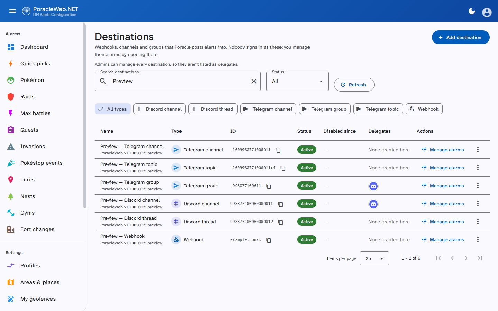
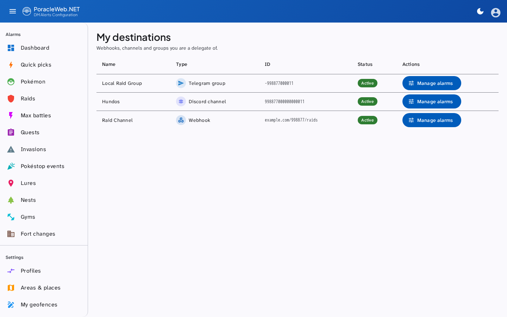
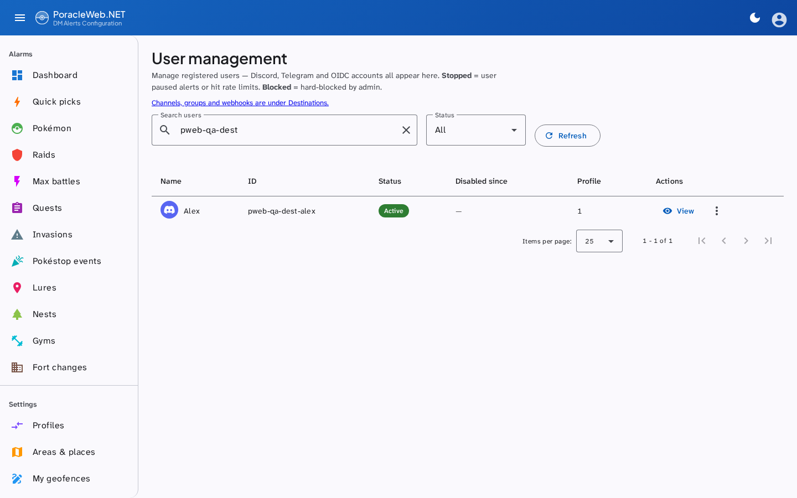
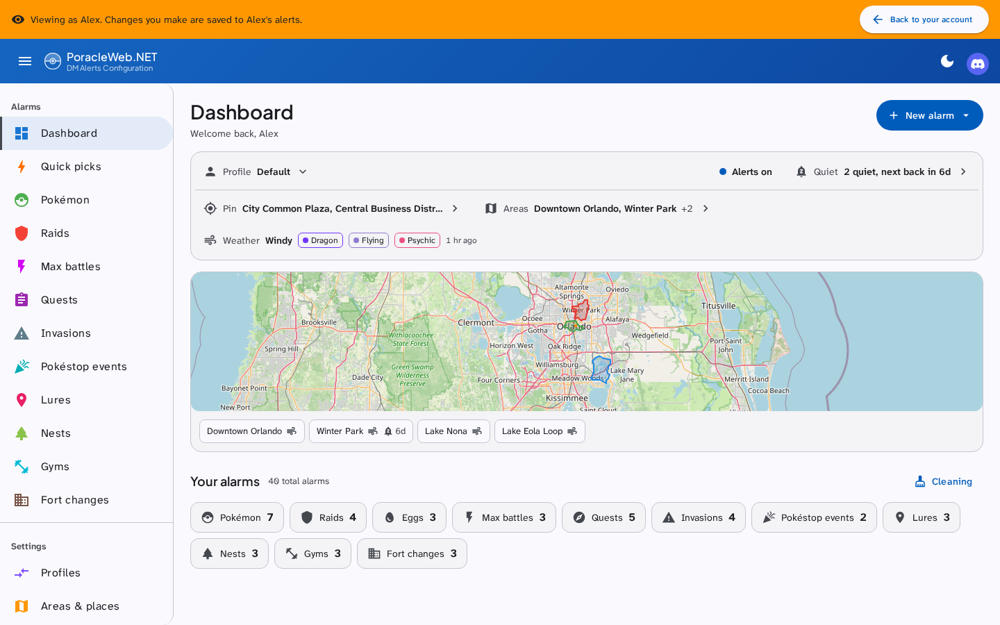

# Destinations and delegates

A **destination** is a Poracle account that alerts are posted into rather than sent to a person. It
holds alarms exactly as a person does (profiles, areas, a pin, filters), but nobody signs in as it.
The commonest kind is a **webhook**: an account whose id is a Discord webhook URL. Communities use one
per feed: a raids channel, a hundo channel, a nests channel.

A **delegate** is a person allowed to manage one of those accounts without being an administrator of
this site.

## People and destinations

Poracle keeps people and destinations in one table, told apart by a type. **Admin → Users** lists the
people. **Admin → Destinations** lists everything else, so a Discord channel or a Telegram group never
shows up as a user you could block or impersonate by mistake. The Users page links across to
Destinations.

| Kind | Poracle type | Listed under |
|---|---|---|
| Person | `discord:user`, `telegram:user`, or no type at all (older accounts) | Users |
| Webhook | `webhook` | Destinations |
| Discord channel | `discord:channel` | Destinations |
| Discord thread | `discord:thread` | Destinations |
| Telegram channel | `telegram:channel` | Destinations |
| Telegram group | `telegram:group` | Destinations |
| Telegram topic | `telegram:topic` | Destinations |

Anything else Poracle holds with a type that isn't a person also lands on Destinations, shown with
its raw type, rather than on neither page. That covers an operator's typo or a type added later. Such
a row can't take delegates and a delegate can't open it: only the six kinds above can.

The Destinations page has a search box and a filter by type (the chips appear only when more than one
type is present), plus the usual status filter. Each row has a button that copies its id, which for a
webhook is the whole URL even though the page shows it shortened.

## Adding a destination

**Admin → Destinations → Add destination.** The dialog asks what kind of destination it is first,
then for a name, the id that kind is addressed by, and an optional note. Poracle can post alerts into
six kinds:

| Kind | What to paste as the id | Where to find it |
|---|---|---|
| Webhook | The webhook URL, starting `http://` or `https://` | Discord: channel settings → Integrations → Webhooks → Copy Webhook URL |
| Discord channel | The channel's id, digits only (up to 20) | Turn on Developer Mode (User Settings → Advanced), then right-click the channel → Copy Channel ID |
| Discord thread | The thread's id, digits only (up to 20) | With Developer Mode on, right-click the thread and copy its ID |
| Telegram channel | The chat id, a negative number such as `-1001234567890` | Channels and supergroups start with `-100`. A bot added to the chat sees the id in every update it receives |
| Telegram group | The chat id, a negative number | A supergroup's id starts with `-100`; an older basic group's is shorter, such as `-1234567890`. Both are accepted |
| Telegram topic | Two fields: the group's chat id and the topic number, saved as `chat:topic` (`-1001234567890:42`) | Copy a link to any message in the topic. In `t.me/c/1234567890/42/100` the chat id is `-1001234567890` and the topic number is `42` |

The dialog refuses only an id that can't be real: letters in a Discord id, a positive Telegram chat
id, a topic number of zero. Nothing checks that the channel or chat exists, so paste the id rather
than typing it. Alerts sent to a wrong id go nowhere. For a Discord channel or thread, or any
Telegram kind, Poracle's own bot also has to be in that channel or chat and allowed to post there.

The id must be unique. If it's already in Poracle, the add is refused and names the account holding
it, for example: This ID is already in Poracle as "raids" (Discord channel). That way you can tell a
mistyped id from a destination you added before. If Poracle rejects the account, the half-written
record is removed, so a failure means nothing was created and a retry is safe.

The same page can pause, resume, block, delete the account's alarms, delete the account outright, and
open its alarms directly (see [what a delegate can do](#what-a-delegate-can-do)).

Deleting a webhook takes everything it owned with it, delegate grants included. Recreating the same
URL later starts clean rather than adopting the old grants.

## Adding a delegate

**Admin → Destinations →** the group-add icon on the destination's row. Any of the six kinds can take
delegates: a webhook, a Discord channel or thread, or a Telegram channel, group or topic. A row with any
other type has no icon.

Both accounts have to exist first, and the delegate has to be a person: a channel or group can't sign
in, so a grant to one is refused. The person must have registered with the Poracle bot and signed in
at least once, so there is an account to grant; a grant naming an account that does not exist is
refused rather than stored.

Search for them and select. The grant is written immediately, and they can reach the destination on
their next page load, with no sign-out and no restart.

The dialog shows three kinds of chip:

| Chip | Source | Removable here |
|---|---|---|
| Locked, "global admin" | Poracle's `admins` list, or `PORACLE_ADMIN_IDS` | No |
| Locked, "config delegate" | Poracle's own config | No |
| Removable | This site's `webhook_delegates` table | Yes |

The locked ones are shown so you can see who already has access, not so you can change it. They come
from somewhere this site does not write.

## What a delegate can do

**My Destinations**, under **Destinations** in the sidebar, lists every destination they manage with
its kind, so a Telegram group and a webhook of the same name can't be confused. **Manage alarms**
switches the session to that destination: from there they see the site as it does, and can set up
alarms, areas, profiles, its pin, and send test notifications. A test notification posts into the destination, not to
the delegate's DMs. A banner names what they're managing
("Managing Discord channel #raid-alerts"), and the button on it returns them to their own account and
to My Destinations. A session that ends because the grant was revoked lands there too.

The page used to be **My Webhooks** at `/my-webhooks`. That address redirects, so old bookmarks still
work.

A delegate **cannot** create or delete destinations, grant delegation to anyone else, or reach any
admin page. Their access is exactly the destinations granted to them and nothing more, re-checked on
every attempt rather than trusted from their sign-in. Opening an account checks its type at that
moment, so a grant whose id turns out to belong to a person opens nothing.

## Mentions on a destination's alarms

Alerts to a webhook, a Discord channel or a Discord thread land in a channel, so an alarm can mention a
role or a person when it fires. Telegram has no equivalent, so Telegram destinations don't get the
field. While you're managing one of those three (as a delegate, or an admin viewing it), the edit
dialogs have a **Mention** field taking a Discord role (`<@&123456789012345678>`) or a person
(`<@123456789012345678>`). Every type has it except Pokéstop Events. It isn't offered on your own
alarms, where it would have nobody to notify, and it isn't in the add dialogs: add the alarm, then
edit it to set the mention.

The mention is stored as the rule's `ping`. Later edits from the web, a bulk distance change and the
cleaning toggle keep it, and duplicating a profile copies it.

## Viewing as another account

The same session switch is open to admins for any account. **Admin → Users** lists every person Poracle
knows. **View** on a row opens the site as that account, and the row's menu stops or starts their
alerts, blocks them, or deletes their alarms or the account.

While viewing, a banner reads "Viewing as" and the account's name, with **Back to your account** to
return. Quiet-period writes are refused in that session, so an admin checking why someone gets nothing
can't silence them by accident. The quiet controls are hidden there for the same reason; a running
quiet period still shows its countdown.

## Do you need to edit Poracle's config?

**For managing a destination on this site, no.** Alarm writes reach Poracle over a server-to-server
secret, and the authorisation happens here. A row in this site's own table is enough, which is what
the admin dialog writes.

**For managing it through the bot, yes.** For a webhook that is `[[discord.webhook_admins]]` in
Poracle's config; for a channel it is `[[discord.delegated_admins]]` or `[[telegram.delegated_admins]]`.
Either needs a Poracle restart, and this site cannot grant them.

The two are independent, and someone who should have both needs both. This site accepts a
`webhook_admins` entry as proof for its own access, so a webhook delegate configured in Poracle gets
**My Destinations** here without anyone adding a row. A `delegated_admins` entry counts only when the
`delegation_poracle_channels` setting is on (see below).

## Where delegation is resolved from

Three sources, unioned on every check:

| Source | Covers |
|---|---|
| Poracle's `getAdministrationRoles` | `discord.webhook_admins` and any Discord guild-role delegation Poracle performs; the channel lists from `delegated_admins` only when `delegation_poracle_channels` is on |
| This site's `webhook_delegates` table | What the admin dialog writes, for any of the six kinds (the table's name predates that) |
| Administrators, from `PORACLE_ADMIN_IDS` or Poracle's `admins` list | Every destination. They're never listed as delegates of a particular one |

Every grant is checked against the list of destinations Poracle holds, read once a minute. A grant
naming a webhook however the operator wrote it in `webhook_admins` (by the webhook's name, or by its
URL) is resolved to the webhook it names, so both work. A name two webhooks share names neither of
them, so give webhooks distinct names before granting one by name. A channel grant from Poracle is matched by id
only. A grant naming nothing Poracle holds is ignored: it grants access to nothing, and counting it
would put **My Destinations** in the sidebar over an empty page.

### Letting Poracle's channel admins manage here

**Admin → Settings → Administration → Let Poracle's channel admins manage here** (`delegation_poracle_channels`)
is off by default. Poracle's `[[discord.delegated_admins]]` and `[[telegram.delegated_admins]]` say who
may administer a channel in the bot, which isn't necessarily who should manage its alarms here, so this
site ignores them until you turn it on. With it on, anyone those entries name gets the channels they
cover as delegations here. An entry for a whole Discord server covers only the channels registered
as destinations on this site, never every channel in the server. Saving the switch takes
effect straight away. If PoracleNG can't read the Discord channels at that moment, the list it reports
may be shorter until it can. See [Site Settings](../configuration/site-settings.md#administration).

The answer is cached for a minute per person, so granting or revoking takes effect within about that
long rather than at their next sign-in. A lookup that cannot reach one of its sources is never
cached, and falls back to what the session already knew rather than dropping access mid-session.

## Troubleshooting

**They cannot see My Destinations.** The nav item appears only for people who manage at least one
destination. Check the grant exists on the destination's delegates dialog, and that they signed in at least
once before being granted — a grant to an account that never existed is refused, so an absent chip
means it was never written.

**Impersonating them hides the page.** It does not any more: an impersonation session sees the
delegate's destinations, which is the point of looking. Impersonating a second account from inside that
session is refused; leave the first one before starting another.

**They can see it in Discord but not here, or the reverse.** These are separate grants. The bot side
is Poracle's config; this side is the delegates dialog. Having one does not imply the other, although
a Poracle-side grant does also work here.

**My Destinations is in the sidebar but the page is empty.** The grant names a destination that does
not exist here. The usual cause is a `webhook_admins` target that no longer matches any webhook — a URL whose
token was rewritten when the config was converted from PoracleJS's JSON, for instance. Naming the
webhook by its name rather than its URL avoids the whole class of problem.

**A revoked delegate still has access.** Give it a minute — the resolution is cached that long.
Beyond that, check whether they are a global admin or hold a Poracle-side grant, both of which this
site can display but not remove.

## Related

- [Site Settings](../configuration/site-settings.md): the admin settings the destination pages sit
  alongside, including `delegation_poracle_channels`
- [Database](../architecture/database.md) — the `webhook_delegates` table
