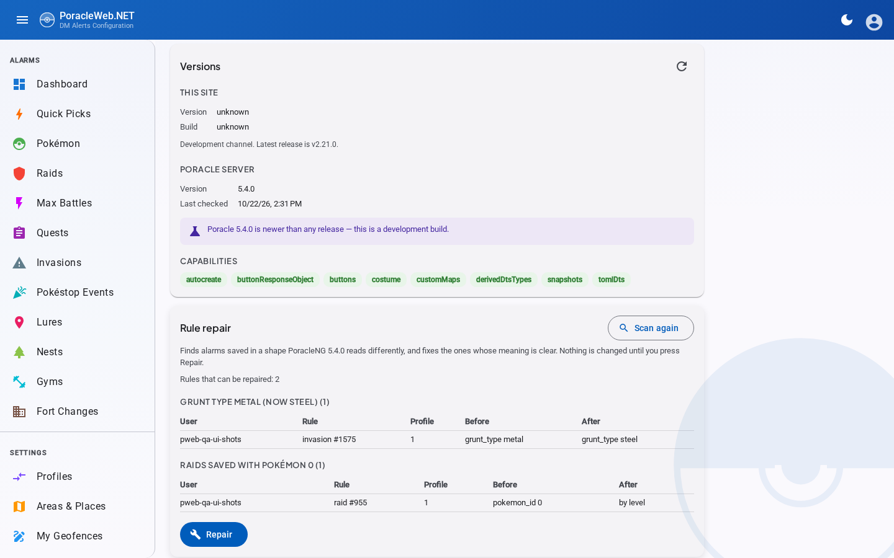
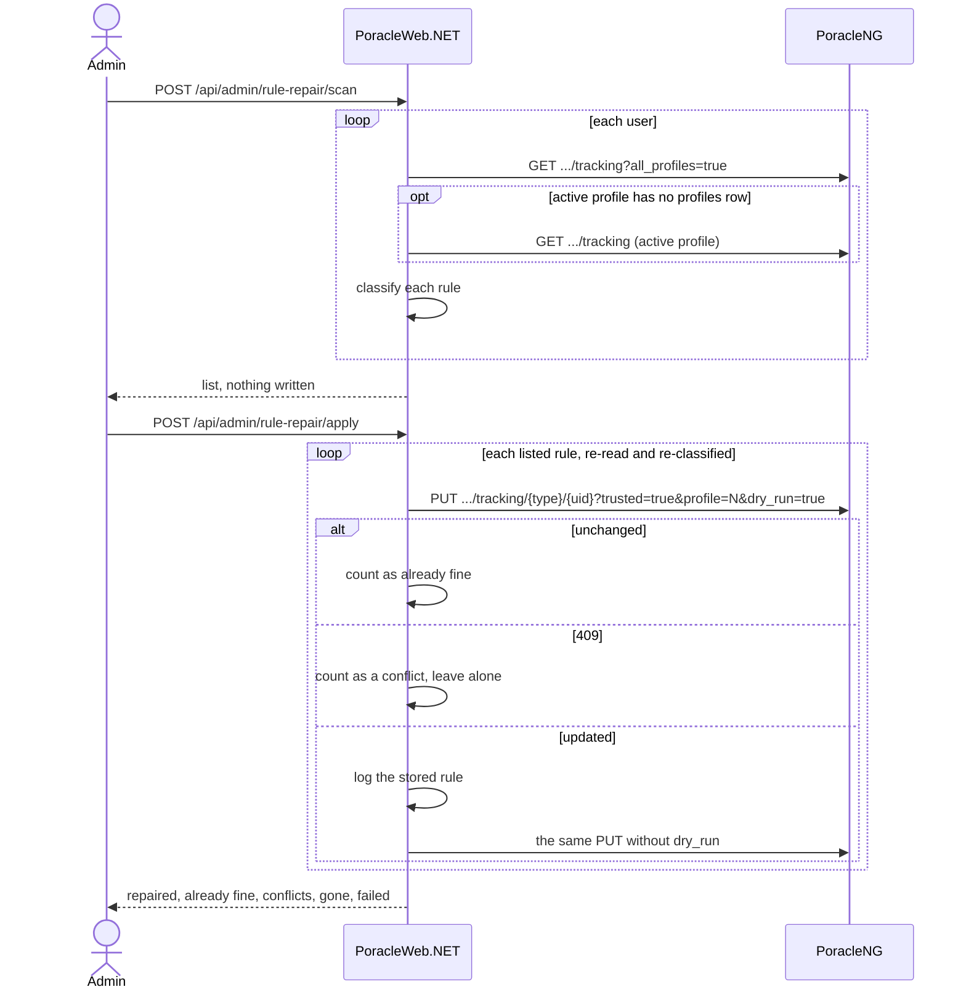

# Upgrading to PoracleNG 5.4.0

This release of PoracleWeb.NET needs PoracleNG 5.4.0 or newer. Upgrade PoracleNG first, then PoracleWeb.NET, then run the rule repair once.

PoracleWeb.NET still starts against an older PoracleNG, but it logs an error, the Versions card under **Admin > Settings** warns that PoracleNG is too old, and calls to routes the older server lacks fail with a message naming the version they need.

## What users will notice

Most of the change is underneath. Every alarm read, add, edit, delete, bulk distance change and cleaning toggle now goes through PoracleNG's `/api/v2`, and nothing is written to PoracleNG's database any more. These behaviours differ on screen:

- An Add that would take over another alarm is still refused with "Another alarm of this type already uses those settings". PoracleNG makes that call now, using its own dry run, where PoracleWeb.NET used to keep a copy of its rules.
- An alarm PoracleNG can't store as it is (an egg without a level in an old quick pick or import file, an invasion with gender 3, a PVP league outside 500, 1500 and 2500) is refused with "PoracleNG can't store this alarm as it is: ... Nothing was changed."
- Adding a max battle for a boss you already track, at a second radius, is refused. PoracleNG 5.4.0 merges the two, so the Add would have quietly changed the first alarm's distance.
- Changing the distance on a selection updates every rule it can and reports how many it skipped because they would clash with another rule. It used to fail the whole selection.
- Quick picks and profile import create only the alarms that are new, and skip any that already exist or would replace another.
- Importing a profile no longer switches your active profile while it copies.
- A role or user mention on a webhook's alarm survives an edit.
- Invasion alarms saved as `metal` become `steel` the next time they're edited. `metal` never matched anything, because PoracleNG's game data calls the grunt `steel`.
- An invasion rule for every grunt, or for every boss encounter, that was limited to one gender loses that limit the next time it's saved, because PoracleNG's v2 read doesn't report a gender on those two catch-all rules ([jfberry/PoracleNG#331](https://github.com/jfberry/PoracleNG/pull/331) fixes the read). Only rules set up through the bot have this shape.
- A rule stored with a legacy zero (`pvp_ranking_best 0`, `size 0`) shows the default instead, and the next edit, bulk distance change or cleaning toggle saves the default. Matching doesn't change.
- Deleting a geofence that alarms are limited to asks whether to delete those alarms too or keep them on the profile's areas.
- A new geofence that couldn't be switched on straight away says "Saved, but it couldn't be switched on yet. Use the toggle to retry."
- A quiet period the bot set on one alarm rule is listed with its type (for example "raid 60") and can be lifted from the web.
- When PoracleNG doesn't answer, every alarm page says the server is unavailable (HTTP 503) instead of showing an empty list.
- The Areas API answers 400, naming the area, when asked to save an area the user can't select. The Areas page never offers one.

One setting is gone: `PORACLE_TRACKING_API_VERSION` (`Poracle:TrackingApiVersion`) chose which tracking API edits used, and there's only one now. A leftover value is ignored.

## Run the rule repair

After PoracleNG is on 5.4.0, open **Admin > Settings** and find the **Rule repair** card. It looks for stored rules that 5.4.0 reads differently from the way they were saved, and fixes the ones whose meaning is clear.

Press **Scan** first. The scan reads every user's rules and writes nothing; you can run it as often as you like. It reports these kinds:

| Kind | What it is | What Repair does |
|---|---|---|
| Grunt type `metal` | An invasion alarm for a grunt PoracleNG now calls `steel` | Saves it as `steel` |
| Raid with Pokémon 0 | A raid alarm whose boss is stored as 0 | Saves it as "by level" |
| Raid for any boss | A raid alarm for any boss, saved as Pokémon 9000. PoracleNG 5.4.0 reads it back with no boss and no level, so the scan can't tell whether the tier is right | Dry-runs the rewrite and saves it as any boss, any tier only if PoracleNG says something would change |
| Max battle for any boss | The same shape on a max battle alarm | The same as for raids |
| Cannot be edited | A rule PoracleNG 5.4.0 won't save as it stands | Nothing. The card lists it so you can fix or delete it by hand |

Nothing changes until you press **Repair**. Each rule is then checked again just before it's written, so a rule that someone edited after the scan is judged on its current state. If PoracleNG says a write would be identical to the rule already stored, the card counts it as already fine. If it would duplicate another rule, the card leaves it alone and lists it as a conflict; one of the two rules is probably redundant. Each rule is rewritten from the values PoracleNG holds for it, with the one stored value changed, and it normally keeps its id.

If some users couldn't be read, the card lists them with the reason and opens that list, and it won't tell you nothing needs repairing. If no user could be read at all, the scan fails and says why.

Only one scan or repair runs at a time, and a second start is refused while one is running. A run stops if PoracleNG stops answering (or a proxy in front of it keeps answering 502, 503 or 504) or turns out to be too old; repairs already written stay written, and you can scan again afterwards. The job's state lives in memory, so if PoracleWeb.NET restarts during a scan or repair, scan again; running it again is safe. Only admins can use the card, and not while impersonating a user. The server log records which admin started each run, and, just before each repair is written, the rule as it was stored, so a repair can be undone by hand.

You can run the repair again at any time. A rule that has been repaired no longer shows up in the next scan.

The `...` in each route is `/api/v2/humans/{id}`. The card polls `GET /api/admin/rule-repair` for progress while a run is going.

## Rules on a profile with no profile row

A rule's `profile_no` can point at a profile that has no row in PoracleNG's profiles table, usually one deleted through an older tool. PoracleNG's v2 read of all of a user's profiles skips such rules ([jfberry/PoracleNG#330](https://github.com/jfberry/PoracleNG/issues/330)). What that means today depends on which profile it is:

- Rules on the user's **active** profile are read and repaired. When the active profile has no row, PoracleWeb.NET reads it a second time on its own and files the rules under the active profile number, so they show in Profile Overview and the scan.
- Rules on any **other** profile with no row aren't read. They don't appear in Profile Overview or the scan, and the repair can't reach them. Like every rule off the active profile, they don't fire.

[jfberry/PoracleNG#331](https://github.com/jfberry/PoracleNG/pull/331) (open, not yet merged) makes the all-profiles read return those rules. PoracleWeb.NET already handles its answer, dropping the rules both reads return, so once your PoracleNG carries that change the leftover profiles' rules appear in Profile Overview and the scan with nothing to change here.

## The database settings can go

PoracleWeb.NET no longer connects to PoracleNG's database. The `DB_HOST`, `DB_PORT`, `DB_NAME`, `DB_USER` and `DB_PASSWORD` settings in your `.env` (and `ConnectionStrings__PoracleDb`, if you set it directly) are unused, and you can remove them. While any of them is still set, startup logs one line: `DB_* settings are no longer used by PoracleWeb.NET and can be removed.` Nothing else changes, and `WEB_DB_*` stays.

The old `pweb_settings` table in PoracleNG's database isn't read any more, and PoracleWeb.NET never alters or drops it. An admin can drop it once they've confirmed the upgrade went well.

The one-time copy of settings, webhook delegates and quick picks out of `pweb_settings` is gone with it. An install older than 0.6.0 has to start any 2.x release once before upgrading to this one, so that copy has run. Anything else has already done it. A new install starts from the default settings and doesn't read any rows another tool left in `pweb_settings`.

## Order of steps

1. Back up both databases.
2. Upgrade PoracleNG to 5.4.0 and confirm it's running.
3. Update PoracleWeb.NET (`./scripts/docker.sh update` for Docker installs).
4. Check the Versions card under **Admin > Settings** shows no warning that PoracleNG is too old.
5. Scan, review, then Repair on the Rule repair card.

See [PoracleNG Version Compatibility](../architecture/poracleng-compatibility.md) for what changed in the integration and why.
