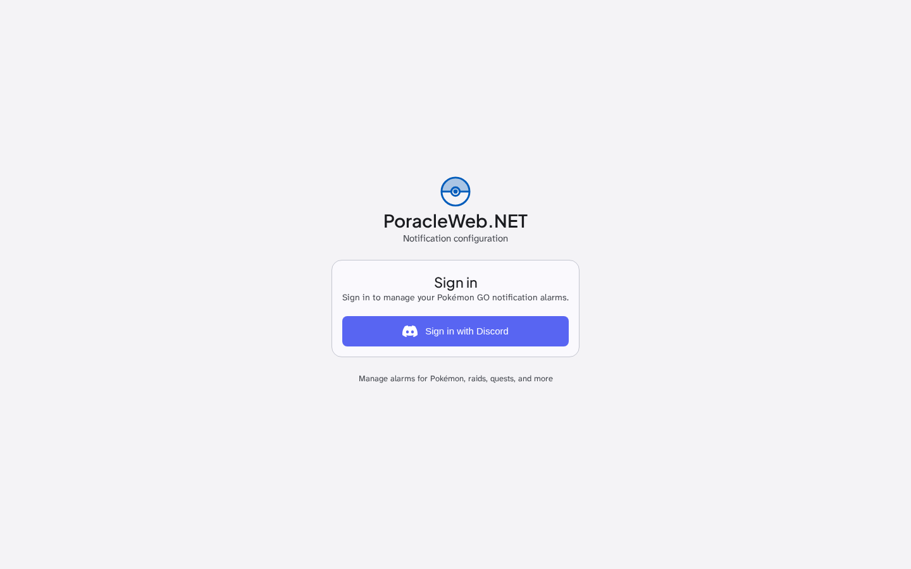
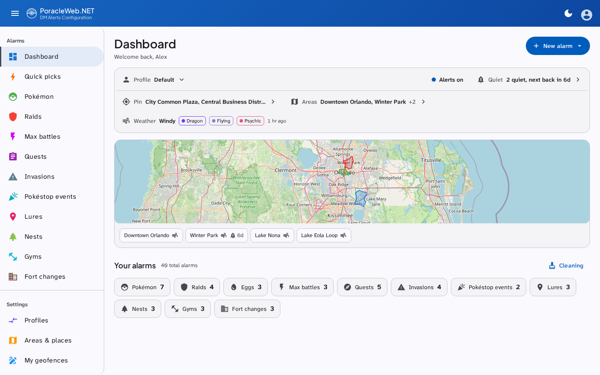
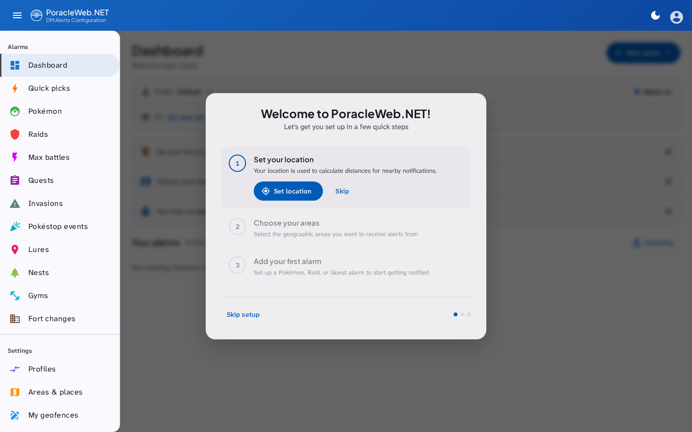
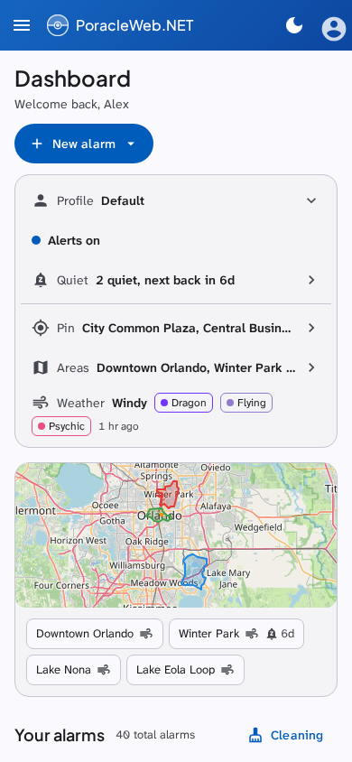
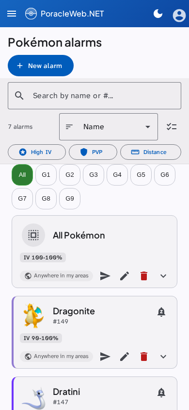
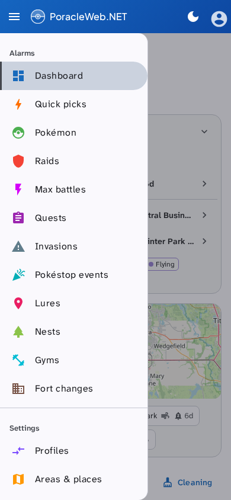
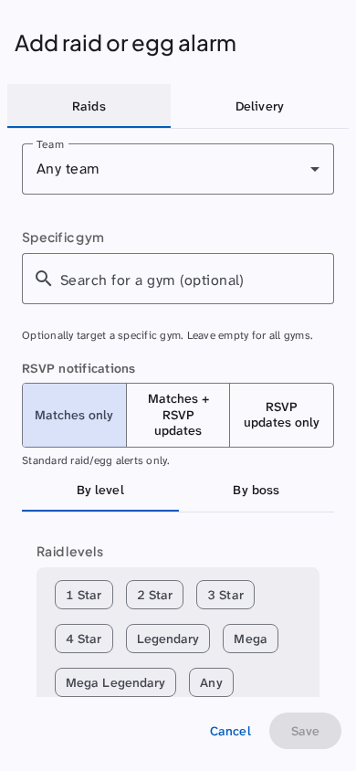
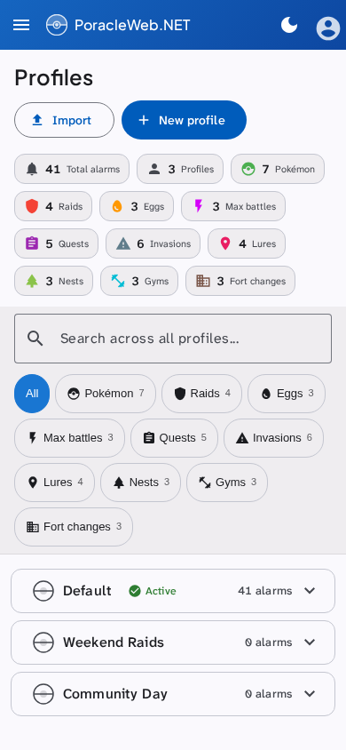
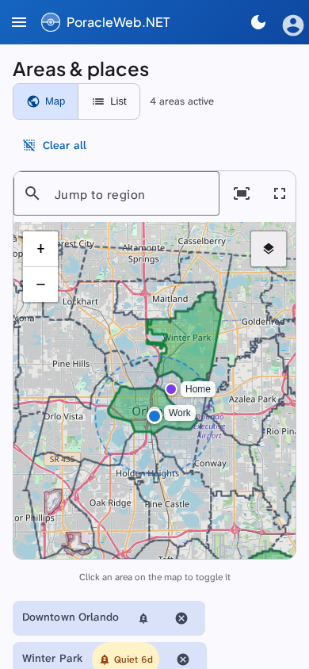
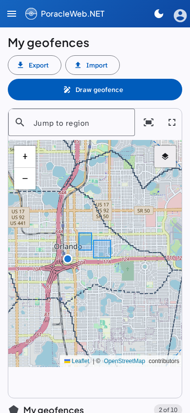

# PoracleWeb.NET

A web application for managing Pokemon GO notification alarms through the [PoracleNG](https://github.com/jfberry/PoracleNG) bot. Users authenticate via Discord OAuth2 or Telegram and configure personalized alert filters (Pokemon, Raids and Eggs, Max Battles, Quests, Invasions, Pokéstop Events, Lures, Nests, Gyms, Fort Changes) through a browser-based UI.

!!! warning "PoracleNG is required"
    All alarm management, profile handling, and user operations are proxied through PoracleNG's REST API. [PoracleJS](https://github.com/KartulUdus/PoracleJS) is not a tested or supported configuration — some operations that rely on PoracleNG-specific endpoints will not work.

    **PoracleNG 5.4.0 or newer is required.** PoracleWeb.NET still starts against an older server, so an admin can reach the UI and read what went wrong, but it logs an error at startup, reports the version on Admin → Server settings, and every call to a route 5.4.0 added fails with a message naming the version it needs. Upgrade PoracleNG first. Why 5.4.0, and what it replaced, is in [PoracleNG Version Compatibility](architecture/poracleng-compatibility.md).

## Tech Stack

| Layer | Technology |
|---|---|
| Backend | .NET 10, ASP.NET Core Web API, EF Core with MySQL (Oracle provider) |
| Frontend | Angular 21, Angular Material 21 (Material Design 3), Leaflet maps |
| Auth | Discord OAuth2, Telegram Bot Login, OIDC, JWT bearer tokens |
| Testing | Jest (frontend), xUnit (backend) |
| CI/CD | GitHub Actions, Docker (ghcr.io) |

## Features

| Feature | What it does |
|---|---|
| [Alarm management](features/alarms.md) | Create, edit and delete filters for Pokemon, Raids, Eggs, Max Battles, Quests, Invasions, Pokéstop Events, Lures, Nests, Gyms and Fort Changes |
| Gym picker | Search for a gym by name, with photo thumbnails and area names, and aim a gym, raid or egg alarm at it (needs the scanner database) |
| Pokemon availability | See which species are spawning now while you pick Pokemon for an alarm (needs Golbat) |
| Bulk operations | Select several alarms to delete them or change their radius in one go; on a phone the bar stays pinned to the bottom of the screen |
| Alert defaults | Set where new alerts reach you by default: your areas, or a radius from your pin or a saved place |
| Per-alarm delivery scope | Aim one alert anywhere in your areas, near a place or a point on the map, or only in specific areas, including geofences you drew yourself |
| Saved places | Name the points your alerts measure from, so one alert can watch your workplace while the rest follow your pin |
| Quick picks | Admin-defined alarm templates users apply with one click |
| Areas & places | A Leaflet map for choosing areas, dropping your pin and naming the places your alerts measure from |
| [Custom geofences](features/custom-geofences/index.md) | Draw your own polygons, served to the Poracle bot through a built-in feed, and submit one for review to make it a public area |
| Geofence review | Admins approve or reject submitted geofences, with a Discord forum thread for each |
| Hidden areas | Take a staging or test area off Areas & places, the per-alarm scope picker and the bot's area list without deleting it, from Admin → Areas |
| [Profiles](features/profiles.md) | Several alarm profiles per user, with active hours that switch between them by day and time, duplication, and JSON backup and restore |
| Notification preview | Live preview of DTS templates with Handlebars evaluation |
| Dark and light mode | Theme toggle, remembered per browser, with accent colours for the toolbar and highlights; maps on the site default switch to a dark basemap in dark mode |
| Responsive layout | On a phone the sidebar collapses into a menu and add and edit dialogs open full screen. Tablets in portrait keep the sidebar open |
| Onboarding wizard | A first-run guide on the dashboard that walks a new user through their pin, areas and first alarm |
| Keyboard shortcuts | ++question++ for help, ++bracket-left++ / ++bracket-right++ to collapse or expand the sidebar |
| [11 UI languages](features/internationalization.md) | English, French, German, Spanish, Dutch, Italian, Portuguese, Brazilian Portuguese, Polish, Danish and Swedish. Pokemon names, types and forms follow the display language, translated by Poracle itself. What Poracle writes in your DMs is a separate choice, **Alert language**, beside **Display language** in the user menu |
| Single sign-on | Discord and Telegram login, plus any OIDC provider ([setup](configuration/external-sso.md)), with optional [silent refresh and single logout](configuration/oidc-refresh-tokens.md) |
| Admin panel | Users, webhooks, site settings, geofence review and hidden areas, plus a status line on the settings page that opens a Versions card showing the running PoracleWeb.NET and PoracleNG builds and a [Rule repair](getting-started/upgrading-to-poracleng-5-4.md#run-the-rule-repair) card for rules PoracleNG 5.4.0 reads differently |
| [Webhooks & delegates](features/webhooks.md) | Channel feeds managed as their own accounts, with named people allowed to manage one without being made an administrator |
| Test alerts | Send a sample notification from an alarm card to see what the alert looks like (all types except Fort Changes, Max Battles and Pokéstop Events) |
| Weather | Current in-game weather at your pin and across your areas, on the dashboard (needs the scanner database) |
| [Quiet periods](features/quiet-periods.md) | Silence one gym, area, species or Power Spot for a set time without touching the alarms themselves |
| Pokéstop events | Track Showcases, Kecleon sightings and Gold Stops. The page is there unless Poracle's own `general.disable_showcase` is `true` (or an admin switches it off) |
| Fort changes | Get a DM when a Pokéstop or gym is added, removed, renamed, moved, re-described or given a new image |
| Max battles | Track Dynamax and Gigantamax battles at Power Spots by level or by Pokemon |
| GeoJSON import and export | Move custom geofences in and out in standard GeoJSON |

On a phone the sidebar becomes a menu and each add dialog fills the screen, with Save pinned to the bottom:

## Prerequisites

| Requirement | Version | Purpose |
|---|---|---|
| MySQL or MariaDB | Whatever your Poracle installation runs | A `poracle_web` database this application creates its own tables in. PoracleWeb.NET doesn't connect to Poracle's database |
| Poracle | [PoracleNG](https://github.com/jfberry/PoracleNG) 5.4.0 or newer | Running instance with REST API enabled. All alarm, profile, and user operations are proxied through PoracleNG's REST API. PoracleJS is not a tested configuration. |
| Discord App | — | OAuth2 application for user authentication |
| Koji | — | Geofence server. Supplies the admin areas in the unified geofence feed and receives user geofences an admin approves. Drawing a private geofence still works while Koji is unreachable |
| .NET SDK | 10.0 | Backend development (not needed for Docker) |
| Node.js | 22+ | Frontend development (not needed for Docker) |
| Scanner DB | — | Optional. Powers the gym picker and the weather display; both hide themselves when it is not configured |
| Docker | Engine with the Compose V2 plugin (`docker compose`) | Production deployment |

## Quick Links

-   :material-rocket-launch:{ .lg .middle } **Getting Started**

    ---

    Get up and running with Docker, standalone, or a development environment

    [:octicons-arrow-right-24: Quick Start (Docker)](getting-started/quick-start.md)

    [:octicons-arrow-right-24: Standalone Setup (no Docker)](getting-started/standalone-setup.md)

    [:octicons-arrow-right-24: Upgrading to PoracleNG 5.4.0](getting-started/upgrading-to-poracleng-5-4.md)

-   :material-cog:{ .lg .middle } **Configuration**

    ---

    Full reference of all environment variables and settings

    [:octicons-arrow-right-24: Configuration Reference](configuration/reference.md)

-   :material-layers-outline:{ .lg .middle } **Architecture**

    ---

    Solution structure, backend and frontend patterns

    [:octicons-arrow-right-24: Architecture Overview](architecture/overview.md)

    [:octicons-arrow-right-24: PoracleNG Version Compatibility](architecture/poracleng-compatibility.md)

-   :material-map-marker-radius:{ .lg .middle } **Custom Geofences**

    ---

    How the unified geofence feed works

    [:octicons-arrow-right-24: Custom Geofences](features/custom-geofences/index.md)

## Community & Support

There is **no Discord server** for PoracleWeb.NET at this time. Support happens on GitHub: report bugs and request features in [Issues](https://github.com/PGAN-Dev/PoracleWeb.NET/issues), ask questions in [Discussions](https://github.com/PGAN-Dev/PoracleWeb.NET/discussions), and send contributions as [Pull Requests](https://github.com/PGAN-Dev/PoracleWeb.NET/pulls).

## Credits

PoracleWeb.NET stands on the shoulders of these projects and their authors:

| Project | Author | Role |
|---|---|---|
| [PoracleJS](https://github.com/KartulUdus/PoracleJS) | KartulUdus | The original Poracle bot — the notification engine this UI manages |
| [PoracleNG](https://github.com/jfberry/PoracleNG) | jfberry | Next-generation Poracle whose REST API powers all alarm tracking |
| [Kōji](https://github.com/TurtIeSocks/Koji) | TurtIeSocks | Geofence management platform used for admin areas, region detection, and public geofence promotion |
